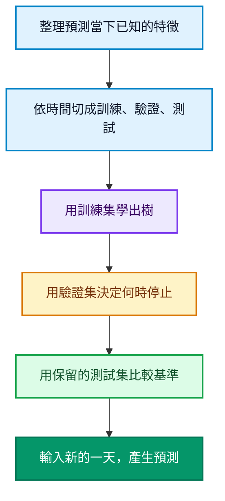

LightGBM 可以幫你從過去的表格資料學出規律，再預測新資料的答案。假設你經營一家咖啡店，手上有每天的氣溫預報、促銷紀錄與實際銷量，就能試著回答：「星期六會熱到 28 度，又有促銷，該準備多少杯？」

這篇從這個問題開始，依序看懂它在學什麼、怎麼訓練，以及怎麼知道預測有沒有幫上忙。你不需要先懂微積分；實作部分只需要能執行基本 Python。

<!--more-->

## 先把問題整理成一張表

下面是**說明欄位用的虛構資料，不是後面程式的實測輸出**：

| 星期幾 | 當天的氣溫預報 | 是否促銷 | 實際賣出杯數 |
| --- | --- | --- | --- |
| 星期一 | 24 度 | 否 | 150 |
| 星期六 | 28 度 | 是 | 220 |
| 星期日 | 20 度 | 否 | 165 |

每列代表一天。前三欄是預測時能提供的**特徵**，程式通常叫它們 **X**；最後一欄是希望模型學會預測的**目標**，通常叫 **y**。

**訓練**時，你同時提供 X 和已知的 y，讓模型找規律。**預測**時，你只提供新的一天的 X，模型輸出估計杯數。新的一天真正會賣多少，當然不能先放進輸入裡。

這種「拿有答案的歷史資料學習」的方式，叫做**監督式學習**。LightGBM 常用的三種任務如下；[官方 Python API](https://lightgbm.readthedocs.io/en/stable/Python-API.html) 分別提供對應介面。

| 想回答的問題 | 任務 | Python 介面 |
| --- | --- | --- |
| 明天賣幾杯？ | 迴歸，預測數值 | **LGBMRegressor** |
| 這位顧客會不會回購？ | 分類，預測類別或機率 | **LGBMClassifier** |
| 同一次搜尋的商品怎麼排序？ | 排序，學習相對順序 | **LGBMRanker** |

排序還需要把同一次查詢的候選項目分組，不能直接把銷量範例換個類別名稱就當成排序系統。這篇先完成最直覺的銷量迴歸。

## 它在學什麼？從問問題，到逐步修正預測

先想像一棵**決策樹**。它會依序問「是否促銷？」「氣溫高於某個門檻嗎？」，把歷史資料分成不同群組，最後給出一個數值。問題、門檻和數值都由資料學出來。

LightGBM 的預設做法會把許多棵樹依序組合起來。後面的樹根據前面整個模型的不足，學習下一步怎麼修正。這就是**梯度提升**的核心直覺。

用平方誤差的迴歸來想，修正方向可以理解成「實際值減掉目前預測」的殘差。換成分類或其他目標時，修正方向會由對應損失函數的梯度決定。[scikit-learn 的梯度提升說明](https://scikit-learn.org/stable/modules/ensemble.html#gradient-boosted-trees) 有更完整的原理。

以下數字**只用來示意修正過程**，假設某天實際賣出 130 杯：

| 階段 | 這次加入的修正 | 合計預測 |
| --- | --- | --- |
| 初始預測 | 從 100 杯開始 | 100 杯 |
| 第一棵修正樹 | 加 20 杯 | 120 杯 |
| 第二棵修正樹 | 加 8 杯 | 128 杯 |

表中的修正已包含學習率的縮放。實際訓練會同時考慮許多天；每棵樹也可能調高或調低預測，驗證誤差不保證每一輪都下降。

你可以把訓練後的模型想成一組會一起工作的規則。預測時，模型把新資料送進這些樹，再合併它們的貢獻；它不需要重新訓練才能回答每一筆新資料。

## LightGBM 為什麼強調效率？

先認識兩個設計就夠了：

- **直方圖分箱**：把連續數值整理成較少的區間，減少尋找切分點時的運算與記憶體負擔。
- **優先切分改善最大的葉節點**：每次挑最能降低訓練損失的位置繼續長，而不要求每一層整齊長滿。這叫 **leaf-wise** 生長。

這些設計是 [LightGBM 官方功能文件](https://lightgbm.readthedocs.io/en/stable/Features.html) 說明的重點。葉節點就是樹走到底、給出數值的地方；長得太細，模型可能把少數樣本的巧合也記住，形成**過度擬合**。

因此速度與誤差仍要在自己的資料上比較。資料量小、欄位缺乏訊號，或未來情境改變時，模型名稱本身無法保證好結果。

## 動手前，先把資料分成三段

這個例子預測未來銷量，所以保留時間順序。1000 天分成前 700 天訓練、接著 150 天驗證、最後 150 天測試。



**訓練集像練習題，驗證集像練習中的小考，測試集像最後才拆封的考卷。** 提前停止和調參數都看驗證集；如果反覆看測試成績調整模型，最後的分數也會失去公正性。

這裡用一次時間切分教流程。正式評估可以再做多個時間視窗的回測；[TimeSeriesSplit 官方說明](https://scikit-learn.org/stable/modules/generated/sklearn.model_selection.TimeSeriesSplit.html) 解釋了這類切分的理由。

## Python 實作：從零跑完一次銷量預測

以下程式**自行生成模擬資料**，不需要下載資料集。它刻意讓氣溫、週末與促銷影響銷量，再加入隨機擾動，方便觀察模型能不能找回規律。

### 1. 安裝並建立範例檔

準備好 Python 3.12。還沒有虛擬環境，可以先執行 **python -m venv .venv**。macOS／Linux 用 **source .venv/bin/activate** 啟用；Windows PowerShell 用 **.venv\Scripts\Activate.ps1** 啟用。

在已啟用的環境中安裝：

```bash
python -m pip install lightgbm==4.7.0 pandas==3.0.6 scikit-learn==1.9.1
```

若 macOS 匯入時提示缺少 OpenMP，依 [官方安裝說明](https://github.com/lightgbm-org/LightGBM/tree/main/python-package#installation) 安裝 **libomp**。

把下面三段 Python 依序放進同一個 **lightgbm_coffee_demo.py**。也可以[下載完整 Python 範例](lightgbm_coffee_demo.py)，再執行 **python lightgbm_coffee_demo.py**。

### 2. 準備特徵 X 與答案 y

```python
import numpy as np
import pandas as pd
import lightgbm as lgb
from sklearn.dummy import DummyRegressor
from sklearn.metrics import mean_absolute_error

rng = np.random.default_rng(42)
n = 1000
dates = pd.date_range("2024-01-01", periods=n, freq="D")
X = pd.DataFrame({
    "day_of_week": dates.dayofweek,
    "forecast_temp": rng.uniform(10, 35, n),
    "promotion": rng.integers(0, 2, n),
})
y = pd.Series(np.maximum(0, np.round(
    80 + 3 * X["forecast_temp"]
    + 20 * (X["day_of_week"] >= 5)
    + 35 * X["promotion"]
    + rng.normal(0, 8, n)
)), name="cups_sold")
```

**day_of_week** 以 0 代表星期一、6 代表星期日；**promotion** 的 0／1 代表沒有／有促銷。**forecast_temp** 模擬預測時已取得的氣溫預報。

你看得到生成 y 的公式，是因為這是教材。**模型訓練只收到 X 和 y，沒有拿到那個公式。** 真正的專案會從歷史紀錄讀取這些欄位。

### 3. 切分資料，讓模型學習

```python
X_train, y_train = X.iloc[:700], y.iloc[:700]
X_valid, y_valid = X.iloc[700:850], y.iloc[700:850]
X_test, y_test = X.iloc[850:], y.iloc[850:]

model = lgb.LGBMRegressor(
    objective="regression", metric="mae",
    n_estimators=800, learning_rate=0.05,
    num_leaves=15, min_child_samples=20,
    random_state=42, n_jobs=2, verbosity=-1,
)
model.fit(
    X_train, y_train,
    eval_X=X_valid, eval_y=y_valid,
    callbacks=[lgb.early_stopping(30, verbose=False)],
)
```

**fit** 負責訓練，**eval_X／eval_y** 提供驗證資料。**early_stopping(30)** 表示驗證 MAE 連續 30 輪沒有改善就停止，並記錄最佳輪次；它需要驗證集才能運作。[提前停止官方文件](https://lightgbm.readthedocs.io/en/stable/pythonapi/lightgbm.early_stopping.html) 說明了這個機制。

這份範例固定使用 **LightGBM 4.7.0**。新版以 **eval_X／eval_y** 取代已棄用的 **eval_set**；若使用較舊版本，這兩個新參數可能不被接受，請先對齊安裝版本。[版本與參數依據](https://lightgbm.readthedocs.io/en/stable/pythonapi/lightgbm.LGBMRegressor.html#lightgbm.LGBMRegressor.fit)

### 4. 看成績，再預測新的一天

```python
baseline = DummyRegressor(strategy="mean")
baseline.fit(X_train, y_train)
baseline_mae = mean_absolute_error(y_test, baseline.predict(X_test))
model_mae = mean_absolute_error(y_test, model.predict(X_test))
print(f"Baseline MAE: {baseline_mae:.2f} cups")
print(f"LightGBM MAE: {model_mae:.2f} cups")
print(f"Best iteration: {model.best_iteration_}")

tomorrow = pd.DataFrame({
    "day_of_week": [5],
    "forecast_temp": [28.0],
    "promotion": [1],
})
print(f"New-day prediction: {model.predict(tomorrow)[0]:.1f} cups")
```

**DummyRegressor** 在這裡只會猜訓練集的平均銷量，作為最簡單的[比較基準](https://scikit-learn.org/stable/modules/generated/sklearn.dummy.DummyRegressor.html)。**predict** 才是把新特徵轉成預測答案的動作。

## 跑出來的數字，應該怎麼讀？

2026 年 10 月 17 日，我們在 Python 3.12.10、LightGBM 4.7.0、pandas 3.0.6、scikit-learn 1.9.1 與 NumPy 2.5.4 環境實際執行，得到：

```text
Baseline MAE: 24.40 cups
LightGBM MAE: 7.15 cups
Best iteration: 104
New-day prediction: 220.3 cups
```

**MAE 是平均絕對誤差，越小越好**。7.15 杯表示這 150 個測試日的預測，平均與實際值相差約 7.15 杯；它不保證每一天都只差這麼多，也不是「準確率 92.85%」。[MAE 官方定義](https://scikit-learn.org/stable/modules/generated/sklearn.metrics.mean_absolute_error.html) 可對照計算方式。

最佳輪次 104 表示驗證集挑出的模型用了 104 輪，並非把 800 輪全部用完。新一天的 220.3 杯是數值估計；如果要拿來備料，還需要把缺貨與剩料的成本一起考慮。

**這些成績只來自本文設計的模擬資料。** 真實咖啡店還有天氣預報誤差、臨時活動與需求變化，不能直接套用這個誤差。正式專案也應加入更有挑戰性的基準，例如「上週同一天銷量」。

## 先認識這五個設定就好

| 設定 | 這份範例 | 白話意思 |
| --- | --- | --- |
| **n_estimators** | 800 | 最多訓練幾輪；本例每輪加一棵樹 |
| **learning_rate** | 0.05 | 每次修正跨多大一步 |
| **num_leaves** | 15 | 每棵樹最多保留多少個葉節點 |
| **min_child_samples** | 20 | 控制每個葉節點至少需要的樣本量 |
| **early_stopping** | 30 | 驗證成績連續幾輪沒改善就停止 |

先保留這組起點，觀察訓練與驗證的差距。如果訓練表現很好、驗證很差，可以試著減少葉節點或提高葉節點的樣本門檻。**min_child_samples** 對應核心參數 **min_data_in_leaf**；官方另有 **max_depth** 可限制樹深度。[調參指南](https://lightgbm.readthedocs.io/en/stable/Parameters-Tuning.html) 與 [參數定義](https://lightgbm.readthedocs.io/en/stable/Parameters.html#min_data_in_leaf) 有完整說明。

範例中的 **objective="regression"** 用平方誤差訓練，**metric="mae"** 則用 MAE 看驗證成績。訓練的目標與評估的尺，負責的是兩件不同的事。

## 換成自己的資料，先檢查這三件事

若你已有 **sales.csv**，每列代表一天，包含日期 **date**、氣溫預報 **forecast_temp**、促銷 **promotion** 與銷量 **cups_sold**，可以保留匯入套件的部分，用這段取代步驟 2 的資料生成程式：

```python
df = pd.read_csv("sales.csv", parse_dates=["date"]).sort_values("date")
df["day_of_week"] = df["date"].dt.dayofweek
X = df[["day_of_week", "forecast_temp", "promotion"]]
y = df["cups_sold"]
```

**promotion** 維持 0／1。原範例的 700／850 切點是針對 1000 列；筆數不同時，先按自己的資料量重新分配訓練、驗證和測試區間，再執行訓練。

**第一，預測當下真的拿得到這個欄位嗎？** 預測明天銷量，可以用明天的預報與已排定促銷；明天打烊後才知道的營業額、實際來客數，都不能偷放進特徵。這叫**資料洩漏**，會讓測試成績好得不真實。[常見資料洩漏問題](https://scikit-learn.org/stable/common_pitfalls.html#data-leakage) 值得在接真資料前先看一次。

**第二，欄位的型別有整理好嗎？** 星期、預報溫度與促銷要有一致格式。LightGBM 支援數值缺失值與類別特徵，但一般字串欄位仍需處理；例如店型可轉成 pandas 的 **category** 型別，並維持訓練、預測時的類別對應。支援缺值不代表你可以忽略資料品質。[類別與缺失值官方說明](https://lightgbm.readthedocs.io/en/stable/Advanced-Topics.html)

**第三，測試方式像未來的使用情境嗎？** 先依日期排序，再分出訓練、驗證和測試。預測新資料時，維持相同特徵名稱、順序與意義；不要把 **cups_sold** 答案欄一起送進 **predict**。

第一次實作，先把「準備 X／y → 切分 → fit → 和基準比較 → predict」走通。等你能解釋每個欄位為什麼可用、每個誤差代表什麼，再來增加特徵與調整模型，會更知道自己正在改善哪個問題。
