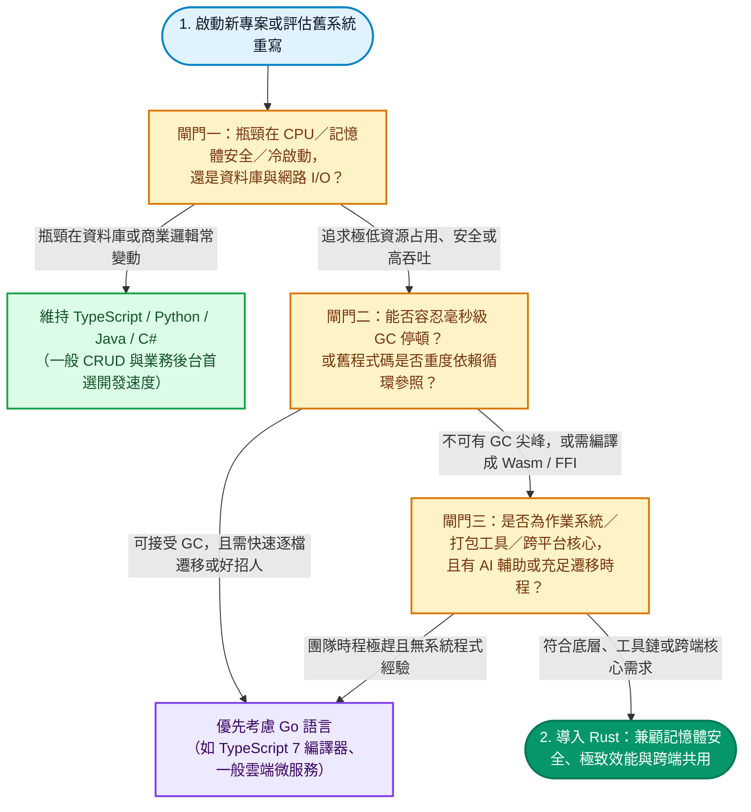

不管你是寫前端、寫 Python 還是每天開著桌面軟體工作，這兩年都很難忽略 **Rust** 的存在：前端打包工具換成了 Rust 寫的 **Turbopack** 與 **Rolldown（Vite 8）**，Python 社群一窩蜂改用 **uv** 與 **Ruff**，**Linux 7.0** 正式摘掉 Rust 的實驗性標籤，連玩家天天開著的 **Discord** 也在 2026 年 11 月宣布桌面版要拋棄 **Electron**、改用 **Rust** 重頭打造。

**Rust 確實越來越紅，但它的流行非常集中：主要發生在作業系統核心、高併發雲端基礎設施、開發者工具鏈，以及受夠記憶體肥大與啟動緩慢的跨平台應用程式。** 讓各大科技巨頭願意投入重寫的關鍵，在於 Rust 不必仰賴垃圾回收（Garbage Collection, GC），就能同時做到**編譯期記憶體安全**與**接近 C 語言的執行效能**；而在 2026 年，AI 輔助開發搭配 Rust 嚴格的編譯器檢查，更讓過去動輒耗時數年的大型專案移植成本大幅降低。不過，Rust 並不是所有軟體的標準答案——微軟重寫 **TypeScript 7** 編譯器時就選擇了 **Go**，Cloudflare 也曾因為一行 Rust 程式碼裡的 `unwrap()` 造成全球大當機。

<!--more-->

## Rust 現在到底有多紅？從排名與開發者調查拆解真實熱度

很多工程師心裡會有個疑問：社群上幾乎每週都有某個知名專案「用 Rust 重寫（Rewrite It in Rust）」的新聞，但打開求職網站，Rust 的職缺數量卻遠不及 Python、Java 或 TypeScript。要看清 Rust 的真實位置，可以把主流排行榜與開發者調查放在一起對照：

| 指標來源 | 關鍵數據與排名變化 |
| --- | --- |
| [TIOBE 2026 年 11 月指數](https://www.tiobe.com/tiobe-index/) | 排名第 **11 名**（占比 **1.63%**），較一年前的第 14 名上升三名；2026 年 7 月至 10 月連續四個月擠進前 10 名，11 月才被 **Go** 微幅超車 |
| [Stack Overflow 2026 開發者調查](https://survey.stackoverflow.co/2026/technology/data/languages) | **18.0%** 的受訪開發者表示過去一年大量使用 Rust，在所有程式語言中排第 **12 名** |
| Stack Overflow 2025 開發者調查 | 連續第九年拿下「最受喜愛／推崇語言」，高達 **72%** 用過 Rust 的開發者表示明年想繼續使用 |

這三組數字反映出一個很有趣的現象：**Rust 不是靠龐大的初學者基數或一般商業網站衝高市占率，而是靠極高的開發者留存率，在底層系統與工具鏈領域穩步擴張。** 多數前端或 Python 工程師雖然沒有直接寫 Rust，每天執行打包、格式檢查或安裝套件時，底下跑的卻已經全是 Rust 編譯出來的執行檔。

## 為什麼大廠紛紛改用 Rust？五個解決工程痛點的核心原因

把一個已經上線運作多年的系統換成另一種語言，對任何工程團隊來說都是高風險投資。為什麼 Google、微軟、Cloudflare、GitHub 與 Discord 還是決定跨出這一步？背後主要有五個實際的工程考量：

### 1. 編譯期守住記憶體安全，從根源擋下底層資安漏洞

在傳統的作業系統、瀏覽器引擎與底層函式庫中，C 與 C++ 幾乎是唯一能滿足效能與硬體控制需求的選擇。但人工管理記憶體的代價極高——微軟與 Google 都曾公開統計，過去數十年約有 **70% 的嚴重資安漏洞**（例如緩衝區溢位 Buffer Overflow、釋放後使用 Use-After-Free、雙重釋放與資料競態）都源自記憶體安全瑕疵。像先前 [Node.js 十月安全更新](/2026/10/21/Nodejs十月安全更新深度解析/)中修補的 Brotli 原生解碼器越界寫入漏洞，就是底層原生程式碼常見的風險。

Rust 透過獨特的**所有權（Ownership）**、**借用檢查器（Borrow Checker）**與**生命週期（Lifetimes）**機制，在不影響執行速度的前提下，把記憶體檢查提前到「編譯階段」。只要程式碼存在指標懸空或未受保護的跨執行緒讀寫，編譯器就會直接拒絕編譯。

根據 [Google Android 資安團隊公布的實戰數據](https://blog.google/security/rust-in-android-move-fast-fix-things/)，自從 Android 新系統程式碼大量改用 Rust 後，記憶體安全漏洞占全體漏洞的比例**史上首次降到 20% 以下**；Android 內部 Rust 程式碼的記憶體漏洞密度約只有 C／C++ 的**千分之一**，而且因為編譯期檢查嚴格，工程師提交變更後的回滾率（Rollback Rate）也降低了 **4 倍**。

### 2. 不靠垃圾回收（GC），徹底消除服務的延遲尖峰

既然要記憶體安全，為什麼不直接用 Go、Java、C# 或 JavaScript？在大多數一般網站後台，這些語言確實就夠用了。但它們都是靠**垃圾回收器（Garbage Collector, GC）**在背景定期掃描並回收不再使用的記憶體。當服務承受極高流量、或者管理數百萬個快取物件時，GC 啟動掃描就會造成短暫卻明顯的停頓（Latency Spikes）。

最著名的例子就是 **Discord** 在 2020 年將負責追蹤用戶已讀狀態的 **[Read States 服務從 Go 改寫為 Rust](https://discord.com/blog/why-discord-is-switching-from-go-to-rust)**。當時 Go 語言的執行環境每 2 分鐘就會強制執行一次垃圾回收，導致服務固定每兩分鐘出現一次延遲尖峰；改用 Rust 後，記憶體在變數離開作用域的瞬間就確定性地釋放，延遲曲線瞬間變得平滑，連帶讓 CPU 與記憶體消耗大幅下降。

### 3. 接近 C 語言的執行效能與毫秒級啟動速度

對於命令列工具（CLI）、前端打包器與 AI Agent 執行環境來說，「啟動要快、占用資源要少」直接決定了使用者的體感。直譯式語言或帶有龐大虛擬機的執行環境，光是啟動載入與即時編譯（JIT）就要花掉不少時間。

**GitHub Copilot** 在 2026 年 8 月將旗下的 Agent 執行環境從原本的 TypeScript 與 Node.js [全面改寫成 83 萬行 Rust](https://github.blog/news-insights/product-news/migrating-the-github-copilot-runtime-to-rust-using-copilot/)。根據 [InfoQ 的技術報導](https://infoq.com/news/2026/10/github-copilot-rust-migration)，改寫後的執行環境從啟動到完成第一輪對話的時間，由原本的 **5.25 秒**直接縮短到 **292 毫秒**，冷啟動延遲幾乎消失。

### 4. 一份核心程式碼，透過 FFI 與 WebAssembly 跨平台共用

現代軟體經常需要同時支援 Windows、macOS、Linux、iOS、Android 與網頁端。如果每個平台各自用原生語言寫一套核心邏輯，不僅維護成本高，還很容易發生「手機版算出來跟電腦版不一樣」的同步問題。

Rust 編譯出的原生程式庫沒有沉重的執行環境依賴，能輕鬆透過 **FFI（外部函式介面）** 讓 Python、Node.js、Swift、Kotlin 或 Go 直接呼叫，也能編譯成 **WebAssembly（Wasm）** 跑在瀏覽器裡。GitHub Copilot 的 Rust 執行環境就是利用這個特性，用同一份底層核心同時供六種不同程式語言的 SDK 呼叫；Discord 的新一代跨平台架構也採取完全相同的策略。

### 5. 2026 年的關鍵推力：AI 輔助寫程式加上嚴格編譯器，讓大型改寫變得划算

過去許多團隊明知舊系統效能不佳，卻不敢輕易啟動重寫，因為**重寫軟體最貴的永遠是工程師的人力與時間**。但到了 2026 年，AI 編碼代理（Coding Agents）與 Rust 的結合改變了這道算式。

正如我們在[從 Vibe Coding 狂歡到 PR 審查地獄](/2026/08/26/從-Vibe-Coding-狂歡到-PR-審查地獄：這幾年軟體工程界到底發生了什麼事？/)一文中所探討的，AI 生成動態語言程式碼時，最怕產生「看似能跑、卻在邊界條件崩潰」的隱蔽錯誤；而 **Rust 極度嚴格的型別系統與借用檢查器，剛好成為 AI 寫程式最天然的自動化驗證閘門**。當 AI 寫出型別不符或生命週期錯誤的程式碼時，Rust 編譯器會給出極為詳盡的報錯訊息，讓 AI 代理自己讀錯誤訊息、自己修正，直到通過編譯與測試為止。

GitHub 官方就透露，將 Copilot Agent 執行環境移植到 83 萬行 Rust 這項浩大工程，放在過去至少需要一個完整工程團隊投入一到兩年；但這次主要由**一位工程師搭配 Copilot，在約 14.5 週內**就完成了遷移。

## 哪些知名專案已經換成 Rust？四大領域代表案例總整理

為了讓你快速掌握產業現況，先將近年最具代表性的企業與開源改寫案例整理如下表，接著再看各領域背後的轉換邏輯：

| 領域 | 專案或企業 | 改寫內容與實際成效 | 關鍵時間點 |
| --- | --- | --- | --- |
| 作業系統 | **Linux 核心** | [Linux 7.0](https://linuxiac.com/linux-kernel-7-0-released/) 正式移除 Rust 的「實驗性」標籤，Rust 成為核心長期支援的官方語言之一 | 2026 年 4 月 |
| 作業系統 | **Android** | 新系統程式碼大量採用 Rust，記憶體安全漏洞占比[首度降至總數 20% 以下](https://blog.google/security/rust-in-android-move-fast-fix-things/) | 2025 年 |
| 作業系統 | **Windows** | 字型解析元件 **DirectWriteCore** 移植為 15.4 萬行 Rust；**Win32k** 的 GDI region 程式碼已隨系統出貨（[Azure CTO Russinovich](https://www.thestack.technology/rewriting-windows-in-rust/)） | 2025 年 |
| 作業系統 | **Ubuntu 26.04 LTS** | 預設改用 **sudo-rs** 與 Rust 版 coreutils（**cp**、**mv**、**rm** 仍維持 GNU 版本） | 2026 年 4 月 |
| 雲端基礎設施 | **Cloudflare** | 以自研的 [Pingora](https://blog.cloudflare.com/how-we-built-pingora-the-proxy-that-connects-cloudflare-to-the-internet/) 取代 NGINX，每天處理超過 1 兆個請求，同流量下 **CPU 減少 70%、記憶體減少 67%** | 2022 年起 |
| 雲端基礎設施 | **AWS** | 支撐 AWS Lambda 與 Fargate 背後的微型虛擬機 **Firecracker** 完全以 Rust 編寫 | 2018 年起 |
| 瀏覽器 | **Google Chrome** | 網頁字型處理改用 Rust 編寫的 [Skrifa](https://developer.chrome.com/blog/memory-safety-fonts) 取代老牌 C 語言庫 FreeType | 2025 年 |
| 開發工具 | **Vite 8** | 預設打包器換成 Rust 打造的 [Rolldown](https://vite.dev/blog/announcing-vite8)，官方測試建置速度提升 **10 到 30 倍** | 2026 年 3 月 |
| 開發工具 | **Next.js 16** | Rust 編寫的 [Turbopack](https://nextjs.org/blog/next-16) 正式成為預設打包器 | 2025 年 10 月 |
| 開發工具 | **uv、Ruff** | Python 高速套件管理與 Lint 工具；開發商 Astral 於 2026 年 3 月被 [OpenAI 宣布收購](https://thenewstack.io/openai-astral-acquisition/)並併入 Codex 團隊 | 2026 年 3 月 |
| 開發工具 | **fish shell** | 4.0 版本完成從 C++ 到 Rust 的完整移植 | 2025 年 2 月 |
| 開發工具 | **GitHub Copilot** | Agent 執行環境從 TypeScript／Node.js [改寫為 83 萬行 Rust](https://github.blog/news-insights/product-news/migrating-the-github-copilot-runtime-to-rust-using-copilot/)，啟動加首輪對話從 5.25 秒降至 292 毫秒 | 2026 年 8 月 |
| 跨平台應用 | **Discord** | 從後端服務、語音引擎一路擴展到 2026 年宣布桌面版拋棄 Electron 改用 Rust（代號 **Phoenix**） | 2018 年至 2026 年 |

從這張表可以清楚看出一個規律：**轉向 Rust 的全都是「底層核心、長時間高併發運行、對安全或延遲極度敏感」的基礎軟體，而不是一般的企業內部管理後台。**

- **作業系統與瀏覽器看重的是「攻擊面收斂」**：像字型解析器（Windows 的 **DirectWriteCore**、Chrome 的 **Skrifa**）與權限提升工具（Ubuntu 的 **sudo-rs**），每天都在處理來自外部不可信的複雜二進位輸入，過去是駭客最愛挖掘緩衝區溢位漏洞的地方，換成 Rust 能直接消除整類記憶體越界風險。
- **雲端大廠看重的是「硬體成本與密度」**：對 Cloudflare 這種每天處理超過 1 兆次請求的網路巨頭來說，**Pingora** 省下的 70% CPU 與 67% 記憶體，換算下來就是少買數萬台伺服器與龐大的機房電費。
- **前端與 Python 工具鏈看重的是「開發者等待時間」**：JavaScript 與 Python 寫商業邏輯很方便，但拿來處理成千上萬個檔案的語法樹解析與打包時，單執行緒與直譯開銷就會成為瓶頸。改用 Rust 結合平行運算（如 **Rolldown**、**Turbopack**、**uv**、**Ruff**），能把原本幾十秒的建置與安裝縮短到一兩秒內。

## 深度案例：為什麼 Discord 決定連桌面版都拋棄 Electron、改用 Rust？

在所有案例中，**Discord** 是最能代表「應用程式從後端一路 Rust 化到前端桌面」的完整縮影。

Discord 從 2018 年起就在後端基礎設施與語音服務中使用 Rust，並在 2020 年完成著名的 Read States 服務遷移。然而，廣大玩家與社群使用者每天打開的 **Discord 桌面版**，多年來一直是基於 **Electron** 框架（底層打包了完整的 Chromium 瀏覽器與 Node.js）。雖然 Electron 讓團隊能用一套 React 程式碼跨平台開發，但也帶來了眾所皆知的缺點：記憶體動輒吃掉 1 GB 以上、冷啟動要等好幾秒。

即便 Discord 工程團隊在 2026 年 9 月努力將客戶端升級到 **Electron 42**，雖然讓中位數 CPU 使用率下降了約 **17%**，但記憶體占用反而微幅上升了約 **4%**——這證明只要還揹著整座瀏覽器引擎，優化就有物理極限。

因此在 **2026 年 11 月 4 日**，Discord 技術長 Stanislav Vishnevskiy 正式宣布內部代號為 **Phoenix** 的跨世代重構計畫：桌面版將[徹底拋棄 Electron](https://www.ghacks.net/2026/11/06/discord-is-rebuilding-its-desktop-app-in-rust-with-the-new-client-using-290-mb-of-ram/)，改用 **Rust** 搭配 **Zed 編輯器**團隊打造的 GPU 加速介面框架 **GPUI** 重新打造。

| 評估維度 | 舊版 Discord（Electron 架構） | 新版代號 Phoenix（Rust + GPUI 架構） |
| --- | --- | --- |
| **記憶體占用** | 常態占用數百 MB 至超過 1 GB | Windows 11 同時登入兩個帳號僅占 **290.2 MB**（CTO 公布之實測截圖） |
| **冷啟動時間** | 約 **6 秒** | 約 **1 秒** |
| **手機版架構** | 使用 React Native | 移除 React Native，保留 iOS／Android 原生介面，與桌面版共用同一套 Rust 核心邏輯 |
| **網頁版架構** | 純 JavaScript 與 HTML | 保留 HTML 畫面渲染，底層狀態與邏輯改編譯為 **WebAssembly** |
| **目前進度** | 線上正式版運行中 | 內部版本已完成驗證，官方預告將於近期展開外部測試 |

Discord 的做法為跨平台應用指出了另一條路：不一定要為了跨平台而在桌機上塞進整顆瀏覽器，透過 **Rust 撰寫底層共用邏輯**，再分別對接桌面端 GPU 渲染、手機端原生 UI 與網頁端 Wasm，就能同時保住開發效率與原生級別的輕量體驗。

## Rust 不是萬靈丹：不選 Rust 的真實反例與翻車代價

看到這裡，你可能會想：「既然 Rust 又快又安全，那我們是不是該把公司所有新專案都改成 Rust？」先別急，工程世界沒有沒有代價的銀彈。以下四個真實反例，清楚劃出了 Rust 目前的邊界：

### 1. 為什麼微軟 TypeScript 7 編譯器放棄 Rust、選擇 Go？

當前端圈的工具鏈（Vite、Next.js、SWC、Biome）紛紛投向 Rust 時，微軟在重寫自家 **[TypeScript](/2023/03/05/TypeScript入門：什麼是TypeScript？/) 7** 原生編譯器（將編譯速度提升約 10 倍）時，卻出人意料地選擇了 **Go 語言**，而不是 Rust。

微軟團隊給出的理由非常務實：原本用 TypeScript 寫成的舊編譯器，架構上高度依賴**垃圾回收（GC）**以及大量**互相參照（Cyclic References）的抽象語法樹（AST）資料結構**。如果選用同樣具備 GC 的 Go 語言，工程師可以把舊編譯器的程式碼「一對一逐檔翻譯移植」，完整保留十多年來累積的型別推論邏輯與邊界行為；但如果改用 Rust，借用檢查器會直接禁止這種複雜的雙向與循環指標結構，團隊就必須把整套編譯器的資料結構與演算法打掉重練，不僅工期難以估計，也很難保證新版行為與舊版 100% 相容。

### 2. 記憶體安全不等於不會當機：Cloudflare 的 unwrap() 全球大當機

很多人誤以為「用 Rust 寫的系統就不會崩潰」，但 **2025 年 11 月 18 日**發生的 [Cloudflare 全球大當機](https://blog.cloudflare.com/18-november-2025-outage/)給了所有工程師一記當頭棒喝。

這起被 Cloudflare 稱為自 2019 年以來最嚴重的事故，起因是一份設定檔大小超出了系統預期的上限，而用 Rust 編寫的新一代 **FL2** 代理程式在讀取該設定時，直接使用了 `unwrap()` 處理回傳結果。當錯誤發生時，`unwrap()` 直接觸發程式 **panic（崩潰終止）**，進而引發全球網路流量中斷。這個案例證明了一件事：**Rust 能幫你擋下記憶體越界與競爭危害，但擋不住草率的錯誤處理與商業邏輯漏洞。**

### 3. 企業導入放緩：陡峭的學習曲線與徵才瓶頸

在基礎設施大廠之外，一般企業對 Rust 的態度其實相對保守。根據 [DeveloperTech 2026 年 4 月的產業報導](https://www.developer-tech.com/news/rust-adoption-stalls-memory-safe-programming-trends/)，許多企業採用 Rust 的步伐出現放緩跡象，關鍵卡在兩個現實問題：**學習曲線太陡**與**資深工程師難找**。

對習慣 Java、C#、Go 或 Python 的工程師來說，剛接觸 Rust 的所有權、生命週期標註與非同步型別時，往往要經歷一段「跟編譯器搏鬥」的陣痛期。如果只是一般的企業內部系統、電商網站或 CRUD 商業後台，效能瓶頸通常在資料庫查詢或外部 API 網路延遲，用 Java、C# 或 Go 開發的速度更快、團隊更好招人，硬上 Rust 反而會拖慢產品交付節奏。

### 4. 生態系成熟度與「全面消除 C++」的傳言澄清

雖然 Rust 在系統層與命令列工具非常成熟，但在圖形介面（GUI）與部分垂直領域仍在快速變動。例如 Discord 這次選用的 **GPUI** 框架就還沒發布 1.0 正式版，Discord 團隊必須自己投入人力維護修改分支。

另外，網路上一度盛傳「微軟宣布在 2030 年前把 Windows 用 Rust 全部重寫」——事實上，那是一位微軟工程師 Galen Hunt 在社群上提到目標在 2030 年前「藉由 AI 與自動化工具消除 C／C++ 程式碼」，事後已公開澄清那屬於**程式碼遷移工具的內部研究計畫**，並非微軟要把整套 Windows 作業系統全部改寫成 Rust。

## 技術選型指南：你的專案適合用 Rust、Go 還是維持現狀？

如果你正在評估下一個專案或重構計畫該不該導入 Rust，可以順著下面這張決策流程圖，從專案的**效能敏感度**、**架構特性**與**團隊成本**三個關鍵閘門來判斷：

總結來說，你可以用這張對照表快速做出決定：

| 非常適合導入 Rust 的場景 | 不一定需要（建議選其他語言）的場景 |
| --- | --- |
| **作業系統核心、驅動程式、嵌入式與瀏覽器引擎**：需要直接操作底層資源，且絕不能出現記憶體越界漏洞 | **一般 CRUD 網站、電商與企業管理後台**：需求變動快，用 TypeScript、Python、Java 或 Go 開發效率高出許多 |
| **高流量代理伺服器、即時通訊與資料庫**：如 Cloudflare Pingora 或 Discord，不能容忍任何 GC 延遲尖峰 | **重度依賴 GC 與複雜循環參照的既有大型專案**：如 TypeScript 編譯器，改用 Go 逐檔移植比用 Rust 重新設計更務實 |
| **編譯器、打包工具、Linter 與 CLI 工具**：如 Vite Rolldown、uv、Copilot CLI，極度在意毫秒級啟動與多核心平行處理 | **上線時程緊迫、且團隊完全沒有 Rust 經驗的專案**：初期與借用檢查器磨合的成本，可能會直接耽誤產品驗證 |
| **跨桌面、手機、網頁共用的底層核心邏輯**：需要透過 FFI 或 WebAssembly 寫一次供多端呼叫 | **效能瓶頸在 SQL 查詢或外部 API 等待時間的服務**：換成 Rust 並不會讓慢速的資料庫查詢變快 |

## 常見問題 FAQ

### Q1：2026 年值得開始學 Rust 嗎？哪些工程師最該學？

如果你的工作是寫一般的網頁畫面或串接商業 API，不學 Rust 完全不會影響日常工作。但如果你屬於以下三種人，學習 Rust 的投資報酬率會非常高：
1. **想深入前端或 Python 工具鏈底層的開發者**：現在主流的打包器（Turbopack、Rolldown）與 Python 工具（uv、Ruff、Pydantic 核心）都是用 Rust 寫的，懂 Rust 才有能力看懂原始碼或編寫高效能外掛。
2. **需要打造輕量級桌面應用或跨端核心的獨立開發者**：使用 Tauri 或 GPUI 搭配 Rust，能做出體積只有幾 MB、記憶體占用極低的桌面軟體。
3. **重度使用 AI 寫程式的工程師**：透過 Rust 嚴格的編譯器約束 AI 代理，能一人開發出過去需要小團隊才能維護的高效能底層工具。

### Q2：Rust 和 Go 該怎麼選？它們是互相取代的關係嗎？

兩者雖然常被放在一起比較，但定位其實相當互補。**Go 語言**的設計哲學是「簡單、編譯快、心智負擔低、內建垃圾回收（GC）」，非常適合雲端微服務、API 閘道、容器編排工具（如 Docker、Kubernetes）以及像 TypeScript 7 這樣需要快速移植的專案；而 **Rust** 的設計哲學是「零成本抽象、無 GC、編譯期把關所有記憶體與並行安全」，適合對延遲尖峰零容忍、追求極限硬體利用率或需要嵌進其他語言環境的底層核心。

### Q3：Rust 未來會完全取代 C 和 C++ 嗎？

短期內不會「完全取代」既有龐大的 C／C++ 歷史程式碼庫，因為全球仍有數十億行穩定運行的 C／C++ 系統，沒有商業理由全部重寫。但從 Linux 7.0 正式扶正 Rust、Android 與 Windows 將高風險元件換成 Rust 的趨勢來看，**「新撰寫的系統底層模組與高風險解析器優先使用 Rust，既有 C／C++ 程式碼維持維護或逐步替換邊界模組」**，已經成為整個科技產業的明確共識。
