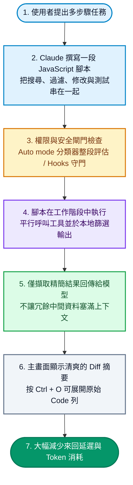

**Code Mode 是 Claude Code 推出的實驗性功能：它讓 Claude 從「每做一步都要回頭請示一次的遙控助理」，變成「自己寫一張 JavaScript 流程腳本、把好幾個步驟一次跑完再回報重點」的高效率助手。** 過去查檔案、改程式、跑測試要來回折返跑好幾趟，現在一個步驟就能串接或平行處理完畢，大幅減少等待時間與上下文 Token 消耗；不過目前預設關閉，也有工作階段恢復與安全審查粒度上的限制。[Claude Code 官方 Code Mode 文件](https://code.claude.com/docs/zh-TW/code-mode)

<!--more-->

## 為什麼需要 Code Mode？先用「大賣場買醬油」看懂傳統模式的痛點

要理解 **Code Mode** 在解決什麼問題，先想像一個生活場景：你請了一位很聰明的居家助理幫你去大賣場買醬油、順便買青菜和蒜頭回家煮晚餐。

在**沒有開啟 Code Mode 的傳統模式**下，AI 呼叫工具的規則就像是「用對講機一步一步遙控」——**助理每做完一個微小動作，都必須走回你家客廳門口回報結果，等你點頭思考完下一句，他才能再出門做下一步**：

1. 你說：「先去貨架看有哪些醬油。」助理跑去賣場拍下整排 50 瓶醬油的成分與價格表，抱著一大疊傳單回到客廳給你看。
2. 你掃完那 50 瓶的價錢，說：「好，挑最便宜那瓶去結帳。」助理又跑一趟去結帳，拿著明細回來。
3. 你說：「再去拿一把青菜。」助理再跑一趟拿青菜回來。
4. 你說：「再去拿一袋蒜頭。」助理又跑一趟拿蒜頭回來。

明明 5 分鐘可以一次搞定的採買，助理在客廳與賣場之間來回折返跑了四、五趟。套用到工程師每天用的 **Claude Code** 上，這種傳統的「單步工具呼叫（Sequential Tool Calling）」會立刻撞上兩個痛點：

- **客廳桌面被廢紙塞爆（Context Bloat）**：為了找到一個設定檔或函式，AI 常得先搜尋整個專案。搜尋回來的幾百行檔案清單與雜訊全都會被擺上模型的上下文桌面，不只浪費大量 **Token**，模型還得從雜訊堆裡重新消化重點。
- **來回折返的等待延遲（Round-trip Latency）**：每呼叫一次搜尋（**Grep**）、讀檔（**Read**）、修改（**Edit**）或終端指令（**Bash**），都得等結果回傳給模型、模型再想一輪並發出下一次工具請求，彼此互不衝突的工作也不能同時進行。

**Code Mode 換了一套工作邏輯**：與其用對講機遙控，不如讓助理直接在現場拿一張便條紙，寫下整套執行步驟（一段 **JavaScript** 程式碼）——「查完 50 瓶醬油價格後我自己當場比價，挑出最便宜那瓶，同時順手把青菜和蒜頭一起拿去結帳，最後只帶回那瓶醬油和發票向你回報」。客廳桌面不會堆滿沒買的醬油目錄，折返跑也從好幾趟縮減成 **1 趟**。

## 實際運作長什麼樣子？拆解官方的四行 JavaScript 範例

講完生活比喻，來看看官方文件裡給的真實例子。假設今天你想請 Claude Code 在專案裡找出某個重試機制（retryPolicy）的程式檔案，把最大重試次數從 3 改成 5，改完順便跑一下對應的單元測試。

如果開了 **Code Mode**，Claude 在背後寫出的腳本會長這樣：

```javascript
const files = await $`rg -l "function retryPolicy" src`.text();
const target = files.trim().split("\n")[0];
await edit(target, "maxAttempts: 3", "maxAttempts: 5");
({ edited: target, tests: $`npm test -- retryPolicy`.nothrow() });
```

就算平常不寫 JavaScript，照著下面這四步也能秒懂每一行在做什麼：

1. **第一行（現場查貨架）**：用 **rg**（ripgrep）在 **src** 資料夾搜尋有 `function retryPolicy` 的檔案清單。如果是傳統模式，這份清單得先傳回模型視窗看一遍；但在這裡，資料先留在腳本變數裡。
2. **第二行（現場自己挑）**：在程式碼裡直接整理字串、拿出第一個符合的目標檔案路徑 `target`。整串過濾動作都在本地執行，不佔用模型對話的記憶空間。
3. **第三行（動手修改）**：直接呼叫 **edit** 工具，把目標檔案裡的 `maxAttempts: 3` 換成 `maxAttempts: 5`。
4. **第四行（驗收並只帶重點回報）**：跑完指定測試 `npm test -- retryPolicy`，最後只把「改了哪個檔案」與「測試結果」這兩個精簡資訊送回給 Claude。

把整個過程畫成一張流程圖，就能一眼看清 **Code Mode** 如何把繁瑣的來回溝通壓縮成單一回合：



這種設計思路其實也呼應了 [Anthropic 在 2025 年 11 月工程部落格](https://www.anthropic.com/engineering/code-execution-with-mcp)提出的想法：與其讓語言模型透過自然語言一問一答地呼叫外部工具，不如讓模型直接寫程式來編排流程、在執行環境先過濾資料，既省 Token 又更貼近模型本身最擅長寫程式的強項。

## 什麼情境開 Code Mode 最有感？三個生活與開發對照

並不是寫一行「hello world」都需要出動 Code Mode。這項功能真正拉開差距的地方，在於任務包含「重複動作」、「大量資料過濾」或「多件可同步進行的小事」。以下整理三個最常見的對應情境：

| 生活常見情境 | 對應的 Claude Code 開發任務 | Code Mode 省下什麼功夫 |
| :--- | :--- | :--- |
| **月底一次對帳 30 張統一發票**，不用每對一張就問主管一次 | **跨大量檔案的重複修改**（例如把 30 個元件裡的舊函式名稱或參數批次換掉） | 用迴圈在腳本裡一次改完，不必重複進行 30 輪工具請求 |
| **拿健檢報告時先畫出紅字項目**，不把 200 頁正常數值全念給醫生聽 | **大範圍搜尋後先過濾再讀取**（先用 **Grep** 或 **Glob** 篩掉無關檔案，只把關鍵片段帶回上下文） | 中間過程的雜訊不進模型視窗，避免 Token 浪費與注意力分散 |
| **餐廳主廚同時煮飯、炒菜、滾湯**，不用等飯熟才開火炒下一道 | **同時執行多個彼此獨立的指令**（例如一邊跑 lint、一邊跑兩組不同模組的測試） | 互不依賴的工具呼叫可在同一段腳本裡平行出發，總等待時間直接縮短 |

## 開啟後畫面會變亂嗎？用 Ctrl + O 偷看背後的程式碼

很多人聽到「AI 每次動作都改寫一段 JavaScript 來跑」，第一個擔心就是：「那我的終端機對話畫面會不會被滿滿的程式碼洗版？」

實際上完全不會。在預設的主對話介面中，**Code Mode** 會把原始腳本收起來，畫面上依然只顯示高階且清爽的工具互動結果——例如你原本就習慣看到的檔案變更差異（Diff）。

如果你對 Claude 背後到底寫了什麼腳本感到好奇、或者想檢查看看它的篩選邏輯對不對，只要按下 **Ctrl + O** 開啟逐字稿檢視器（Transcript Viewer），就會看到每一次執行都以一個收合的 **Code** 列呈現，點開就能完整檢閱當時執行的 JavaScript 程式碼。想要在終端機裡更順手地管理工作階段或插話回溯，也可以搭配這篇 [Claude Code 有趣指令指南](/2026/10/14/Claude-Code-有趣指令指南：插話、回溯、定時巡查與終端機彩蛋/)一起服用。

## 如何開啟與關閉 Code Mode？設定方式與安全邊界

**Code Mode** 目前仍是實驗性、採自願啟用（Opt-in）的功能，**預設為關閉狀態**。你可以依照想試用的範圍，選擇單次啟動或寫進個人設定：

### 方法一：只在這次終端機測試（最推薦先這樣試）

直接在專案資料夾用環境變數啟動 **Claude Code**，用完關閉終端機就自動恢復預設：

```bash
CLAUDE_CODE_EXPERIMENTAL_CODE_MODE=1 claude
```

如果想在同一個 Shell 環境裡明確關掉，把值設回 **0** 即可：

```bash
export CLAUDE_CODE_EXPERIMENTAL_CODE_MODE=0
```

### 方法二：寫進個人全域設定檔永久開啟

如果你已經試過而且很喜歡它的速度，可以加進個人設定檔 **~/.claude/settings.json**（或透過 **claude --settings** 帶入指定設定檔）的 **env** 區塊中：

```json
{
  "env": {
    "CLAUDE_CODE_EXPERIMENTAL_CODE_MODE": "1"
  }
}
```

### 為什麼專案資料夾裡的設定檔不能開？

有個容易踩坑、但其實非常合理的安全設計：**你無法透過專案層級的 .claude/settings.json 或 .claude/settings.local.json 來開啟 Code Mode。**

換個生活例子來想就秒懂：你網購收到一個陌生人寄來的包裹，包裹裡附了一張紙條寫著「請把你家大門的自動感應鎖打開」，你的門鎖當然不應該照著紙條自動解鎖。同樣道理，當你從 GitHub clone 一個別人的開源專案時，裡頭可能附帶 **.claude/settings.json**；禁止專案設定檔擅自開啟這項實驗性執行模式，就是為了防止外部設定在未經你本人同意下改變代理的執行方式。

此外，在公司或團隊環境中，**組織管理員也能透過管理設定（Managed Settings）統一關閉或封鎖 Code Mode**；只要環境變數、個人設定或管理設定其中一處明確設為 **0**，功能就會維持關閉。

## 上手前必知的四個限制與注意事項

雖然把多個工具綁成一段程式跑起來很過癮，但官方文件也明確列出了四項現階段的限制，在投入正式工作流之前最好先有心理準備：

1. **實驗性功能隨時可能調整**：因為標記為 Experimental 且預設關閉，介面行為、可用函式與支援範圍在未來更新中都可能變動甚至移除。
2. **接續對話（Resume）必須同環境**：在 **Code Mode** 下跑過的工作階段，目前**只能在終端機介面、且同樣開啟 Code Mode 的狀態下恢復接續**。如果你切到沒開 Code Mode 的設定，或是想改從其他非終端機介面繼續同一段對話，就會受到限制。
3. **Auto mode 的安全審查變成「整包評估」**：在一般模式下開啟 **Auto mode**（自動模式）時，背後的安全分類器會像公司會計一樣，針對每一次單獨的工具呼叫「逐筆簽核」；但開啟 Code Mode 後，分類器會改成**把整段 JavaScript 腳本當成單一動作來評估**。這就像主管改成「整份專案採購包一次簽核」，審查粒度與一般模式不同。不過底層的權限規則（**allow**／**ask**／**deny**）與生命週期 Hooks 依然會發揮防護作用。
4. **長腳本會讓對話等待完成**：如果 Claude 寫出一段要跑比較久的腳本，除非明確交由背景執行，否則當前工作階段會等到整段腳本執行完畢才繼續往下走。

## 總結：什麼時候該開、什麼時候維持預設就好？

一句話總結 **Code Mode** 的核心價值：**它讓擅長寫程式的 AI，用「寫程式」這個它最拿手的語言來呼叫工具，告別過去像老式對講機一樣一來一往的折返跑。**

如果你的日常工作常常需要「跨幾十個檔案批次修改」、「搜尋完要先做複雜過濾再讀內容」，或是「同時跑多項互不干擾的檢查指令」，非常推薦先用 `CLAUDE_CODE_EXPERIMENTAL_CODE_MODE=1 claude` 在個人專案試跑幾次，體會一下上下文變乾淨、反應變俐落的感覺；反之，如果你需要隨時在不同介面之間恢復對話、對每次單一工具操作都要求獨立的 Auto mode 審查紀錄，或者正在執行團隊規範嚴格的正式專案，維持預設關閉就是最穩妥的選擇。

想對照其他 Claude Code 進階工作方式，例如讓兩個終端機視窗互相傳話協作，也可以延伸閱讀這篇 [Claude Code 跨 Session 溝通完整用法](/2026/08/09/Claude-Code-跨工作階段訊息：讓不同-Session-互相傳話的完整用法/)，或直接前往 [Claude Code 官方 Code Mode 文件](https://code.claude.com/docs/zh-TW/code-mode)查看最新規範。
