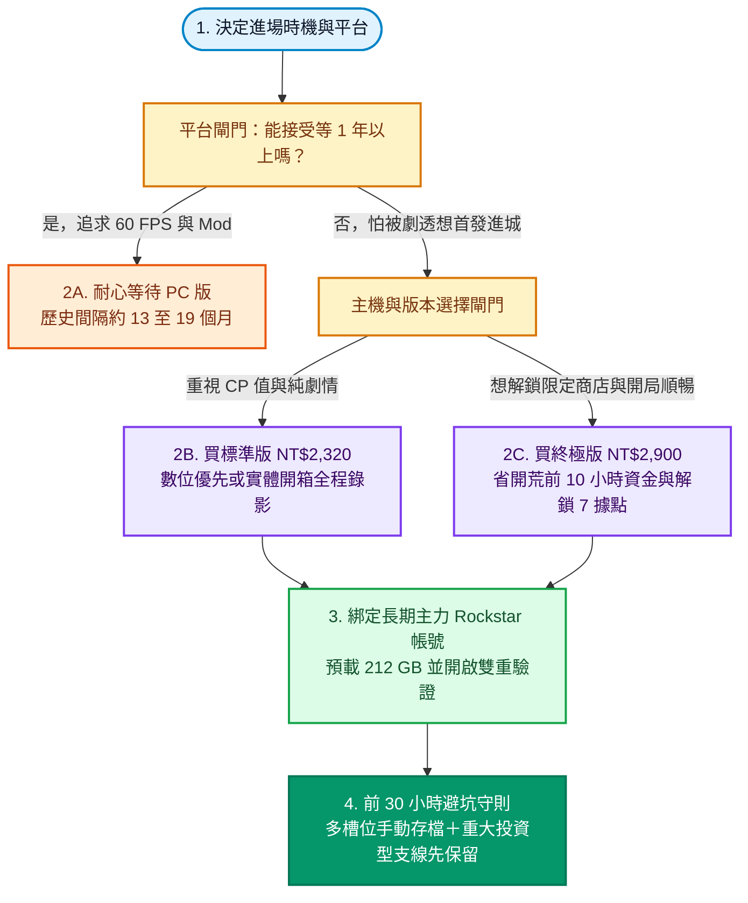

**《Grand Theft Auto VI》（GTA 6）將於 2026 年 11 月 19 日台灣時間凌晨 00:00 正式解鎖，首發僅登陸 PS5 與 Xbox Series X|S，預載空間需要 212 GB。** 台灣標準版定價為 **NT$2,320**，實體盒裝首度取消光碟改採一次性序號卡，全主機皆鎖定 **30 FPS**，且當日不會同步推出線上模式與 PC 版。進軍 **Leonida（雷歐尼達州）** 前，先把發售門檻、新系統與 **GTA 5** 過去十年的避坑教訓一次對齊。

<!--more-->

## 發售時間、預載與「無光碟實體版」五大現實

多數人只記住了 **11 月 19 日**，但開機前還有五項直接影響荷包與硬碟空間的官方規格要先確認。[Rockstar Games GTA 6 官方頁面](https://www.rockstargames.com/VI)

| 項目 | 官方規格與台灣狀況 | 玩家實戰影響 |
| :--- | :--- | :--- |
| 解鎖時間 | **2026 年 11 月 19 日** 當地午夜滾動解鎖 | 台灣時間 **11 月 19 日 00:00** 開放 |
| 首發平台 | **PS5**（含 PS5 Pro 強化）、**Xbox Series X\|S** | PC 版與任天堂平台首發缺席、未定時間 |
| 預載容量 | **11 月 10 日** 起陸續開放（台灣約 **11 月 12 日**） | 遊戲本體約 **212 GB**，建議預留 **220 GB** 以上 SSD |
| 台灣售價 | 標準版 **NT$2,320**（79.99 美元）／終極版 **NT$2,900**（99.99 美元） | 正式跨過過去 69.99 美元 3A 遊戲門檻 |
| 實體盒裝 | 標準版改採 **Code-in-Box（僅附序號卡與海報）** | **無光碟、無法賣二手回血**；終極版僅售數位版 |

- **實體版無光碟的兩大衝擊**：因容量達 **212 GB** 遠超單張藍光上限，[PlayStation 官方部落格](https://blog.playstation.com/) 與通路確認盒裝內只有一次性序號與海報。優點是約 11 月 12 日提前出貨就能預載；代價是**徹底無法破關賣二手**，且海外已有早期買家回報序號爭議，**拆封務必從未拆外膜開始錄影**。
- **Xbox vs PS5 紐西蘭跨區差異**：紐西蘭 11 月為夏令時（UTC+13），午夜相當於 **台灣時間 11 月 18 日 19:00**。據 [IGN 報導](https://www.ign.com/)，**Xbox** 於 **設定 → 系統 → 語言與地區** 切換紐西蘭重開即可提早玩；**PS5** 則鎖定購買帳號商店地區，單改主機時區無效，跨區購買也存在違反條款風險。

## 標準版 NT$2,320 vs 終極版 NT$2,900：差價 580 元給了什麼？

只要在 **11 月 20 日前** 購買標準或終極版，皆可獲得 **Vintage Vice City Pack**，內含 **1955 年 Vapid Stanier 轎車與車庫**、主角復古服飾髮型、熱帶武器塗裝，符合資格的數位預購另贈 **1 個月 GTA+**。

多花 **NT$580** 升級 **終極版（NT$2,900）**，內容會**隨故事章節推進逐步解鎖**，不破壞開荒節奏：

- **專屬載具**：**1995 年 Grotti Cheetah** 跑車、**1967 年 Vapid Dominator Buggy** 沙灘車、**Shitzu Squalo** 快艇、Jason 安全屋的 **Dinka Enduro** 機車與 **Crest Kayak** 獨木舟，以及皮卡復古套件。
- **武器與外觀**：源自 Vercetti 莊園背景的 **Hawk & Little Morgan** 對槍、雙主角專屬 **Girardi ES9** 與 **Klose K17** 客製塗裝。
- **7 個專屬據點**：解鎖 **Rideout Customs** 與 **One-Eyed Willie's** 改車廠、**Sara's Unisex Salon** 造型店、**Stock 305** 服飾店、**Electric Fang** 刺青店、**Goodtime Gear** 及 **PTT Youngin$** 黑市據點。

**怎麼買最划算**：對照 **GTA 5** 特別版與 **碧血狂殺 2** 終極版歷史，特典裝備最強勢只在**前 5–10 小時**，中後期多半會被商店頂規品追平。純跑劇情選 **NT$2,320 標準版** 搶免費預購包就很夠，後續有興趣也能單獨補買數位終極升級包。

## 硬體規格真相：為什麼連 PS5 Pro 都只跑 30 FPS？

包含基本款 **PS5**、**Xbox Series X|S** 甚至 **PS5 Pro**，首發全都目標 **30 FPS**，**沒有 60 FPS 效能模式**。

根據 [Digital Foundry 與 Eurogamer 分析](https://www.eurogamer.net/)，瓶頸卡在開放世界的 **CPU 模擬極限**：GTA 6 把算力壓在 **即時光線追蹤全域照明（RTGI）**、超高密度人群與車流 AI、水體物理與動態颶風天候，單靠降低解析度無法讓幀數翻倍。

- **PS5 Pro 實質優勢**：同樣 30 FPS，但靠 **PSSR** AI 超解析度消除動態模糊與邊緣鋸齒，並擁有基礎機型缺少的 **專屬光追陰影（Ray-traced shadows）**。
- **PS5 手把調校提醒**：本作完整支援 **DualSense** 自適應扳機、細膩觸覺回饋與 **Tempest 3D 音效**；打算長時間連玩者，進無障礙設定微調扳機阻力能減少手指疲勞。

## 進城前必看：《An Extended Look》五大系統變革

Rockstar 在 2026 年 8 月 27 日發布的 **27 分鐘** 實機展示 **《Grand Theft Auto VI: An Extended Look》**（先於 Netflix 獨播 6 小時後上架官方頻道，據 [Variety 統計](https://variety.com/) 四天吸睛 3,110 萬次），加上 [GameSpot 專訪](https://www.gamespot.com/) 揭露主線與核心劇情支線約 **80 小時**，五大機制改變了傳統玩法：

1. **放棄「神奇口袋」改用後車廂配裝**：長槍必須背在身上或放進車尾廂。提著重戰利品袋時會觸發單手上彈等物理動作；靠近平民區時主角會自動壓低武器，避免過早引發驚慌報警。
2. **雙主角現場協同與動態關係**：**Jason Duval** 與 **Lucia Caminos** 除了即時切換，還能用手機叫對方來支援、或在追逐戰交換駕駛座由 AI 搭檔開車。日常約會、回訊與互動會動態影響兩人默契與故事線。
3. **Focus 專注慢動作**：血條下方的紫色眼型量表可進入慢動作瞄準，以 **紅點（致命）** 與 **黃點（繳械）** 區分擊中部位。
4. **6 星通緝回歸與「空心星」情報**：經典 6 星回歸且星下會顯示罪行圖示。**空心白星**代表警方只在搜查最後目擊區或僅握有模糊特徵（例如「一對男女」），**暗巷換車、換裝甚至雙主角分頭散開**比無腦狂飆更容易消星。
5. **即時社群生態與日常系統**：街頭事件與追逐戰會即時推播到遊戲內短影音與直播平台；同步回歸健身增肌減脂、與狗互動、高爾夫、撞球、深海潛水與沼澤氣墊船等活動。

## 從 GTA 5 與 RDR2 十年歷史看 GTA 6 四大避坑分析

把 **GTA 5**（截至 2026 年 11 月 [Take-Two 財報](https://www.take2games.com/) 累計出貨近 **2.35 億套**）與 **碧血狂殺 2** 的發售史攤開來看，最關鍵的進場決策與避坑步驟能濃縮成底下這張路徑圖：

### 分析一：PC 版還要等多久？

Rockstar 歷代大作從不首發 PC：**GTA 5** 主機（2013/09/17）到 PC（2015/04/14）隔了 **19 個月**；**碧血狂殺 2** 主機（2018/10/26）到 PC（2019/11/05）隔了約 **13 個月**。集中打磨單一主機架構能避免 PC 硬體碎片化翻車，也能帶動核心玩家二次購買。怕劇透又不願等一年半以上者建議直上主機；非 **60 FPS** 與 Mod 不可者要有長期防雷準備。

### 分析二：別亂綁小號！跨平台存檔遷移的歷史限制

GTA 5 長年禁止 PlayStation 與 Xbox 跨陣營遷移，**2017 年 3 月 6 日** 關閉 PS3 / Xbox 360 轉移後，世代升級也幾乎只限同主機家族內部，主機與 PC 間限制極嚴（2022 年 PS4 轉 PS5 初上線時甚至一度刪除舊主機角色，直到 2023 年中才修改規則）。**11 月 19 日首次開機請務必綁定長期主力且開啟雙重驗證的 Rockstar Games Account**，別抱著「主機進度未來一定能無痛搬去 PC」的預設心理。

### 分析三：為什麼首發沒有 GTA 6 線上模式？

2013 年 GTA 5 上市首日吸金 **8 億美元**、三日破 **10 億美元**，但兩週後（10 月 1 日）開服的 **GTA Online** 隨即被爆量玩家癱瘓，引爆載入卡死、新手賽車塞車與雲端角色消失，Rockstar 最終公開致歉並發放每人 **GTA$ 500,000** 補償金；RDR2 線上版當年也延後一個月才上 Beta。

這次 Take-Two 執行長 Strauss Zelnick 已明確承諾**舊版《GTA Online》不會在 GTA 6 上市後關服**；至於 GTA 6 多人模式官方尚未定案，業界多預估落在 **2027 年**。首發玩家反而能避開伺服器災難，專心消化 80 小時單機劇情。

### 分析四：GTA 5 「21 億美金股市教訓」與前 30 小時三守則

2013 年玩家最慘痛的集體失誤，就是過早清光 **萊斯特（Lester）暗殺任務**，導致拿完最終大搶劫分紅後沒機會配合 **BAWSAQ / LCN 股市** 將三主角資產衝上 **21.4 億美元上限**。延續 GTA 5 與 RDR2「把超高倍率回報綁在主線大額分紅節點」的設計慣例，開荒前 30 小時務必守住三件事：

- **多槽位手動存檔**：重要劫案、高投資抉擇或雙主角關鍵劇情前，獨立建立手動存檔，不單靠自動覆寫。
- **前期節制純外觀消費**：前 10 到 20 小時將流動現金優先投入武器配件與車輛性能，少花冤枉錢在昂貴服飾塗裝。
- **遇到疑似牽動產業競爭或股價的事件先緩解**：先觀察前一個任務的結算機制與倍率，確認不吃主線後期本金再動手。

## 發售前 48 小時檢查清單

- **清出 220 GB 以上空間**：確保 **212 GB** 主程式與首日補丁順利安裝。
- **完成預載或開箱全程錄影**：實體盒裝收到即錄影拆封並輸入序號。
- **檢查 Rockstar 帳號與 2FA**：確保 PSN / Xbox 綁定正確帳號，順利領取 **1 個月 GTA+**。
- **11 月 20 日前入手**：保留免費 **Vintage Vice City Pack** 與 **'55 Vapid Stanier** 經典車。
- **預先調整 DualSense 阻力**：依手部習慣設定扳機張力，準備進入 30 FPS 的雷歐尼達州。
