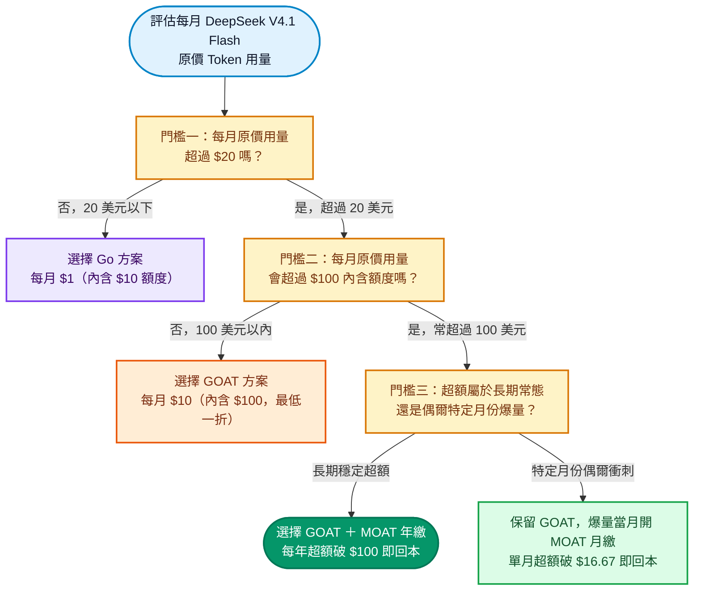

剛接觸 **Command Code** 的開發者，看到官網列出 **Go**、**GOAT** 和 **MOAT** 三個方案時，十個有九個會先愣一下：這三個到底誰取代誰？訂了 **GOAT** 還需要買 **MOAT** 嗎？還是乾脆只買 **MOAT** 就好？其實只要換個生活比喻，整套定價邏輯三秒就能看懂：**Go 和 GOAT 像是「打一折的預付禮券」，MOAT 則是「好市多四折會員卡」——而且兩張卡可以同時疊加使用。**

這篇文章以 **2026 年 11 月 26 日** 的官方方案資料為基準、聚焦多數人主力使用的 **DeepSeek V4.1 Flash**（以下金額皆為美元），透過互動式長條圖、五方案折線圖、區間示意圖與決策流程圖，把**各方案真實支出、平均 Token 折數、MOAT 回本門檻、每月省錢幅度與各用量最佳組合**一次拆解清楚，不講複雜數學，讓你兩分鐘就能選出最省荷包的訂閱組合。

<!--more-->

## 先用生活比喻看懂三個方案：一折禮券 vs 好市多會員卡

如果你看過本站之前整理的[AI 訂閱怎麼買最划算](/2026/09/17/how-to-buy-ai-subscriptions-best-value/)，應該知道同一個月費在不同平台能換到的實際用量差非常大。Command Code 之所以把定價切出 **Go**、**GOAT** 與 **MOAT**，是因為它們扮演的角色完全不同：

- **Go（每月 $1）與 GOAT（每月 $10）像「一折預付禮券」**：你花 $1 就換到 $10 原價額度、花 $10 就換到 $100 原價額度，等於在額度內直接用**一折**跑模型；唯一缺點是額度用完之後，多出來的用量必須按**原價**儲值。
- **MOAT（年繳 $60，平均每月 $5；或月繳 $10）像「好市多會員卡」**：辦卡本身**不會送任何免費 Token 額度**（內含 $0），但它會把你額外購買 **DeepSeek V4.1 Flash** 的結帳價直接打 **60% 折扣（也就是原價四折）**。
- **最關鍵的規則是「可以疊加」**：當你同時訂閱 **Go＋MOAT** 或 **GOAT＋MOAT** 時，系統會先扣完方案內含的一折額度；額度用光後，超額部分自動套用 MOAT 的四折價，等於一次吃下「前段一折＋後段四折」兩層優惠。

```chart
{
  "type": "bar",
  "title": "五大方案比較長條圖：每月會員費 vs 每月內含原價額度",
  "subtitle": "一眼看出 Go 與 GOAT 的 10 倍額度槓桿，以及 MOAT 零內含額度、專攻超額四折的定位差異",
  "height": 340,
  "yPrefix": "$",
  "yMax": 120,
  "yStep": 20,
  "yLabel": "每月金額（美元）",
  "showBarLabels": true,
  "legendPosition": "top",
  "labels": ["Go", "GOAT", "MOAT（年繳）", "Go + MOAT", "GOAT + MOAT"],
  "datasets": [
    {
      "label": "每月會員費（實付）",
      "data": [1, 10, 5, 6, 15],
      "color": "#f97316",
      "labelColor": "#c2410c"
    },
    {
      "label": "每月內含原價額度",
      "data": [10, 100, 0, 10, 100],
      "color": "#059669",
      "labelColor": "#047857"
    }
  ],
  "note": "資料日期：2026/11/26｜MOAT 另提供月繳 $10（隨時取消）；疊加訂閱時先扣內含額度，超額享 DeepSeek V4.1 Flash 四折。"
}
```

把五種實際可選的組合整理成一張速查表，每個數字都很透明：

| 方案 | 每月會員費 | 年度會員費 | 每月內含用量 | 年度內含用量 | 超額 Token 價格 |
| :--- | ---: | ---: | ---: | ---: | ---: |
| **Go** | $1 | $12 | $10 | $120 | 原價 |
| **GOAT** | $10 | $120 | $100 | $1,200 | 原價 |
| **MOAT（年繳）** | $5 | $60 | $0 | $0 | 四折 |
| **Go＋MOAT** | $6 | $72 | $10 | $120 | 四折 |
| **GOAT＋MOAT** | $15 | $180 | $100 | $1,200 | 四折 |

補充說明 **MOAT 的兩種繳費方式**：選擇**年繳 $60**，攤下來平均每月只要 **$5**；如果擔心之後用不到，也可以選**月繳 $10**、隨時取消，彈性很大。

## 懶人直接看結論：你的用量落在哪一區，就買哪一組

不想先看曲線推導的人，可以直接看下面這張**最佳方案使用區間圖**（滑鼠移到或點擊各色塊可看詳細區間說明）。這裡以 **MOAT 年繳（每月 $5）**、在 Command Code 內部使用，以及上述五種方案為基準，只要估一下你每個月大概會燒掉多少「原價」的 DeepSeek V4.1 Flash 用量，就能立刻對號入座：

```chart
{
  "type": "range",
  "title": "最佳方案使用區間",
  "subtitle": "每月 DeepSeek V4.1 Flash 原價用量（區間示意，非等比例；以 MOAT 年繳 $5/月為基準）",
  "defaultHint": "點選或滑過上方任一方案區塊，查看對應每月與年度用量區間。",
  "segments": [
    {
      "label": "Go",
      "weight": 21,
      "color": "#64748b",
      "detail": "Go（$1/月）：每月原價用量 $18.33 以下（年度 $220 以下）最省錢，適合輕度日常開發。"
    },
    {
      "label": "Go + MOAT",
      "weight": 5.5,
      "color": "#ea580c",
      "callout": true,
      "detail": "Go + MOAT（$6/月）：僅在每月 $18.33～$20（年度 $220～$240）極窄區間勝出，最多省不到 $0.67/月。"
    },
    {
      "label": "GOAT",
      "weight": 43,
      "color": "#2563eb",
      "detail": "GOAT（$10/月）：每月 $20～$108.33（年度 $240～$1,300）最划算，用滿 $100 時平均成本低至原價一折。"
    },
    {
      "label": "GOAT + MOAT",
      "weight": 30.5,
      "color": "#059669",
      "detail": "GOAT + MOAT（$15/月）：每月超過 $108.33（年度 $1,300 以上）完勝，前 $100 一折＋超額全面四折。"
    }
  ],
  "ticks": [
    { "label": "$0", "align": "start" },
    { "label": "$18.33", "stagger": true },
    { "label": "$20", "align": "start", "dx": 2 },
    { "label": "$108.33" },
    { "label": "∞", "align": "end" }
  ],
  "note": "註：單獨訂閱 MOAT 在五種方案中沒有最佳區間；同等用量達 $100/月以上時，疊加 GOAT 永遠比單買 MOAT 每月少花 $30。"
}
```

| 每月 Token 原價用量 | 年度 Token 原價用量 | 最划算方案 |
| ---: | ---: | :--- |
| $18.33 以下 | $220 以下 | **Go** |
| $18.33～$20 | $220～$240 | **Go＋MOAT** |
| $20～$108.33 | $240～$1,300 | **GOAT** |
| $108.33 以上 | $1,300 以上 | **GOAT＋MOAT** |

這張區間圖背後藏著兩個幫你少走彎路的大結論：

1. **實際上只需要在 Go、GOAT、GOAT＋MOAT 三選一**：**Go＋MOAT** 勝出的區間只有每月 $18.33 到 $20 之間——寬度才 $1.67，就算精準踩在正中間也只省不到一美元。對絕大多數開發者來說，輕度用 **Go**、中度直接上 **GOAT**、重度再疊 **GOAT＋MOAT** 就夠了。
2. **「單獨買 MOAT」在這五種方案裡完全沒有成本優勢**：原因非常直白——單買 MOAT 買 $100 原價額度要花 $5 會費加 $40 Token 費，共 $45；但只要多花 $10 疊上 GOAT，前 $100 額度直接包在裡面，總花費降到 $15。只要每月用量達到 $100 以上，**GOAT＋MOAT 永遠比單買 MOAT 每月少花 $30（一年少花 $360）**。

## 拆解平均 Token 成本：為什麼重度用戶一定要疊加？

很多人算訂閱費時容易看錯重點，只盯著月費 $10 還是 $15，卻忘了算**「平均每買 $1 原價 Token，自己實際付了幾毛錢」**。我們用一個超簡單的公式就能衡量每個方案的真實折數：

**平均成本比例 ＝（會員費 ＋ 額外 Token 費用）÷ Token 原價總用量 × 100%**

這個比例越低，代表你用越少的錢買到相同的 Token 用量。例如 **10%** 就是原價一折，**40%** 就是原價四折。把五種方案（**Go**、**Go＋MOAT**、**GOAT**、**GOAT＋MOAT** 與 **單獨 MOAT 年繳**）全部畫在同一張等比例互動折線圖上——滑鼠移上去可以直接比對每個用量的精確折數，點下方圖例也能自由開關單獨曲線：

```chart
{
  "type": "line",
  "title": "五種方案平均 Token 成本折線圖（年度原價用量 $120～$3,600）",
  "subtitle": "橫軸為真實等比例年度原價用量，線越低代表越省；點擊底部圖例可開關個別方案曲線",
  "height": 380,
  "xType": "linear",
  "xMin": 120,
  "xMax": 3600,
  "xTicks": [120, 600, 1200, 1900, 2400, 3000, 3600],
  "xPrefix": "$",
  "xLabel": "年度 Token 原價用量（美元）",
  "yMin": 0,
  "yMax": 160,
  "yStep": 20,
  "ySuffix": "%",
  "yLabel": "平均 Token 成本（原價百分比）",
  "tooltipTitlePrefix": "年度原價用量 ",
  "legendPosition": "bottom",
  "referenceLines": [
    { "axis": "y", "value": 40, "color": "#64748b", "label": "40% 四折漸近線", "labelAlign": "right" },
    { "axis": "x", "value": 1300, "color": "#d97706", "label": "$1,300 黃金交叉 (16.9%)", "labelBg": "#fffbeb", "labelColor": "#92400e", "labelYOffset": 4 },
    { "axis": "x", "value": 1900, "color": "#64748b", "label": "$1,900 GOAT 追平 MOAT", "labelBg": "#f8fafc", "labelColor": "#334155", "labelYOffset": 34 }
  ],
  "datasets": [
    {
      "label": "Go",
      "color": "#2563eb",
      "data": [
        { "x": 120, "y": 10 }, { "x": 180, "y": 40 }, { "x": 220, "y": 50.91 }, { "x": 240, "y": 55 },
        { "x": 400, "y": 73 }, { "x": 600, "y": 82 }, { "x": 900, "y": 88 }, { "x": 1200, "y": 91 },
        { "x": 1300, "y": 91.69 }, { "x": 1900, "y": 94.32 }, { "x": 2400, "y": 95.5 }, { "x": 3600, "y": 97 }
      ]
    },
    {
      "label": "Go + MOAT",
      "color": "#16a34a",
      "data": [
        { "x": 120, "y": 60 }, { "x": 180, "y": 53.33 }, { "x": 220, "y": 50.91 }, { "x": 240, "y": 50 },
        { "x": 400, "y": 46 }, { "x": 600, "y": 44 }, { "x": 900, "y": 42.67 }, { "x": 1200, "y": 42 },
        { "x": 1300, "y": 41.85 }, { "x": 1900, "y": 41.26 }, { "x": 2400, "y": 41 }, { "x": 3600, "y": 40.67 }
      ]
    },
    {
      "label": "GOAT",
      "color": "#ea580c",
      "data": [
        { "x": 120, "y": 100 }, { "x": 180, "y": 66.67 }, { "x": 220, "y": 54.55 }, { "x": 240, "y": 50 },
        { "x": 400, "y": 30 }, { "x": 600, "y": 20 }, { "x": 900, "y": 13.33 }, { "x": 1200, "y": 10 },
        { "x": 1300, "y": 16.92 }, { "x": 1900, "y": 43.16 }, { "x": 2400, "y": 55 }, { "x": 3600, "y": 70 }
      ]
    },
    {
      "label": "GOAT + MOAT",
      "color": "#d97706",
      "borderWidth": 3.4,
      "data": [
        { "x": 120, "y": 150 }, { "x": 180, "y": 100 }, { "x": 220, "y": 81.82 }, { "x": 240, "y": 75 },
        { "x": 400, "y": 45 }, { "x": 600, "y": 30 }, { "x": 900, "y": 20 }, { "x": 1200, "y": 15 },
        { "x": 1300, "y": 16.92 }, { "x": 1900, "y": 24.21 }, { "x": 2400, "y": 27.5 }, { "x": 3600, "y": 31.67 }
      ]
    },
    {
      "label": "MOAT（年繳）",
      "color": "#7c3aed",
      "data": [
        { "x": 120, "y": 90 }, { "x": 180, "y": 73.33 }, { "x": 220, "y": 67.27 }, { "x": 240, "y": 65 },
        { "x": 400, "y": 55 }, { "x": 600, "y": 50 }, { "x": 900, "y": 46.67 }, { "x": 1200, "y": 45 },
        { "x": 1300, "y": 44.62 }, { "x": 1900, "y": 43.16 }, { "x": 2400, "y": 42.5 }, { "x": 3600, "y": 41.67 }
      ]
    }
  ],
  "note": "年度用量超過 $3,600 後，GOAT 會持續攀升至趨近 100%（原價），而 GOAT + MOAT 與 MOAT 均穩穩壓在 40%（四折）以內。"
}
```

| 年度 Token 原價用量 | GOAT | MOAT（年繳） | GOAT＋MOAT（年繳） |
| ---: | ---: | ---: | ---: |
| $600 | **20%** | 50% | 30% |
| $1,200 | **10%** | 45% | 15% |
| $1,300 | **16.92%** | 44.62% | **16.92%** |
| $1,500 | 28% | 44% | **20%** |
| $1,900 | 43.16% | 43.16% | **24.21%** |
| $2,400 | 55% | 42.5% | **27.5%** |
| $3,600 | 70% | 41.67% | **31.67%** |
| $6,000 | 82% | 41% | **35%** |
| $12,000 | 91% | 40.5% | **37.5%** |
| 趨近無限用量 | 100% | 40% | **40%** |

順著曲線上的三個關鍵轉折點，你就能徹底看懂為什麼 Command Code 這樣設計定價：

- **轉折點一：年用量 $1,200（每月剛好用滿 $100）**——這是 **GOAT** 最甜的一刻。全年 $120 會員費換滿 $1,200 原價額度，平均 Token 成本直接壓到驚人的 **10%（一折）**；這時如果多買了 MOAT 卻沒超額，等於白付 $60 會費，平均成本反而變成 15%。
- **轉折點二：年用量 $1,300（每月 $108.33）**——這就是 **GOAT 與 GOAT＋MOAT 的黃金交叉點**。只要超過 $1,200 內含額度，單獨 GOAT 每一塊錢超額都要付原價，橘色曲線立刻陡峭往上飆；就在 $1,300 這裡，兩條線在 **16.92%** 正式交會，從此之後 **GOAT＋MOAT 一路壓著打**。
- **轉折點三：年用量 $1,900（約每月 $158）**——單獨 GOAT 的平均成本已經飆升到 **43.16%（超過四成三）**，連沒送額度的單買 MOAT 都追上它了；反觀 **GOAT＋MOAT 此時平均成本依然只有 24.21%（不到原價兩成五）**。就算用量一路放大到 $12,000 甚至趨近無限，單獨 GOAT 會逼近 **100% 原價**，而 GOAT＋MOAT 則穩穩鎖死在 **40%（四折）**以內。

## MOAT 回本門檻怎麼算？別背複雜表，記兩條數字就好

很多已經訂了 **GOAT** 的朋友最常問：「我到底超支到什麼程度，才該加購 **MOAT**？」

拆開算其實比超市集點還簡單。加購 **MOAT 年繳**等於每個月多付 **$5 會員費**，換來每一美元超額 Token **省下 60%（$0.60）**。把多付的會費除以折扣率，回本門檻立刻就出來了：

- **年度超額回本門檻**：$60 ÷ 60% ＝ **$100 超額用量**（整年只要原價超支超過 $100 就回本）。
- **每月平均超額門檻**：$5 ÷ 60% ＝ **$8.33 超額用量**。
- **每月總用量回本門檻**：內含 $100 ＋ 超額 $8.33 ＝ **$108.33 原價用量**。

為了避免誤會，這裡特別攤開 **回本交叉點當月的真實帳單明細** 給你對照：

| 每月費用項目 | 單獨 GOAT | GOAT＋MOAT（年繳） |
| :--- | ---: | ---: |
| GOAT 會員費 | $10 | $10 |
| MOAT 會員費 | $0 | $5 |
| 內含 Token 用量 | $100 | $100 |
| 額外 Token 原價用量 | $8.33 | $8.33 |
| 額外 Token 實際費用 | $8.33 | $3.33 |
| **實際總支出** | **$18.33** | **$18.33** |
| Token 原價總用量 | $108.33 | $108.33 |

請特別留意，**108.33 美元是 Token 的原價價值，不是你刷卡付出去的錢**。在這個交叉點上，兩個方案你實際從荷包掏出來的都是 **$18.33**——只要你單月超額比 $8.33 再多花哪怕一塊錢，GOAT＋MOAT 就開始幫你淨賺價差。

### MOAT 年繳 vs 月繳：長期穩用還是短期衝刺？

如果你不是每個月都會寫爆額度，而是平常 $100 夠用、只有趕上線或大規模重構的那一兩個月會狂燒 Token，這時就不一定要綁年繳，可以改看 **MOAT 月繳（$10/月、隨時取消）**。把每月用量 $100 到 $160 放大畫成三條互動直線，年繳與月繳各自的回本交叉點一眼就能定位：

```chart
{
  "type": "line",
  "title": "MOAT 年繳 vs 月繳回本交叉折線圖（月用量 $100～$160 放大圖）",
  "subtitle": "已訂 GOAT 用戶加購 MOAT 的兩條回本門檻：年繳超額 $8.33 回本、月繳超額 $16.67 回本",
  "height": 340,
  "xType": "linear",
  "xMin": 100,
  "xMax": 160,
  "xStep": 10,
  "xPrefix": "$",
  "xLabel": "每月 Token 原價總用量（美元）",
  "yMin": 0,
  "yMax": 75,
  "yStep": 15,
  "yPrefix": "$",
  "yLabel": "每月實際總支出（美元）",
  "tooltipTitlePrefix": "每月原價用量 ",
  "legendPosition": "top",
  "referenceLines": [
    { "axis": "x", "value": 108.33, "color": "#059669", "label": "年繳回本 $108.33（實付 $18.33）", "labelBg": "#ecfdf5", "labelColor": "#065f46", "labelYOffset": 4 },
    { "axis": "x", "value": 116.67, "color": "#2563eb", "label": "月繳回本 $116.67（實付 $26.67）", "labelBg": "#eff6ff", "labelColor": "#1e40af", "labelYOffset": 34 }
  ],
  "datasets": [
    {
      "label": "單獨 GOAT（月費 $10）",
      "color": "#ea580c",
      "data": [
        { "x": 100, "y": 10 }, { "x": 108.33, "y": 18.33 }, { "x": 116.67, "y": 26.67 },
        { "x": 130, "y": 40 }, { "x": 140, "y": 50 }, { "x": 150, "y": 60 }, { "x": 160, "y": 70 }
      ]
    },
    {
      "label": "GOAT + MOAT 月繳（月費 $20）",
      "color": "#2563eb",
      "dash": [6, 4],
      "data": [
        { "x": 100, "y": 20 }, { "x": 108.33, "y": 23.33 }, { "x": 116.67, "y": 26.67 },
        { "x": 130, "y": 32 }, { "x": 140, "y": 36 }, { "x": 150, "y": 40 }, { "x": 160, "y": 44 }
      ]
    },
    {
      "label": "GOAT + MOAT 年繳（月費 $15）",
      "color": "#059669",
      "borderWidth": 3.4,
      "data": [
        { "x": 100, "y": 15 }, { "x": 108.33, "y": 18.33 }, { "x": 116.67, "y": 21.67 },
        { "x": 130, "y": 27 }, { "x": 140, "y": 31 }, { "x": 150, "y": 35 }, { "x": 160, "y": 39 }
      ]
    }
  ]
}
```

| 比較項目 | MOAT 年繳 | MOAT 月繳 |
| :--- | ---: | ---: |
| 每月會員成本 | $5 | $10 |
| GOAT＋MOAT 每月會員總成本 | $15 | $20 |
| DeepSeek V4.1 Flash 超額折扣 | 60%（四折） | 60%（四折） |
| **每月超額用量回本門檻** | **$8.33** | **$16.67** |
| 每月總用量回本門檻 | $108.33 | $116.67 |
| 回本時每月實際支出 | $18.33 | $26.67 |

挑法非常乾脆：**長期每個月都會穩定超額，直接買年繳最便宜**（把超額門檻壓到只要 $8.33）；**只有少數衝刺月份才會爆量，平常維持 GOAT，爆量當月開一次 MOAT 月繳**（只要當月額外原價儲值超過 $16.67 就回本），月底再取消即可。

## 荷包真實有感：不同用量下每月、每年到底省多少？

折數百分比有時候沒那麼有感，我們直接換算成**每個月信用卡帳單上真實少付的美元金額**。以下兩張互動長條圖均以 **GOAT＋MOAT 年繳**為基準，所有金額都已計入會員費與額外儲值費：

```chart
{
  "type": "bar",
  "title": "每月實際支出比較長條圖（GOAT vs GOAT + MOAT 年繳）",
  "subtitle": "費用已包含會員費與額外 Token 儲值，柱體越低代表實付越少",
  "height": 330,
  "yPrefix": "$",
  "yMax": 1050,
  "yStep": 200,
  "xLabel": "每月 Token 原價用量",
  "yLabel": "每月實際總支出（美元）",
  "showBarLabels": true,
  "legendPosition": "top",
  "labels": ["$100", "$108.33", "$120", "$150", "$200", "$300", "$500", "$1,000"],
  "datasets": [
    {
      "label": "單獨 GOAT 實付",
      "data": [10, 18.33, 30, 60, 110, 210, 410, 910],
      "color": "#fb923c",
      "labelColor": "#c2410c"
    },
    {
      "label": "GOAT + MOAT（年繳）實付",
      "data": [15, 18.33, 23, 35, 55, 95, 175, 375],
      "color": "#059669",
      "labelColor": "#047857"
    }
  ]
}
```

```chart
{
  "type": "bar",
  "title": "加購 MOAT 年繳後的年度淨省金額長條圖",
  "subtitle": "正值為每年淨省下的美元金額，負值為未達回本門檻時多付的年費差額",
  "height": 300,
  "yPrefix": "$",
  "yShowPlus": true,
  "yMin": -800,
  "yMax": 7200,
  "yStep": 2000,
  "xLabel": "每月 Token 原價用量",
  "yLabel": "每年淨節省（美元）",
  "showBarLabels": true,
  "zeroLabel": "打平 $0",
  "showLegend": false,
  "labels": ["$100", "$108.33", "$120", "$150", "$200", "$300", "$500", "$1,000"],
  "datasets": [
    {
      "label": "每年淨節省",
      "data": [-60, 0, 84, 300, 660, 1380, 2820, 6420],
      "backgroundColor": ["#ef4444", "#d97706", "#10b981", "#10b981", "#10b981", "#10b981", "#059669", "#047857"],
      "labelColors": ["#b91c1c", "#b45309", "#047857", "#047857", "#047857", "#047857", "#047857", "#065f46"]
    }
  ]
}
```

| 每月 Token 原價用量 | GOAT 實際支出 | GOAT＋MOAT 實際支出 | 每月節省 | 每年節省 |
| ---: | ---: | ---: | ---: | ---: |
| $100 | $10 | $15 | -$5 | -$60 |
| $108.33 | $18.33 | $18.33 | 約 $0 | 約 $0 |
| $120 | $30 | $23 | **$7** | **$84** |
| $150 | $60 | $35 | **$25** | **$300** |
| $200 | $110 | $55 | **$55** | **$660** |
| $300 | $210 | $95 | **$115** | **$1,380** |
| $500 | $410 | $175 | **$235** | **$2,820** |
| $1,000 | $910 | $375 | **$535** | **$6,420** |

看幾個最常見的重度開發者場景，你就知道這張 MOAT 會員卡的威力有多誇張：

- **每月跑 $200 原價用量**：單獨 GOAT 要付 **$110**，疊加 MOAT 年繳直接腰斬剩 **$55**，一年省下 **$660**。
- **每月跑 $500 原價用量**：單獨 GOAT 帳單會衝到 **$410**，疊加 MOAT 只要 **$175**，一年幫你省下 **$2,820**（相當於一台頂規 MacBook Pro）。
- **重度 Agent 開發每月跑 $1,000 原價用量**：單獨 GOAT 要燒 **$910**，疊加 MOAT 降到 **$375**，一年直接省下 **$6,420**。

## 30 秒決策流程圖：一張圖決定你的最佳訂閱組合

如果你還在猶豫自己該怎麼下單，照著下面這張流程圖走一遍，30 秒就能做出最划算的決定：



最後再用四句話幫不同身分的讀者做個總結：

- **輕度使用者**：選 **Go**，每月只需 **$1**，把試水溫成本壓到最低。
- **中度使用者**：選 **GOAT**，每月 **$10** 就能穩穩用足 **$100** 原價用量，是 CP 值最高的甜點區。
- **重度使用者**：選 **GOAT＋MOAT（年繳）**，前段吃滿 GOAT 一折額度、超額全面套用 MOAT 四折。
- **短期重度使用者**：平常留著 **GOAT**，遇到趕專案的爆量月份再開 **MOAT 月繳**。

給已經訂閱 GOAT 的人最簡單、完全不用開計算機的判斷口訣：

**如果每年額外原價儲值的金額超過 $100，就值得加購 MOAT 年繳。**

**如果單月額外原價儲值的金額超過 $16.67，就值得考慮加購 MOAT 月繳。**

說穿了，**MOAT 的真正價值不是拿來取代 GOAT，而是當 GOAT 額度用光後，替你把超額 Token 帳單直接砍掉六成的神隊友。** 如果你同時也在評估其他 AI 寫程式主力工具，也可以搭配閱讀[Claude Code vs Codex vs Cursor 比較](/2026/05/06/AI-coding-工具比較：Claude-Code、Codex、Cursor-怎麼選？/)與[Artificial Analysis 排行榜完全指南](/2026/08/17/選模型別再憑感覺！Artificial-Analysis-完整指南：從品質、速度到成本，情境化挑出最適合你的-AI/)，先把工具定位與模型能力對齊，再挑最省錢的計費方案。

## 下手前必看的 7 個注意事項與使用限制

把帳算清楚之後，刷卡前還有幾個實務細節一定要先留意，避免落入規則落差：

1. **模型基準限制**：本文所有折扣與額度試算僅針對 **DeepSeek V4.1 Flash**，Command Code 上其他模型的內含優惠額度與 MOAT 折扣比例可能不同。
2. **年度試算前提**：本文的年度用量皆以「目前優惠規則維持全年」為前提推算，並非官方保證整年固定不變的年度額度。
3. **時段限額差異**：**Go** 與 **GOAT** 的內含額度按月計算，且受到**每 5 小時及每週用量限制**；如果你改用額外付費儲值的 Token，則不受這些時段限額約束。
4. **Provider API 支援差異**：**Go** 的內含額度**不能**用於 Provider API（僅限在 Command Code 內使用），**GOAT** 則支援 Provider API。
5. **極低用量選項**：如果你一個月連 $1 都用不到，也可以完全不訂閱任何方案，直接按量付費即可。
6. **未納入項目**：本文未將 **Pro**、**Max** 等其他方案，以及海外刷卡手續費、稅金與匯率波動計入成本。
7. **淡旺季用量波動**：年度平均比較假設每個月的用量分布均勻；如果你的專案有明顯淡旺季落差，請改以**實際額外原價儲值金額**來判斷是否跨過回本門檻，才不會高估或低估省錢幅度。

## 參考資料

- [Command Code MOAT 會員說明](https://commandcode.ai/zh/moat)
- [Command Code Go 方案文件](https://commandcode.ai/docs/plans/go)
- [Command Code GOAT 方案文件](https://commandcode.ai/docs/plans/goat)
- [Command Code 官方定價頁](https://commandcode.ai/pricing)
- [Command Code Provider API 文件](https://commandcode.ai/docs/provider)
- [Command Code 使用量限制說明](https://commandcode.ai/docs/resources/usage-limits)
