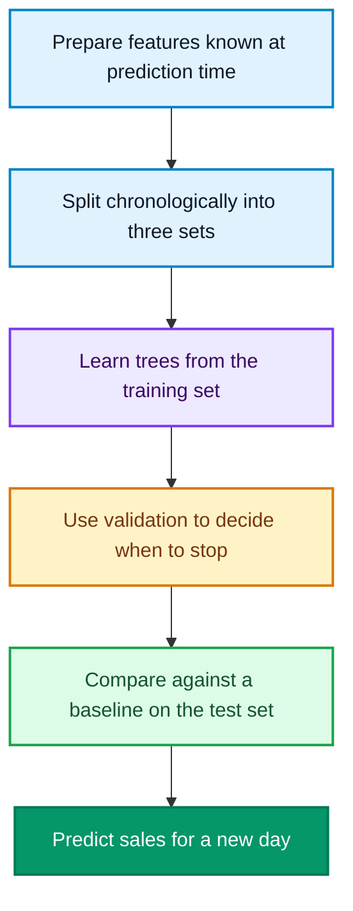

LightGBM learns patterns from historical tables and uses them to predict outcomes for new rows. Imagine running a coffee shop: you have daily weather forecasts, promotion records, and sales counts. You want to ask, “Saturday should reach 28°C, and we have a promotion. How many cups should we prepare?”

This guide follows that question from the idea to working Python code. You will learn what the model learns, how to train it, and how to judge its predictions. The explanation needs no calculus; the practical section assumes basic familiarity with running Python.

<!--more-->

## Turn the question into a table

These rows are **invented to explain the columns**. They are not output from the code later in the article.

| Day | Forecast temperature | Promotion | Cups sold |
| --- | --- | --- | --- |
| Monday | 24°C | No | 150 |
| Saturday | 28°C | Yes | 220 |
| Sunday | 20°C | No | 165 |

Each row describes one day. The first three columns are **features**: information available when you make a prediction. Code usually calls this input table **X**. The final column is the **target**, usually called **y**.

During **training**, you supply both X and the known y so the model can learn relationships. During **prediction**, you supply only the new day's X and receive an estimated sales count. The actual sales for that future day cannot be part of the input.

Learning from examples with known answers is called **supervised learning**. LightGBM supports three common tasks, with separate interfaces in its [official Python API](https://lightgbm.readthedocs.io/en/stable/Python-API.html).

| Question | Task | Python interface |
| --- | --- | --- |
| How many cups will we sell? | Regression: predict a number | **LGBMRegressor** |
| Will this customer buy again? | Classification: predict a class or probability | **LGBMClassifier** |
| How should products within a search be ordered? | Ranking: learn relative order | **LGBMRanker** |

Ranking also requires grouping candidates by query. Changing the class name in a sales example does not create a ranking system. We will start with regression.

## How it learns: rules, followed by corrections

A **decision tree** asks a sequence of questions: “Is there a promotion?” “Is the temperature above this threshold?” Each question divides historical examples into smaller groups, ending with a numerical output. Training finds the questions, thresholds, and output values from the data.

With its default boosting setup, LightGBM adds trees in sequence. Each new tree learns a correction based on the current model's errors. That is the central idea behind **gradient boosting**.

For squared-error regression, you can think of the correction direction as the residual: actual value minus current prediction. Other objectives, including classification, use gradients of their respective loss functions. The [scikit-learn gradient boosting guide](https://scikit-learn.org/stable/modules/ensemble.html#gradient-boosted-trees) explains the general method.

Suppose one day actually produced 130 sales. These numbers are **an illustration of the mechanism**, not measurements:

| Stage | Correction added | Combined prediction |
| --- | --- | --- |
| Initial estimate | Start at 100 cups | 100 cups |
| First correction tree | Add 20 cups | 120 cups |
| Second correction tree | Add 8 cups | 128 cups |

The corrections shown already include learning-rate scaling. Real training considers many rows together. A tree can raise or lower a prediction, and validation error will not necessarily improve at every round.

Once training finishes, the trees form a single model. To predict a new row, the model follows the learned rules and combines the trees' contributions. It does not retrain for each prediction.

## What makes LightGBM efficient?

Two ideas are enough to get started:

- **Histogram binning** groups continuous values into fewer intervals, reducing the work and memory needed to search for splits.
- **Leaf-wise growth** chooses the leaf whose next split gives the greatest reduction in training loss, rather than expanding a whole level together.

The [official features guide](https://lightgbm.readthedocs.io/en/stable/Features.html) describes both. A leaf is an endpoint that supplies a value. Excessively detailed trees can memorize accidental patterns in a few examples, causing **overfitting**.

Measure speed and prediction error on your own data. Small samples, uninformative features, and changing conditions can all affect results.

## Keep training, validation, and testing separate

We are predicting future sales, so we preserve chronological order. The example uses 1,000 days: the first 700 for training, the next 150 for validation, and the last 150 for testing.



Think of **training as practice, validation as progress checks, and testing as a sealed final exam**. Use validation for early stopping and parameter choices. Repeatedly changing the model in response to test results compromises that final assessment.

One chronological split is enough to demonstrate the workflow. A real project can evaluate several time windows; the [TimeSeriesSplit documentation](https://scikit-learn.org/stable/modules/generated/sklearn.model_selection.TimeSeriesSplit.html) explains why time-ordered evaluation matters.

## Python example: predict coffee sales

The example **generates synthetic data locally**, so no dataset download is required. We deliberately make temperature, weekends, and promotions influence sales, then add random noise. This lets us check whether the model recovers those relationships.

### 1. Install the packages and create a file

Start with Python 3.12. If you need a virtual environment, run **python -m venv .venv**. Activate it with **source .venv/bin/activate** on macOS or Linux, or **.venv\Scripts\Activate.ps1** in Windows PowerShell.

Install these packages in the activated environment:

```bash
python -m pip install lightgbm==4.7.0 pandas==3.0.6 scikit-learn==1.9.1
```

If importing LightGBM on macOS reports a missing OpenMP library, follow the [official installation instructions](https://github.com/lightgbm-org/LightGBM/tree/main/python-package#installation) to install **libomp**.

Put the next three Python blocks into one file named **lightgbm_coffee_demo.py**, in order. You can also [download the complete example](lightgbm_coffee_demo.py). Run it with **python lightgbm_coffee_demo.py**.

### 2. Build the features X and target y

```python
import numpy as np
import pandas as pd
import lightgbm as lgb
from sklearn.dummy import DummyRegressor
from sklearn.metrics import mean_absolute_error

rng = np.random.default_rng(42)
n = 1000
dates = pd.date_range("2024-01-01", periods=n, freq="D")
X = pd.DataFrame({
    "day_of_week": dates.dayofweek,
    "forecast_temp": rng.uniform(10, 35, n),
    "promotion": rng.integers(0, 2, n),
})
y = pd.Series(np.maximum(0, np.round(
    80 + 3 * X["forecast_temp"]
    + 20 * (X["day_of_week"] >= 5)
    + 35 * X["promotion"]
    + rng.normal(0, 8, n)
)), name="cups_sold")
```

**day_of_week** uses 0 for Monday and 6 for Sunday. **promotion** uses 0 for no promotion and 1 for a promotion. **forecast_temp** represents a weather forecast already available when predicting.

You can see the target-generating formula because this is a teaching example. **The model receives X and y, not that formula.** In a real project, you would read these columns from historical records.

### 3. Split the data and train

```python
X_train, y_train = X.iloc[:700], y.iloc[:700]
X_valid, y_valid = X.iloc[700:850], y.iloc[700:850]
X_test, y_test = X.iloc[850:], y.iloc[850:]

model = lgb.LGBMRegressor(
    objective="regression", metric="mae",
    n_estimators=800, learning_rate=0.05,
    num_leaves=15, min_child_samples=20,
    random_state=42, n_jobs=2, verbosity=-1,
)
model.fit(
    X_train, y_train,
    eval_X=X_valid, eval_y=y_valid,
    callbacks=[lgb.early_stopping(30, verbose=False)],
)
```

**fit** trains the model. **eval_X** and **eval_y** supply validation data. **early_stopping(30)** stops training after 30 consecutive rounds without an improvement in validation MAE and records the best round. It requires validation data, as the [early-stopping documentation](https://lightgbm.readthedocs.io/en/stable/pythonapi/lightgbm.early_stopping.html) explains.

This example targets **LightGBM 4.7.0**. That release introduced **eval_X** and **eval_y** and deprecated **eval_set**. Older installations may reject the new arguments, so match the installation version before running the example. See the [fit API reference](https://lightgbm.readthedocs.io/en/stable/pythonapi/lightgbm.LGBMRegressor.html#lightgbm.LGBMRegressor.fit).

### 4. Measure the error and predict a new day

```python
baseline = DummyRegressor(strategy="mean")
baseline.fit(X_train, y_train)
baseline_mae = mean_absolute_error(y_test, baseline.predict(X_test))
model_mae = mean_absolute_error(y_test, model.predict(X_test))
print(f"Baseline MAE: {baseline_mae:.2f} cups")
print(f"LightGBM MAE: {model_mae:.2f} cups")
print(f"Best iteration: {model.best_iteration_}")

tomorrow = pd.DataFrame({
    "day_of_week": [5],
    "forecast_temp": [28.0],
    "promotion": [1],
})
print(f"New-day prediction: {model.predict(tomorrow)[0]:.1f} cups")
```

Here, **DummyRegressor** always predicts the training set's mean sales. It provides a deliberately simple [baseline](https://scikit-learn.org/stable/modules/generated/sklearn.dummy.DummyRegressor.html). **predict** is the operation that turns new features into estimated sales.

## What the results mean

We ran the example on October 17, 2026, with Python 3.12.10, LightGBM 4.7.0, pandas 3.0.6, scikit-learn 1.9.1, and NumPy 2.5.4. It produced:

```text
Baseline MAE: 24.40 cups
LightGBM MAE: 7.15 cups
Best iteration: 104
New-day prediction: 220.3 cups
```

**MAE means mean absolute error; lower is better.** Across these 150 test days, the absolute difference between prediction and actual sales averaged 7.15 cups. That does not cap each day's error at 7.15 cups, and it does not mean “92.85% accuracy.” The [official MAE definition](https://scikit-learn.org/stable/modules/generated/sklearn.metrics.mean_absolute_error.html) gives the calculation.

A best iteration of 104 means validation selected a model with 104 boosting rounds, rather than all 800. The 220.3-cup forecast is a numerical estimate. Turning it into a preparation decision also requires considering the costs of shortages and leftovers.

**These results apply to our synthetic example.** Real shops face forecast errors, unexpected events, and changes in demand. Evaluate those conditions using real records, and compare stronger baselines such as sales on the same weekday last week.

## Five settings to understand first

| Setting | Example value | What it controls |
| --- | --- | --- |
| **n_estimators** | 800 | Maximum boosting rounds; one added tree per round here |
| **learning_rate** | 0.05 | The size of each correction step |
| **num_leaves** | 15 | Maximum leaves per tree |
| **min_child_samples** | 20 | The sample-count constraint for leaves |
| **early_stopping** | 30 | Consecutive rounds allowed without validation improvement |

Start with these settings and inspect the gap between training and validation performance. If training looks excellent but validation is poor, try fewer leaves or a higher minimum sample count. **min_child_samples** corresponds to the core parameter **min_data_in_leaf**; **max_depth** can also limit tree depth. See the [tuning guide](https://lightgbm.readthedocs.io/en/stable/Parameters-Tuning.html) and [parameter reference](https://lightgbm.readthedocs.io/en/stable/Parameters.html#min_data_in_leaf).

In the example, **objective="regression"** trains with squared error, while **metric="mae"** evaluates validation predictions with MAE. The training objective and the evaluation metric have different jobs.

## Before replacing the example with your own data

Suppose **sales.csv** contains one row per day, with **date**, **forecast_temp**, **promotion**, and **cups_sold** columns. Keep the imports, then replace the synthetic data generation in step 2 with:

```python
df = pd.read_csv("sales.csv", parse_dates=["date"]).sort_values("date")
df["day_of_week"] = df["date"].dt.dayofweek
X = df[["day_of_week", "forecast_temp", "promotion"]]
y = df["cups_sold"]
```

Keep **promotion** encoded as 0 or 1. The original split positions, 700 and 850, assume 1,000 rows. Adjust the training, validation, and test boundaries to your actual row count before fitting.

**Check when each feature becomes available.** Tomorrow's forecast and a scheduled promotion are available in advance. Tomorrow's final revenue and actual customer count are not. Including information unavailable at prediction time causes **data leakage** and misleading test results. The [scikit-learn leakage guide](https://scikit-learn.org/stable/common_pitfalls.html#data-leakage) explains common ways this happens.

**Check the column types.** LightGBM supports numerical missing values and categorical features, but ordinary string columns still need preparation. For example, a store-type column can use pandas' **category** dtype, with consistent category mappings between training and prediction. Native missing-value support does not remove the need to inspect data quality. See the [categorical and missing-value documentation](https://lightgbm.readthedocs.io/en/stable/Advanced-Topics.html).

**Make evaluation resemble real use.** Sort historical rows by date before splitting. Keep feature names, column order, and meanings consistent when predicting. Leave the **cups_sold** target out of the input passed to **predict**.

For a first project, complete the sequence: prepare X and y, split, fit, compare with a baseline, and predict. Once you can explain why each feature is available and what each error means, you have a useful foundation for adding features and tuning the model.
