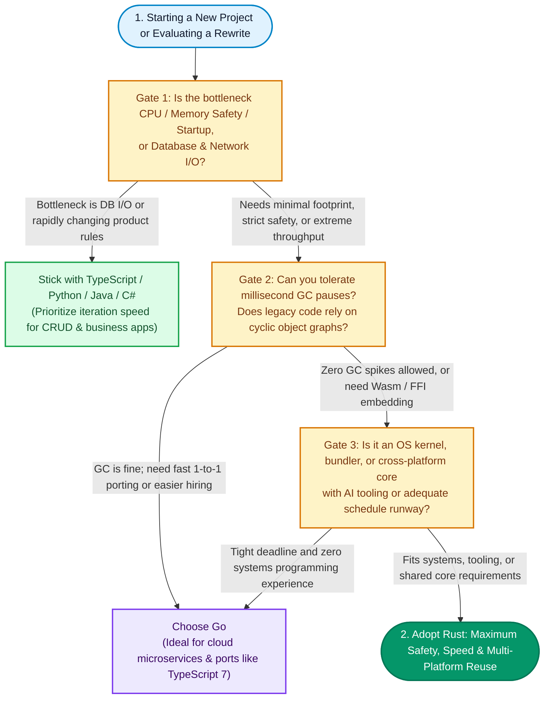

Whether you build web frontends, write Python scripts, or live inside desktop apps all day, it has become almost impossible to ignore **Rust** over the past two years. Frontend bundlers have shifted to Rust-powered tools like **Turbopack** and **Rolldown (Vite 8)**, Python developers have flocked to **uv** and **Ruff**, **Linux 7.0** officially dropped Rust's experimental tag, and in November 2026 **Discord** announced it is rebuilding its desktop client in **Rust** and leaving **Electron** behind.

**Rust is undeniably surging, but its growth is concentrated in specific layers of the stack: operating system kernels, high-throughput cloud infrastructure, developer toolchains, and cross-platform apps tired of high memory overhead and slow startup times.** Tech giants are willing to fund these rewrites because Rust delivers **compile-time memory safety** and **near-C performance** without relying on a garbage collector (GC). In 2026, a new catalyst accelerated the trend: AI coding agents paired with Rust's strict compiler have slashed the cost of large-scale migrations. Even so, Rust is not the universal answer for every codebase—Microsoft chose **Go** when rewriting the **TypeScript 7** compiler, and Cloudflare suffered a major global outage triggered by a single `unwrap()` in Rust.

<!--more-->

## How Popular Is Rust Really? Breaking Down Rankings and Developer Surveys

Many engineers notice a paradox: almost every week brings news of another flagship tool being "rewritten in Rust," yet job boards still list far more openings for Python, Java, or TypeScript. Looking at industry indices alongside developer surveys explains where Rust actually stands:

| Benchmark Source | Key Figures and Year-over-Year Trend |
| --- | --- |
| [TIOBE Index, November 2026](https://www.tiobe.com/tiobe-index/) | Ranked **11th** (**1.63%** share), up three spots from 14th a year earlier; held **10th place** for four consecutive months from July to October 2026 before **Go** edged past it in November |
| [Stack Overflow 2026 Developer Survey](https://survey.stackoverflow.co/2026/technology/data/languages) | **18.0%** of respondents reported extensive use of Rust over the past year, placing it **12th** among all programming languages |
| Stack Overflow 2025 Developer Survey | Voted the **Most Admired Language** for the ninth consecutive year, with **72%** of current users wanting to continue working with it |

Together, these numbers tell a clear story: **Rust is not climbing the charts through massive entry-level bootcamps or everyday CRUD websites—it is expanding through exceptional developer retention across systems software and developer tooling.** Even developers who never write a line of Rust themselves now run Rust binaries every time they bundle a frontend app, lint Python code, or spin up a serverless function.

## Why Are Tech Giants Switching to Rust? Five Core Engineering Reasons

Replacing a battle-tested production system with a new language is always a high-stakes bet. Why are Google, Microsoft, Cloudflare, GitHub, and Discord making that trade? Five practical engineering factors drive the shift:

### 1. Compile-Time Memory Safety Eliminates Entire Classes of Vulnerabilities

In operating systems, browser engines, and native libraries, C and C++ have long been the default choices for raw speed and hardware control. Yet manual memory management carries a steep security tax: both Microsoft and Google have documented that roughly **70% of severe security vulnerabilities** over the past several decades stem from memory safety flaws such as buffer overflows, use-after-free bugs, double frees, and data races. Native memory bugs—like the Brotli out-of-bounds write patched in the [Node.js October 2026 security releases](/en/2026/10/21/nodejs-october-2026-security-analysis/)—remain a constant threat in low-level C and C++ dependencies.

Rust solves this through **ownership**, its **borrow checker**, and **lifetimes**, shifting memory verification to compile time without adding runtime overhead. If a pointer could dangle or two threads could race on shared state without synchronization, the program simply refuses to compile.

According to [production data from Google's Android security team](https://blog.google/security/rust-in-android-move-fast-fix-things/), writing new system code in Rust pushed memory safety vulnerabilities **below 20% of all Android vulnerabilities for the first time**. Inside Android, Rust code exhibits roughly **one-thousandth the memory bug density** of C and C++, and because the compiler catches subtle errors early, Rust changes suffer a **4x lower rollback rate**.

### 2. Predictable Latency Without Garbage Collection (GC) Pauses

If memory safety is the goal, why not use Go, Java, C#, or JavaScript? For most web backends, those languages work great. However, they rely on a **garbage collector (GC)** that periodically scans memory and reclaims unused objects in the background. Under heavy concurrency or when holding millions of cached items in RAM, GC cycles introduce sudden latency spikes.

A classic example is **Discord's** decision in 2020 to migrate its **[Read States service from Go to Rust](https://discord.com/blog/why-discord-is-switching-from-go-to-rust)**. In the Go implementation, the runtime forced a garbage collection run every two minutes, creating regular latency spikes across the service. After rewriting the service in Rust—where memory is freed deterministically the moment a value goes out of scope—the latency spikes vanished, and CPU and memory usage dropped across the board.

### 3. Near-C Execution Speed and Millisecond Cold Starts

For command-line tools (CLIs), bundlers, and AI agent runtimes, startup speed and memory footprint directly shape user experience. Interpreted languages and heavy virtual machines spend precious seconds loading runtimes and warming up just-in-time (JIT) compilers.

In August 2026, **GitHub Copilot** migrated its agent runtime from TypeScript and Node.js to **[832,000 lines of Rust](https://github.blog/news-insights/product-news/migrating-the-github-copilot-runtime-to-rust-using-copilot/)**. As reported by [InfoQ](https://infoq.com/news/2026/10/github-copilot-rust-migration), the time required to start the runtime and complete a single conversation turn dropped from **5.25 seconds to 292 milliseconds**, while drastically shrinking memory consumption.

### 4. One Core Codebase Shared Across Platforms via FFI and WebAssembly

Modern products often ship across Windows, macOS, Linux, iOS, Android, and the web. Maintaining separate business logic in Swift, Kotlin, and TypeScript multiplies engineering cost and invites subtle behavior drift between platforms.

Because Rust compiles to native libraries without a bulky runtime, teams can expose a single Rust core to Python, Node.js, Swift, Kotlin, or Go through **FFI (Foreign Function Interface)**, and compile the exact same logic to **WebAssembly (Wasm)** for the browser. GitHub Copilot's Rust runtime serves SDKs across six programming languages from one codebase, and Discord's new client architecture follows the same blueprint.

### 5. The 2026 Catalyst: AI Coding Agents Plus a Strict Compiler Make Rewrites Economical

Historically, teams tolerated slow legacy systems because **human engineering time is the most expensive part of any rewrite**. In 2026, the combination of AI coding agents and Rust's compiler changed the math.

As discussed in our analysis of [Vibe Coding and the PR Review Bottleneck](/en/2026/08/26/vibe-coding-pr-review-engineering-shift/), AI-generated code in dynamic languages often looks plausible on the surface while hiding subtle type or state bugs. **Rust's strict type system and borrow checker act as a built-in automated verification gate for AI agents.** When an LLM generates invalid memory lifetimes or mismatched types, the Rust compiler rejects the code with detailed diagnostics, allowing the agent to iterate automatically until the build and test suite pass.

GitHub noted that porting the Copilot runtime to 832,000 lines of Rust would have traditionally required a full team working for one to two years. Instead, **a single engineer working with Copilot completed the bulk of the migration in roughly 14.5 weeks**.

## Major Projects Moving to Rust: Key Rewrites Across Four Domains

To give you a clear picture of where industry adoption is happening, here is a summary of notable enterprise and open-source migrations, followed by what drives each sector:

| Domain | Project or Company | What Changed and Measured Impact | Timeline |
| --- | --- | --- | --- |
| Operating Systems | **Linux Kernel** | [Linux 7.0](https://linuxiac.com/linux-kernel-7-0-released/) officially removed the "experimental" label, making Rust a permanent kernel language | April 2026 |
| Operating Systems | **Android** | Extensive Rust adoption in new system code pushed memory safety bugs [below 20% of total vulnerabilities](https://blog.google/security/rust-in-android-move-fast-fix-things/) | 2025 |
| Operating Systems | **Windows** | Font parser **DirectWriteCore** ported to 154,000 lines of Rust; **Win32k** GDI region code ships in production Windows ([Azure CTO Mark Russinovich](https://www.thestack.technology/rewriting-windows-in-rust/)) | 2025 |
| Operating Systems | **Ubuntu 26.04 LTS** | Switched to **sudo-rs** and Rust coreutils by default (**cp**, **mv**, and **rm** remain GNU versions) | April 2026 |
| Cloud Infrastructure | **Cloudflare** | Replaced NGINX with in-house Rust proxy [Pingora](https://blog.cloudflare.com/how-we-built-pingora-the-proxy-that-connects-cloudflare-to-the-internet/), handling over 1 trillion daily requests with **70% less CPU and 67% less memory** | Since 2022 |
| Cloud Infrastructure | **AWS** | Built **Firecracker**, the microVM powering AWS Lambda and Fargate, entirely in Rust | Since 2018 |
| Browsers | **Google Chrome** | Replaced the C-based FreeType library with the Rust font engine [Skrifa](https://developer.chrome.com/blog/memory-safety-fonts) for web fonts | 2025 |
| Developer Tools | **Vite 8** | Switched default bundler to Rust-based [Rolldown](https://vite.dev/blog/announcing-vite8), delivering **10x to 30x faster builds** | March 2026 |
| Developer Tools | **Next.js 16** | Made Rust-based [Turbopack](https://nextjs.org/blog/next-16) the default bundler | October 2025 |
| Developer Tools | **uv, Ruff** | High-speed Python package manager and linter; creator Astral [announced its acquisition by OpenAI](https://thenewstack.io/openai-astral-acquisition/) to join the Codex team | March 2026 |
| Developer Tools | **fish shell** | Completed a full port from C++ to Rust in version 4.0 | February 2025 |
| Developer Tools | **GitHub Copilot** | Rewrote agent runtime from TypeScript/Node.js into [832,000 lines of Rust](https://github.blog/news-insights/product-news/migrating-the-github-copilot-runtime-to-rust-using-copilot/), cutting startup plus first turn from 5.25s to 292ms | August 2026 |
| Cross-Platform Apps | **Discord** | Expanded Rust from backend and voice services to a full desktop rewrite dropping Electron (codenamed **Phoenix**) | 2018 to 2026 |

A clear pattern emerges across all four categories: **Rust is winning in foundational software that runs continuously at scale or sits on untrusted security boundaries—not in standard back-office CRUD applications.**

- **OS kernels and browsers use Rust to shrink their attack surface**: Components like font parsers (Windows **DirectWriteCore**, Chrome **Skrifa**) and privilege escalation utilities (Ubuntu **sudo-rs**) constantly parse complex, untrusted inputs. Historically prime targets for buffer overflow exploits, these modules gain strong memory guarantees in Rust.
- **Cloud providers use Rust to cut server bills**: When Cloudflare processes more than a trillion requests per day, cutting CPU by 70% and RAM by 67% with **Pingora** translates directly into tens of thousands of fewer servers and massive power savings.
- **Frontend and Python toolchains use Rust to eliminate developer wait times**: JavaScript and Python excel at application logic, but single-threaded interpreters bog down when parsing abstract syntax trees (ASTs) across tens of thousands of files. Parallelized Rust tools (**Rolldown**, **Turbopack**, **uv**, **Ruff**) turn multi-minute builds into sub-second operations.

## Deep Dive: Why Discord Is Dropping Electron and Rebuilding Its Desktop App in Rust

Among application companies, **Discord** offers the most complete example of adopting Rust from the backend all the way to the desktop UI.

Discord has used Rust in its backend infrastructure and voice pipelines since 2018. Yet the **Discord desktop app** used by millions of gamers and communities every day has long been built on **Electron**, bundling a full Chromium browser and Node.js runtime. While Electron allowed Discord to share React code across platforms, users have complained for years about bloated RAM usage exceeding 1 GB and sluggish startup times.

Even after Discord upgraded its client to **Electron 42** in September 2026—trimming median CPU usage by roughly **17%**—memory consumption actually ticked up by about **4%**. Optimizing around a bundled browser engine had hit a ceiling.

On **November 4, 2026**, Discord CTO Stanislav Vishnevskiy announced an internal rebuild codenamed **Phoenix**: Discord is [dropping Electron on the desktop](https://www.ghacks.net/2026/11/06/discord-is-rebuilding-its-desktop-app-in-rust-with-the-new-client-using-290-mb-of-ram/) and rebuilding the client in **Rust** using **GPUI**, the GPU-accelerated UI framework created by the **Zed editor** team.

| Dimension | Legacy Discord Client (Electron) | New Phoenix Client (Rust + GPUI) |
| --- | --- | --- |
| **Memory Footprint** | Commonly several hundred MB to over 1 GB | **290.2 MB** on Windows 11 with two accounts signed in (per CTO screenshot) |
| **Cold Startup Time** | Roughly **6 seconds** | Roughly **1 second** |
| **Mobile Architecture** | React Native | Removes React Native; keeps native iOS/Android UIs backed by shared Rust application logic |
| **Web Architecture** | Standard JavaScript and HTML | Keeps HTML rendering while compiling core logic to **WebAssembly** |
| **Rollout Status** | Current production release | Running internally; external testing slated to begin soon |

Discord's Phoenix architecture highlights a growing alternative to Electron: by writing shared state and business logic in **Rust** and pairing it with GPU-rendered native UI on desktop, native toolkits on mobile, and WebAssembly on the web, teams can preserve cross-platform code reuse without shipping a full browser in every desktop app.

## Rust Is No Silver Bullet: Real-World Counterexamples and Trade-Offs

With all of these success stories, should your team rewrite every new service in Rust? Not so fast. Every engineering tool carries trade-offs, and four real-world counterexamples show where Rust is the wrong fit:

### 1. Why Microsoft Chose Go Over Rust for the TypeScript 7 Compiler

While much of the JavaScript ecosystem embraced Rust for tooling, Microsoft surprised many developers by choosing **Go** rather than Rust to rewrite the native **[TypeScript](/en/2023/03/05/what-is-typescript/) 7** compiler (achieving a roughly 10x speedup).

The reasoning came down to architecture and migration risk. The existing TypeScript compiler relies heavily on **automatic garbage collection** and **cyclic abstract syntax tree (AST) data structures** where nodes reference parents, children, and symbols in complex graphs. Because Go also has a garbage collector and permits cyclic pointers, Microsoft engineers could port the existing TypeScript compiler almost file-by-file, preserving over a decade of subtle type-checking edge cases. Moving to Rust would have required redesigning the entire data model around the borrow checker, turning a direct port into a multi-year ground-up rewrite with a high risk of compatibility regressions.

### 2. Memory Safety Does Not Mean Bug-Free: Cloudflare's unwrap() Global Outage

A common misconception is that "if it compiles in Rust, it won't crash in production." On **November 18, 2025**, [Cloudflare's global outage](https://blog.cloudflare.com/18-november-2025-outage/)—its worst incident since 2019—proved otherwise.

The outage began when a configuration file exceeded a hardcoded size limit. When Cloudflare's Rust-based **FL2** proxy read the file and encountered the error result, a call to `unwrap()` caused the process to **panic and crash immediately**, taking down traffic worldwide. The lesson is critical: **Rust prevents memory corruption and data races, but it cannot protect a system from unhandled errors or flawed business logic.**

### 3. Slower Enterprise Adoption: Steep Learning Curves and Hiring Bottlenecks

Outside of systems vendors and developer tooling startups, mainstream enterprise adoption has been far more cautious. In April 2026, [DeveloperTech reported](https://www.developer-tech.com/news/rust-adoption-stalls-memory-safe-programming-trends/) that enterprise Rust adoption has slowed due to two practical hurdles: **a steep learning curve** and **a small pool of senior talent**.

Engineers coming from Java, C#, Go, or Python typically spend weeks fighting the borrow checker, lifetime annotations, and pin/async traits before becoming productive. For standard enterprise backends and e-commerce applications where latency is dominated by database queries and third-party REST APIs, Java, C#, and Go let teams hire faster and ship features much sooner.

### 4. Ecosystem Maturity and Separating Microsoft Rumors from Reality

While Rust's systems and CLI libraries are rock-solid, its GUI ecosystem is still evolving. For instance, **GPUI**—the framework Discord selected for Phoenix—has not yet reached version 1.0, requiring Discord's engineers to maintain their own internal patches.

Similarly, viral headlines claiming "Microsoft is rewriting all of Windows in Rust by 2030" misread an internal post by Microsoft engineer Galen Hunt. Hunt had described a goal to eliminate C and C++ by 2030 using AI and automated tooling, and later clarified that the effort is a **research project focused on migration tooling**, not a commitment to rewrite the entire Windows operating system in Rust.

## Decision Guide: Should Your Project Use Rust, Go, or Stay Put?

If you are evaluating whether to adopt Rust for a new service or rewrite, walk through the three decision gates in the flowchart below:

Here is a quick side-by-side reference for your architecture review:

| Great Fit for Rust | Better Served by Other Languages |
| --- | --- |
| **OS kernels, drivers, embedded firmware, and browser engines**: Direct hardware control where memory corruption is unacceptable | **Standard CRUD web apps and business back offices**: Fast-changing requirements where TypeScript, Python, Java, or Go ship features faster |
| **High-throughput proxies, real-time messaging, and databases**: Workloads like Cloudflare Pingora or Discord that cannot tolerate GC latency spikes | **Large existing codebases built around GC and cyclic graphs**: Like the TypeScript compiler, where a file-by-file port to Go avoids a risky redesign |
| **Compilers, bundlers, linters, and CLIs**: Tools like Vite Rolldown, uv, and Copilot CLI that demand instant startup and multi-core parallelism | **Projects on tight deadlines with no Rust experience**: Onboarding a team onto ownership and lifetimes mid-sprint can derail delivery |
| **Shared core logic across desktop, mobile, and web**: Write once in Rust and expose via FFI and WebAssembly | **I/O-bound services waiting on SQL queries or external APIs**: Rewriting in Rust will not speed up a slow database |

## Frequently Asked Questions (FAQ)

### Q1: Is Rust worth learning in 2026, and who benefits the most?

If your day job revolves around building standard web UIs or connecting business APIs, you do not need Rust to stay competitive. However, learning Rust pays high dividends for three groups of developers:
1. **Frontend and Python engineers who want to build or customize tooling**: With bundlers (Turbopack, Rolldown) and Python tools (uv, Ruff, Pydantic's core) written in Rust, knowing the language lets you contribute upstream or write native plugins.
2. **Indie developers building lightweight desktop or cross-platform apps**: Frameworks like Tauri and GPUI let you ship desktop apps that use a fraction of the RAM and disk space of Electron.
3. **Engineers who build heavily with AI coding agents**: Pairing an LLM with Rust's strict compiler enables solo developers to build reliable, high-performance systems software that previously required a dedicated team.

### Q2: Rust vs. Go: Are they direct competitors?

Although often compared, Rust and Go solve different problems. **Go** prioritizes simplicity, fast compile times, easy onboarding, and built-in garbage collection—making it ideal for cloud-native microservices, API gateways, infrastructure orchestration (Docker, Kubernetes), and rapid ports like TypeScript 7. **Rust** prioritizes zero-cost abstractions, predictable latency without GC, and compile-time memory safety—making it the clear choice for kernels, embedded systems, high-density proxies, and embeddable multi-platform runtimes.

### Q3: Will Rust completely replace C and C++?

Rust will not erase billions of lines of working legacy C and C++ overnight; rewriting stable production code without a clear business case rarely makes sense. However, with Linux 7.0 making Rust permanent and Android, Windows, and Chrome moving high-risk parsers to Rust, the industry consensus is clear: **write new low-level modules and security-critical parsers in Rust, while maintaining existing C/C++ and gradually replacing high-risk boundaries.**
