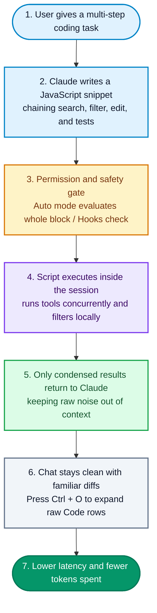

**Code Mode is an experimental opt-in feature in Claude Code that turns Claude from a walkie-talkie assistant—checking back after every single step—into an autonomous runner that writes one short JavaScript snippet to batch multiple tool calls together.** Instead of bouncing back and forth across separate turns to search files, edit code, and run tests, Claude chains and parallelizes the work inside a single step, cutting wait time and saving context tokens. Because it is still experimental, it starts off disabled and carries important caveats around session resuming and Auto mode review. [Official Claude Code Mode documentation](https://code.claude.com/docs/en/code-mode)

<!--more-->

## Why Does Code Mode Exist? Think of Grocery Errands by Walkie-Talkie

To understand what **Code Mode** fixes, imagine hiring a smart personal assistant to pick up soy sauce, greens, and garlic from a big supermarket for dinner.

In **standard tool-calling mode**, an AI behaves as if you are micromanaging it over a walkie-talkie. **After every tiny action, the assistant has to walk all the way back to your living room door to report what happened and wait for your next instruction before heading out again**:

1. You say, "Go check what soy sauces are on the shelf." The assistant walks to the store, photographs all 50 bottles and their nutrition labels, and dumps a massive stack of brochures on your coffee table.
2. You read through the pile and say, "Okay, buy the cheapest one." The assistant walks back to check out and returns with the receipt.
3. You say, "Now grab some greens." Another round-trip.
4. You say, "Now grab garlic." Yet another round-trip.

An errand that should have taken five minutes turns into four or five tiring back-and-forth trips. Inside **Claude Code**, that same sequential loop creates two familiar bottlenecks:

- **Context window clutter:** Searching a repository or reading raw logs pulls hundreds of lines of irrelevant output onto the model's working desk. Every extra line burns tokens and makes it harder for the model to stay focused.
- **Round-trip latency:** Each standalone **Grep**, **Read**, **Edit**, or **Bash** call forces another full inference pass before the next step can start, and independent tasks sit idle in line instead of running together.

**Code Mode flips the workflow.** Instead of giving orders step by step over a radio, Claude writes itself a short **JavaScript** checklist: scan the 50 soy sauce prices locally, pick the cheapest bottle right there in the aisle, grab the greens and garlic in the same trip, and walk back to your living room with only the chosen bottle and the final receipt. Your coffee table stays clean, and five round-trips collapse into **one**.

## What Does It Actually Look Like? Breaking Down the Official 4-Line Example

Suppose you ask Claude Code to locate a retry policy function in your source folder, raise its maximum attempts from 3 to 5, and verify the change with a targeted test.

With **Code Mode** turned on, Claude handles all of that in a single JavaScript block behind the scenes:

```javascript
const files = await $`rg -l "function retryPolicy" src`.text();
const target = files.trim().split("\n")[0];
await edit(target, "maxAttempts: 3", "maxAttempts: 5");
({ edited: target, tests: $`npm test -- retryPolicy`.nothrow() });
```

Even if you rarely write JavaScript, each line maps cleanly to plain English:

1. **Line 1 (Check the aisle):** Runs **rg** (ripgrep) across **src** to list files containing `function retryPolicy`. In standard mode, that entire raw output goes straight into the chat context; here, it stays inside a local variable.
2. **Line 2 (Pick the match):** Parses the string right inside the script and picks the first matching path as `target`, keeping intermediate noise out of Claude's context window.
3. **Line 3 (Make the edit):** Calls **edit** to replace `maxAttempts: 3` with `maxAttempts: 5` in that target file.
4. **Line 4 (Verify and report only what matters):** Runs `npm test -- retryPolicy` and returns only the edited filename and test result back to the conversation.

Here is the end-to-end flow in one vertical view:



This builds on the pattern Anthropic shared in its [November 2025 engineering post on code execution with MCP](https://www.anthropic.com/engineering/code-execution-with-mcp): rather than forcing language models to juggle dozens of tool schemas and raw payloads through chat turns, letting them express control flow in actual code taps straight into what coding models already do best.

## When Does Code Mode Shine? Everyday Analogies vs. Real Coding Tasks

You do not need Code Mode just to tweak one typo. Where it makes an immediate difference is any task involving repetition, heavy search filtering, or independent commands that do not need to wait on one another:

| Everyday Analogy | Real Claude Code Task | Why Code Mode Helps |
| :--- | :--- | :--- |
| **Reconciling 30 receipts at once** instead of asking your manager after every single slip | **Repetitive edits across dozens of files** (renaming a config key or updating an API signature everywhere) | Loops inside one script handle all edits in a single pass instead of 30 back-and-forth turns |
| **Highlighting only abnormal lab results** rather than reading 200 normal pages aloud | **Broad searches filtered before reading** (running **Grep** or **Glob** and trimming results in JS first) | Raw search clutter never reaches the context window, saving tokens and keeping reasoning sharp |
| **A chef boiling rice, stir-frying, and simmering soup together** instead of waiting for one pot at a time | **Running independent checks concurrently** (triggering linters and separate test suites in parallel) | Non-conflicting commands run together in one script block, cutting total wait time |

## Does It Clutter the Terminal? Press Ctrl + O to Peek Under the Hood

Hearing that Claude writes JavaScript for every multi-step action can raise a natural worry: will the terminal turn into an unreadable wall of generated glue scripts?

In practice, the main conversation stays clean. **Code Mode** tucks the underlying script away in the standard chat view and surfaces the familiar high-level results—such as clean file diffs—just as before.

Whenever you want to inspect the exact JavaScript Claude generated and ran, press **Ctrl + O** to open the transcript viewer. Each script execution appears as a collapsed **Code** row that you can expand anytime to audit what happened. For more terminal workflow shortcuts, see [Fun Claude Code Commands](/en/2026/10/14/claude-code-fun-commands/).

## How to Enable or Disable Code Mode (and Why Repo Configs Cannot Turn It On)

Because **Code Mode** is experimental and opt-in, it is **off by default**. You can test it for a single terminal launch or enable it globally in your user profile:

### Option 1: Try It for One Terminal Session

Pass the environment variable when launching **Claude Code** so everything resets once you close the terminal:

```bash
CLAUDE_CODE_EXPERIMENTAL_CODE_MODE=1 claude
```

To explicitly turn it off again in your shell, set it back to **0**:

```bash
export CLAUDE_CODE_EXPERIMENTAL_CODE_MODE=0
```

### Option 2: Enable It Globally in User Settings

To keep it turned on across sessions, add the variable under **env** in **~/.claude/settings.json** (or pass a settings file via **claude --settings**):

```json
{
  "env": {
    "CLAUDE_CODE_EXPERIMENTAL_CODE_MODE": "1"
  }
}
```

### Why Project Settings Files Cannot Enable Code Mode

There is an intentional security boundary here: **you cannot turn on Code Mode from project-level .claude/settings.json or .claude/settings.local.json files.**

Think of it like receiving a package in the mail with a sticky note inside that says "unlock your front door automatically"—your smart lock should ignore instructions coming from inside an untrusted parcel. In the same way, cloning an open-source repo should never let a repository's config file silently opt your agent into experimental script execution. Organization admins can also block or disable Code Mode centrally through managed settings, and any explicit **0** in your shell, user settings, or managed policy keeps it turned off.

## Four Limitations to Know Before Turning It On

Bundling tool calls into scripts speeds up multi-step tasks, but the official documentation highlights four clear constraints worth weighing first:

1. **Experimental status:** Code Mode is disabled by default and may change or be removed in a future release.
2. **Terminal-only session resume:** You can resume a Code Mode session **only inside the terminal with Code Mode enabled**. Switching to another surface or turning Code Mode off prevents resuming that session seamlessly.
3. **Coarser Auto mode review:** Under **Auto mode**, the background safety classifier normally evaluates each standalone tool call one by one—like an accountant signing off on individual receipts. With Code Mode active, the classifier instead evaluates **the entire generated JavaScript block as a single action**, more like approving a bundled purchase order all at once. Underlying permission rules (**allow**, **ask**, **deny**) and hooks still enforce boundaries.
4. **Blocking wait on long scripts:** Unless a long-running script is explicitly sent to the background, your session waits for the whole code block to finish before moving to the next turn.

## When Should You Use Code Mode vs. Stick With the Default?

**Code Mode lets a coding model orchestrate its tools using the medium it understands best—actual code—rather than playing twenty questions across chat turns.**

If your workflow leans heavily on cross-file refactors, noisy codebase searches that benefit from local filtering, or parallel test runs, running `CLAUDE_CODE_EXPERIMENTAL_CODE_MODE=1 claude` on a personal repo is an easy win. If you regularly hop between terminal and non-terminal interfaces when resuming sessions, or want Auto mode's classifier inspecting every tool call individually, keeping the default off makes more sense for now.

If you also coordinate multiple parallel terminal sessions, check out [Claude Code Cross-Session Messaging](/en/2026/08/09/claude-code-cross-session-messaging/), or read the [official Claude Code Mode documentation](https://code.claude.com/docs/en/code-mode) for the latest updates.
