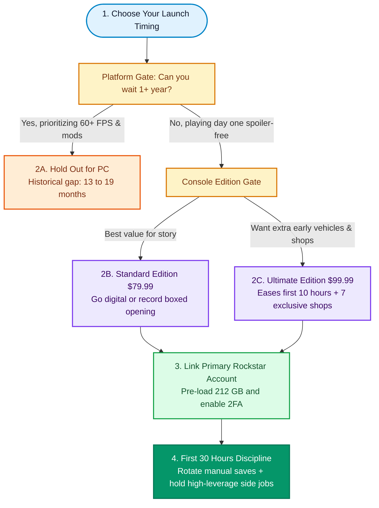

**Grand Theft Auto VI (GTA 6) launches on November 19, 2026, via a rolling local midnight rollout on PS5 and Xbox Series X|S, requiring roughly 212 GB of storage.** Standard Edition pricing rises to **$79.99**, physical retail boxes swap out the game disc for a one-time download voucher, every console targets **30 FPS**, and neither PC nor a new GTA Online mode arrives on day one. Aligning Rockstar's official launch specs with ten years of **GTA 5** and **Red Dead Redemption 2** pitfalls keeps your opening hours trouble-free.

<!--more-->

## Launch Times, Pre-Load Size & the Disc-Free Retail Reality

Everyone knows **November 19**, yet five official details dictate your budget, storage, and unlock clock. [Official Grand Theft Auto VI Portal](https://www.rockstargames.com/VI)

| Category | Official Specification | What It Means at Launch |
| :--- | :--- | :--- |
| Unlock Clock | **November 19, 2026**, rolling midnight local time | Opens at **12:00 AM local** (Nov 19, 00:00 in Taiwan UTC+8) |
| Platforms | **PS5** (PS5 Pro enhanced), **Xbox Series X\|S** | No PC or Nintendo release window announced at launch |
| Pre-Load | Rolling out from **Nov 10** (**Nov 12** in Asia), **212 GB** | Clear **220 GB+** of SSD space for day-one patches |
| Pricing | **Standard $79.99** / **Ultimate $99.99** | Breaks past the prior $69.99 AAA baseline |
| Retail Box | Standard retail is **Code-in-Box (voucher + poster)** | **Zero disc and zero resale value**; Ultimate is digital-only |

- **The Code-in-Box Tradeoff**: Because **212 GB** exceeds standard Blu-ray discs, [PlayStation Blog](https://blog.playstation.com/) and retailers confirm physical boxes ship with a **download voucher and poster**. Early shipments around Nov 12 allow pre-loading, but eliminate used-disc resale—and scattered buyers already reported missing or disputed codes, making an unbroken unboxing video essential.
- **Xbox vs. PS5 New Zealand Trick**: New Zealand daylight time (UTC+13) unlocks hours early (7:00 PM UTC+8 on Nov 18). Per [IGN](https://www.ign.com/), **Xbox** players can toggle location under **Settings → System → Language & Location**, while **PS5** ties unlocks strictly to the purchasing PSN store region—and bypassing store terms carries ToS risks.

## Standard ($79.99) vs. Ultimate ($99.99): What Does $20 Extra Buy?

Every purchase before **November 20, 2026** earns the **Vintage Vice City Pack**, bundling the **1955 Vapid Stanier Sedan and Garage**, retro outfits/hairstyles, a tropical weapon pattern, plus **one free month of GTA+** on eligible digital pre-orders.

Upgrading for **$20** to the **Ultimate Edition ($99.99)** unlocks rewards **gradually by story chapter**, preserving natural progression:

- **Vehicles**: The **'95 Grotti Cheetah**, **'67 Vapid Dominator Buggy**, **Shitzu Squalo** speedboat, Jason's safehouse **Dinka Enduro** dirt bike and **Crest Kayak**, plus a Vapid Ganado retro kit.
- **Custom Firearms**: Vercetti Estate **Hawk & Little Morgan** revolvers and custom skins for **Jason's Girardi ES9** and **Lucia's Klose K17**.
- **7 Exclusive Storefronts**: Access to **Rideout Customs**, **One-Eyed Willie's Mod Shop**, **Sara's Unisex Salon**, **Stock 305**, **Electric Fang Tattoo Parlor**, **Goodtime Gear**, and **PTT Youngin$ Compound**.

**Best Pick**: Looking at **GTA 5** and **RDR2** edition lifecycles, bonus gear shines during the **first 5 to 10 hours** before late-game shop supercars overtake them. Story-first players on a budget can safely grab the **Standard Edition** before Nov 20 and always buy the standalone digital Ultimate Upgrade later.

## Hardware Reality Check: Why Even PS5 Pro Targets 30 FPS

All consoles—**PS5**, **Xbox Series X|S**, and **PS5 Pro**—target **30 FPS** at launch with **no 60 FPS performance mode**.

As analyzed by [Digital Foundry and Eurogamer](https://www.eurogamer.net/), the wall is **CPU simulation density**: Rockstar dedicates massive budgets to **real-time ray-traced global illumination (RTGI)**, dense NPC crowds, traffic AI, water physics, and hurricane weather. Lowering resolution alone cannot double frame rates when simulation per frame is CPU-bound.

- **What PS5 Pro Delivers**: Sony's **PSSR** AI upscaling dramatically sharpens edges and foliage over base consoles, paired with exclusive **ray-traced shadows**.
- **DualSense Tuning**: GTA 6 integrates adaptive triggers, surface haptics, and **Tempest 3D AudioTech**; dialing trigger resistance down slightly in accessibility settings reduces fatigue during marathon sessions.

## Five Major Gameplay Shifts from the 27-Minute Extended Look

Premiering August 27, 2026—first for six hours on Netflix before YouTube, drawing **31.1 million views in four days** per [Variety](https://variety.com/)—**Grand Theft Auto VI: An Extended Look** and Rockstar North's Rob Nelson via [GameSpot](https://www.gamespot.com/) confirmed an **80-hour** core narrative campaign alongside five defining shifts:

1. **Trunk Loadouts Replace Magic Pockets**: Long guns stay slung over shoulders or stored in car trunks. Carrying loot bags changes animations (such as one-handed shotgun racks), while weapons automatically tuck low near civilians.
2. **Coordinated Dual Protagonists**: **Jason Duval** and **Lucia Caminos** swap dynamically, answer calls for backup, or take the wheel while you shoot from the passenger window—with downtime choices shaping their bond.
3. **Focus Slow-Motion Targeting**: A purple eye meter slows gunfights and marks **red fatal zones** vs. **yellow disarm targets**.
4. **Six-Star Heat & Hollow vs. Solid Stars**: **Hollow stars** signal police searching a last-seen perimeter or acting on vague descriptions like "a couple." **Swapping vehicles, changing clothes, and splitting up** outsmarts pursuit faster than raw speed alone.
5. **Live In-Game Social Feeds & Side Life**: Street chases hit an in-game short-video feed in real time, alongside gym/weight stats, dog interactions, scuba diving, kayaking, airboating, golf, pool, and hunting.

## Four Launch Pitfalls Analyzed Through GTA 5 & RDR2 History

With **GTA 5** nearing **235 million units shipped** in [Take-Two's November 2026 report](https://www.take2games.com/), four lessons from Rockstar's past decade form a clear launch roadmap:

### 1. How Long Will the PC Version Actually Take?

Rockstar historically skips PC on launch day: **GTA 5** took **19 months** (Sept 2013 to April 2015), and **RDR2** took roughly **13 months** (Oct 2018 to Nov 2019). If avoiding spoilers matters, waiting means sitting out over a year.

### 2. Cross-Platform Progression & Account Linking Traps

In **GTA 5**, Rockstar blocked transfers between PlayStation and Xbox, permanently ended PS3/Xbox 360 transfers on **March 6, 2017**, and kept later upgrades strictly inside the same console family (even temporarily deleting old-gen characters during early 2022 PS4-to-PS5 migrations). Link your **permanent, 2FA-enabled Rockstar Games Account** on day one rather than assuming console saves will automatically carry to PC later.

### 3. Why GTA 6 Ships Without Multiplayer

After GTA 5 pulled **$800 million on day one**, **GTA Online** buckled two weeks later under record traffic—forcing infinite loading loops, vanished characters, and a **GTA$ 500,000** apology payout. Keeping Nov 19 purely single-player avoids launch-week server crashes. Take-Two CEO Strauss Zelnick confirmed **GTA 5's GTA Online remains supported**, while industry expectations place GTA 6's new online ecosystem in **2027**.

### 4. The $2.1 Billion Lester Lesson: First 30 Hours Discipline

Players who rushed **Lester's Assassination Missions** early in GTA 5 missed multiplying endgame heist payouts via **BAWSAQ** and **LCN** stocks up to the **$2.14 billion cap**. Protect your first 30 hours in Leonida with three rules:

- **Rotate manual saves** before major heists or choices impacting business rivalries and Jason/Lucia's bond.
- **Pace early cosmetic spending**, prioritizing weapon mods and vehicle performance for the first 10–20 hours.
- **Pause before chain-clearing jobs** that visibly swing rival firms or financial payouts until you see how late-game scaling works.

## Final 48-Hour Pre-Launch Checklist

- **Clear 220 GB+ of SSD storage** for the **212 GB** install and day-one patch buffer.
- **Verify pre-load or film boxed opening** to protect digital voucher redemption.
- **Check Rockstar Account linking & 2FA** to receive your **1-month GTA+** trial smoothly.
- **Buy before November 20** to claim the **Vintage Vice City Pack** and **'55 Vapid Stanier**.
- **Tune DualSense trigger tension** before settling in for **30 FPS** across Leonida.
