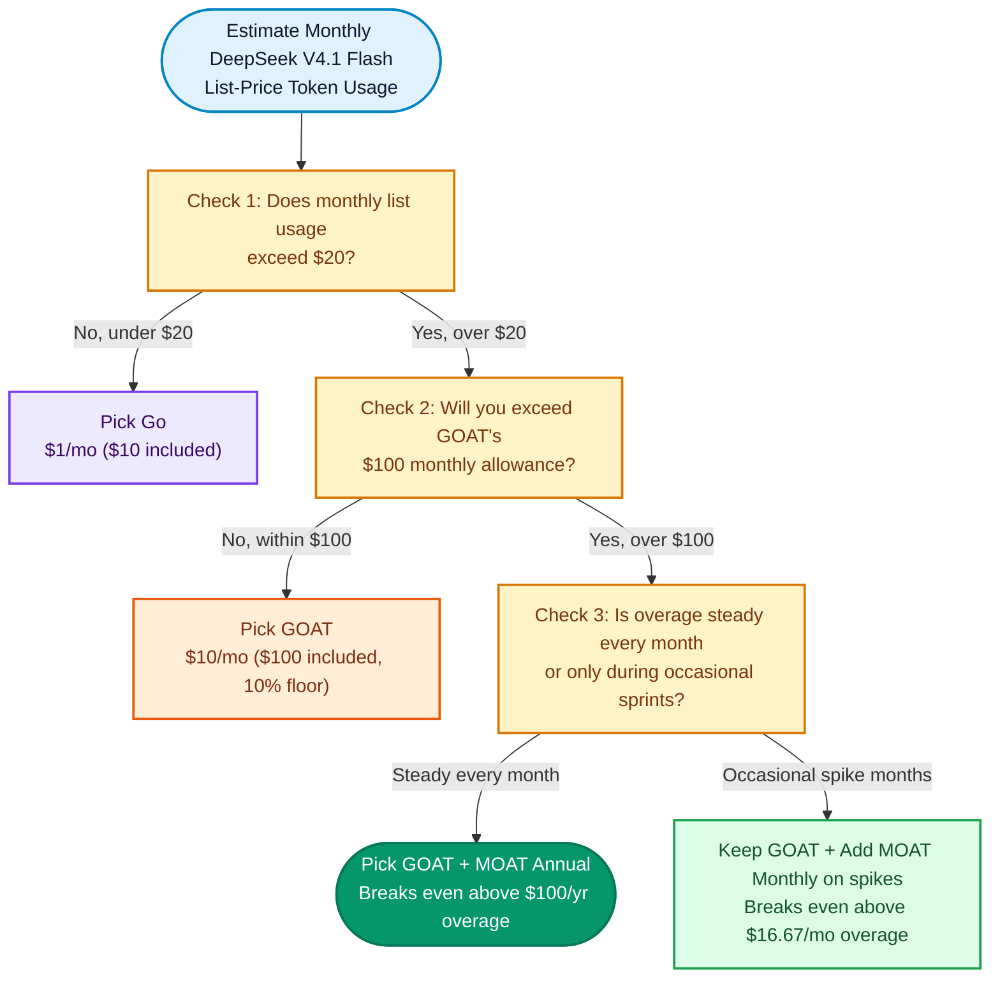

When developers first open **Command Code** pricing and see **Go**, **GOAT**, and **MOAT** side by side, the immediate question is almost always the same: do these plans replace each other, or should I skip GOAT and just buy MOAT? One everyday analogy clears it up in seconds: **Go and GOAT work like 90%-off prepaid gift cards with a monthly cap, whereas MOAT works like a Costco wholesale membership card—no free credits, 60% off every extra dollar you spend—and you can stack them together.**

Using pricing data as of **November 26, 2026** (all amounts in USD) with **DeepSeek V4.1 Flash** as the primary model, this guide breaks down real out-of-pocket costs, effective token discount curves, MOAT breakeven thresholds, and concrete monthly savings using interactive bar charts, multi-line graphs, a usage range diagram, and a decision flowchart—no complicated math required.

<!--more-->

## The Simple Analogy: 90%-Off Credit Packs vs a Wholesale Club Card

As we covered in our earlier guide on [how to buy AI subscriptions without overpaying](/en/2026/09/17/how-to-buy-ai-subscriptions-best-value/), two subscriptions with nearly identical monthly fees can deliver wildly different token value. Command Code splits its lineup into **Go**, **GOAT**, and **MOAT** because each tier solves a distinct piece of the bill:

- **Go ($1/mo) and GOAT ($10/mo) act like 90%-off prepaid packs**: Pay $1 to get $10 in list-price DeepSeek usage, or pay $10 to get $100. Inside that monthly allowance, your effective rate is just **10% of list price**. The catch: once your included bucket runs dry, extra tokens cost **full list price**.
- **MOAT ($60/yr = $5/mo avg, or $10/mo monthly) acts like a wholesale club card**: It includes **$0 in free credits**, but cuts your **DeepSeek V4.1 Flash** usage price by **60% (paying 40% of list price)**.
- **The superpower is stacking**: Subscribe to **Go + MOAT** or **GOAT + MOAT** together, and Command Code burns your 90%-off included monthly credits first, then automatically applies MOAT's 60% discount to every overage dollar after that.

```chart
{
  "type": "bar",
  "title": "Plan Value Bar Chart: Monthly Fee vs Included Monthly Credits",
  "subtitle": "See the 10x credit leverage on Go & GOAT versus MOAT ($0 included credits, 60% off overage)",
  "height": 340,
  "yPrefix": "$",
  "yMax": 120,
  "yStep": 20,
  "yLabel": "Monthly Amount (USD)",
  "showBarLabels": true,
  "legendPosition": "top",
  "labels": ["Go", "GOAT", "MOAT (Annual)", "Go + MOAT", "GOAT + MOAT"],
  "datasets": [
    {
      "label": "Monthly Membership Fee",
      "data": [1, 10, 5, 6, 15],
      "color": "#f97316",
      "labelColor": "#c2410c"
    },
    {
      "label": "Included List-Price Credits",
      "data": [10, 100, 0, 10, 100],
      "color": "#059669",
      "labelColor": "#047857"
    }
  ],
  "note": "Data as of 2026-11-26 | MOAT is also available monthly at $10/mo (cancel anytime); stacked plans burn included credits first."
}
```

Here is how all five combinations line up side by side:

| Plan | Monthly Fee | Annual Fee | Monthly Included Value | Annual Included Value | Overage Token Rate |
| :--- | ---: | ---: | ---: | ---: | ---: |
| **Go** | $1 | $12 | $10 | $120 | Full list price (100%) |
| **GOAT** | $10 | $120 | $100 | $1,200 | Full list price (100%) |
| **MOAT (Annual)** | $5 | $60 | $0 | $0 | 60% off (40% of list) |
| **Go + MOAT** | $6 | $72 | $10 | $120 | 60% off (40% of list) |
| **GOAT + MOAT** | $15 | $180 | $100 | $1,200 | 60% off (40% of list) |

Note that **MOAT** offers two billing options: **Annual ($60/yr, averaging $5/mo)** for steady heavy users, or **Monthly ($10/mo, cancel anytime)** if you only expect occasional spike months.

## The Shortcut Answer: Best Plan by Your Monthly Usage Tier

If you want the bottom line before diving into curves and tables, find your approximate monthly **list-price** DeepSeek V4.1 Flash usage on the interactive range bar below (hover or tap any segment for details; assumes Annual MOAT at $5/mo inside Command Code):

```chart
{
  "type": "range",
  "title": "Optimal Plan by Usage Range",
  "subtitle": "Monthly DeepSeek V4.1 Flash list-price usage (not to scale; based on Annual MOAT at $5/mo)",
  "defaultHint": "Hover or tap any segment above to inspect monthly and annual usage brackets.",
  "segments": [
    {
      "label": "Go",
      "weight": 21,
      "color": "#64748b",
      "detail": "Go ($1/mo): Best under $18.33/mo list usage (under $220/yr) for casual daily coding."
    },
    {
      "label": "Go + MOAT",
      "weight": 5.5,
      "color": "#ea580c",
      "callout": true,
      "detail": "Go + MOAT ($6/mo): Only wins in the razor-thin $18.33–$20/mo ($220–$240/yr) sliver, saving under $0.67/mo."
    },
    {
      "label": "GOAT",
      "weight": 43,
      "color": "#2563eb",
      "detail": "GOAT ($10/mo): Best from $20 to $108.33/mo ($240–$1,300/yr), hitting a 10% effective cost floor at $100/mo."
    },
    {
      "label": "GOAT + MOAT",
      "weight": 30.5,
      "color": "#059669",
      "detail": "GOAT + MOAT ($15/mo): Best above $108.33/mo (over $1,300/yr), combining 90%-off credits with 60%-off overages."
    }
  ],
  "ticks": [
    { "label": "$0", "align": "start" },
    { "label": "$18.33", "stagger": true },
    { "label": "$20", "align": "start", "dx": 2 },
    { "label": "$108.33" },
    { "label": "∞", "align": "end" }
  ],
  "note": "Note: Standalone MOAT has no winning bracket among these five options; at $100+/mo, stacking GOAT saves $30/mo over MOAT alone."
}
```

| Monthly List-Price Usage | Annual List-Price Usage | Best-Value Plan |
| ---: | ---: | :--- |
| Under $18.33 | Under $220 | **Go** |
| $18.33 – $20 | $220 – $240 | **Go + MOAT** |
| $20 – $108.33 | $240 – $1,300 | **GOAT** |
| Over $108.33 | Over $1,300 | **GOAT + MOAT** |

Two practical takeaways jump right off this map:

1. **In real life, almost everyone only needs to choose among Go, GOAT, and GOAT + MOAT**: **Go + MOAT** only wins in a razor-thin **$1.67/mo window** ($18.33 to $20), where it saves less than $0.67/mo at best. Most developers can safely ignore it and step straight from **Go** to **GOAT** to **GOAT + MOAT**.
2. **Standalone MOAT never wins among these five options**: Using $100 of list-price tokens on standalone MOAT costs $5 (fee) + $40 (tokens) = $45. Stacking GOAT adds only $10 in membership fees while covering the entire $100 bucket, dropping your total to $15. At $100/mo or more, **GOAT + MOAT permanently beats standalone MOAT by $30/mo ($360/yr)**.

## Effective Token Cost Curve: Why Heavy Users Always Stack

Staring only at the base subscription fee ($10 vs $15) hides the metric that actually protects your wallet: **what percentage of list price do you end up paying per token?**

**Average Cost Ratio = (Membership Fee + Extra Token Spend) / Total List-Price Usage × 100%**

Lower is better: **10%** means 90% off list price; **40%** means 60% off. Plotting all five plans (**Go**, **Go + MOAT**, **GOAT**, **GOAT + MOAT**, and **MOAT Annual**) on a true linear annual-usage scale makes every crossover unmistakable—hover any point to inspect exact percentages, or click the legend to toggle individual lines:

```chart
{
  "type": "line",
  "title": "Effective Token Cost Curve Across All 5 Plans ($120–$3,600/yr)",
  "subtitle": "True linear annual list-price scale; lower is cheaper. Click legend items below to toggle lines",
  "height": 380,
  "xType": "linear",
  "xMin": 120,
  "xMax": 3600,
  "xTicks": [120, 600, 1200, 1900, 2400, 3000, 3600],
  "xPrefix": "$",
  "xLabel": "Annual List-Price Token Usage (USD)",
  "yMin": 0,
  "yMax": 160,
  "yStep": 20,
  "ySuffix": "%",
  "yLabel": "Effective Cost (% of List Price)",
  "tooltipTitlePrefix": "Annual list usage ",
  "legendPosition": "bottom",
  "referenceLines": [
    { "axis": "y", "value": 40, "color": "#64748b", "label": "40% Asymptote (60% Off)", "labelAlign": "right" },
    { "axis": "x", "value": 1300, "color": "#d97706", "label": "$1,300 Breakeven (16.9%)", "labelBg": "#fffbeb", "labelColor": "#92400e", "labelYOffset": 4 },
    { "axis": "x", "value": 1900, "color": "#64748b", "label": "$1,900 GOAT = MOAT", "labelBg": "#f8fafc", "labelColor": "#334155", "labelYOffset": 34 }
  ],
  "datasets": [
    {
      "label": "Go",
      "color": "#2563eb",
      "data": [
        { "x": 120, "y": 10 }, { "x": 180, "y": 40 }, { "x": 220, "y": 50.91 }, { "x": 240, "y": 55 },
        { "x": 400, "y": 73 }, { "x": 600, "y": 82 }, { "x": 900, "y": 88 }, { "x": 1200, "y": 91 },
        { "x": 1300, "y": 91.69 }, { "x": 1900, "y": 94.32 }, { "x": 2400, "y": 95.5 }, { "x": 3600, "y": 97 }
      ]
    },
    {
      "label": "Go + MOAT",
      "color": "#16a34a",
      "data": [
        { "x": 120, "y": 60 }, { "x": 180, "y": 53.33 }, { "x": 220, "y": 50.91 }, { "x": 240, "y": 50 },
        { "x": 400, "y": 46 }, { "x": 600, "y": 44 }, { "x": 900, "y": 42.67 }, { "x": 1200, "y": 42 },
        { "x": 1300, "y": 41.85 }, { "x": 1900, "y": 41.26 }, { "x": 2400, "y": 41 }, { "x": 3600, "y": 40.67 }
      ]
    },
    {
      "label": "GOAT",
      "color": "#ea580c",
      "data": [
        { "x": 120, "y": 100 }, { "x": 180, "y": 66.67 }, { "x": 220, "y": 54.55 }, { "x": 240, "y": 50 },
        { "x": 400, "y": 30 }, { "x": 600, "y": 20 }, { "x": 900, "y": 13.33 }, { "x": 1200, "y": 10 },
        { "x": 1300, "y": 16.92 }, { "x": 1900, "y": 43.16 }, { "x": 2400, "y": 55 }, { "x": 3600, "y": 70 }
      ]
    },
    {
      "label": "GOAT + MOAT",
      "color": "#d97706",
      "borderWidth": 3.4,
      "data": [
        { "x": 120, "y": 150 }, { "x": 180, "y": 100 }, { "x": 220, "y": 81.82 }, { "x": 240, "y": 75 },
        { "x": 400, "y": 45 }, { "x": 600, "y": 30 }, { "x": 900, "y": 20 }, { "x": 1200, "y": 15 },
        { "x": 1300, "y": 16.92 }, { "x": 1900, "y": 24.21 }, { "x": 2400, "y": 27.5 }, { "x": 3600, "y": 31.67 }
      ]
    },
    {
      "label": "MOAT (Annual)",
      "color": "#7c3aed",
      "data": [
        { "x": 120, "y": 90 }, { "x": 180, "y": 73.33 }, { "x": 220, "y": 67.27 }, { "x": 240, "y": 65 },
        { "x": 400, "y": 55 }, { "x": 600, "y": 50 }, { "x": 900, "y": 46.67 }, { "x": 1200, "y": 45 },
        { "x": 1300, "y": 44.62 }, { "x": 1900, "y": 43.16 }, { "x": 2400, "y": 42.5 }, { "x": 3600, "y": 41.67 }
      ]
    }
  ],
  "note": "Beyond $3,600/yr, standalone GOAT drifts toward 100% list price while GOAT + MOAT stays capped below 40%."
}
```

| Annual List-Price Usage | GOAT | MOAT (Annual) | GOAT + MOAT (Annual) |
| ---: | ---: | ---: | ---: |
| $600 | **20%** | 50% | 30% |
| $1,200 | **10%** | 45% | 15% |
| $1,300 | **16.92%** | 44.62% | **16.92%** |
| $1,500 | 28% | 44% | **20%** |
| $1,900 | 43.16% | 43.16% | **24.21%** |
| $2,400 | 55% | 42.5% | **27.5%** |
| $3,600 | 70% | 41.67% | **31.67%** |
| $6,000 | 82% | 41% | **35%** |
| $12,000 | 91% | 40.5% | **37.5%** |
| Approaching infinity | 100% | 40% | **40%** |

Three turning points tell the whole story:

- **$1,200/yr ($100/mo) — GOAT's sweet spot**: Filling GOAT's included quota without going over drives your effective token cost down to **10% (90% off)**. Paying for MOAT here without overage wastes $60/yr, nudging cost up to 15%.
- **$1,300/yr ($108.33/mo) — The GOAT vs GOAT + MOAT breakeven**: Because standalone GOAT charges full list price past $1,200, its orange curve climbs steeply. At exactly $1,300/yr, both plans tie at **16.92%**, and from there **GOAT + MOAT pulls far ahead**.
- **$1,900/yr (~$158/mo) — Standalone GOAT loses even to standalone MOAT**: GOAT's effective cost hits **43.16%**, matching standalone MOAT, while **GOAT + MOAT sits comfortably at 24.21%**. At extreme scale, standalone GOAT drifts toward **100% full price**, while GOAT + MOAT stays capped below **40%**.

## MOAT Breakeven Math: Only Two Numbers to Remember

Already paying for **GOAT** and wondering when adding **MOAT** actually pays for itself?

With **Annual MOAT**, you pay an extra **$5/mo** ($60/yr) in membership fees to save **60%** on every dollar of overage:

- **Annual overage breakeven**: $60 ÷ 60% = **$100 in overage list-price usage per year**.
- **Monthly average overage breakeven**: $5 ÷ 60% = **$8.33 in overage usage per month**.
- **Total monthly usage breakeven**: $100 included + $8.33 overage = **$108.33 in list-price usage**.

Here is what the actual credit-card bill looks like right at that crossover point:

| Monthly Line Item | GOAT Only | GOAT + MOAT (Annual) |
| :--- | ---: | ---: |
| GOAT Membership Fee | $10 | $10 |
| MOAT Membership Fee | $0 | $5 |
| Included Token Allowance | $100 | $100 |
| Extra List-Price Token Usage | $8.33 | $8.33 |
| Actual Cost of Extra Tokens | $8.33 | $3.33 |
| **Actual Out-of-Pocket Bill** | **$18.33** | **$18.33** |
| Total List-Price Token Value | $108.33 | $108.33 |

Notice the key distinction: **$108.33 is the list-price value of the tokens you consumed, not what you paid**. Your real out-of-pocket spend at breakeven is only **$18.33/mo** on both plans. Every overage dollar beyond $8.33 immediately puts money back in your pocket.

### Annual vs Monthly MOAT: Steady Heavy Use vs Sprint Months

If $100/mo covers your normal workflow and you only spike during big launches or major refactors, compare **Annual MOAT ($5/mo avg)** against **Monthly MOAT ($10/mo, cancel anytime)**. Zooming into the $100–$160/mo range shows both exact breakeven intersections at a glance:

```chart
{
  "type": "line",
  "title": "MOAT Annual vs Monthly Breakeven Line Chart ($100–$160 Zoom)",
  "subtitle": "Exact crossover points for GOAT users: Annual breaks even at +$8.33 overage, Monthly at +$16.67",
  "height": 340,
  "xType": "linear",
  "xMin": 100,
  "xMax": 160,
  "xStep": 10,
  "xPrefix": "$",
  "xLabel": "Total Monthly List-Price Usage (USD)",
  "yMin": 0,
  "yMax": 75,
  "yStep": 15,
  "yPrefix": "$",
  "yLabel": "Actual Monthly Spend (USD)",
  "tooltipTitlePrefix": "Monthly list usage ",
  "legendPosition": "top",
  "referenceLines": [
    { "axis": "x", "value": 108.33, "color": "#059669", "label": "Annual Breakeven $108.33 ($18.33 bill)", "labelBg": "#ecfdf5", "labelColor": "#065f46", "labelYOffset": 4 },
    { "axis": "x", "value": 116.67, "color": "#2563eb", "label": "Monthly Breakeven $116.67 ($26.67 bill)", "labelBg": "#eff6ff", "labelColor": "#1e40af", "labelYOffset": 34 }
  ],
  "datasets": [
    {
      "label": "GOAT Only ($10/mo)",
      "color": "#ea580c",
      "data": [
        { "x": 100, "y": 10 }, { "x": 108.33, "y": 18.33 }, { "x": 116.67, "y": 26.67 },
        { "x": 130, "y": 40 }, { "x": 140, "y": 50 }, { "x": 150, "y": 60 }, { "x": 160, "y": 70 }
      ]
    },
    {
      "label": "GOAT + MOAT Monthly ($20/mo)",
      "color": "#2563eb",
      "dash": [6, 4],
      "data": [
        { "x": 100, "y": 20 }, { "x": 108.33, "y": 23.33 }, { "x": 116.67, "y": 26.67 },
        { "x": 130, "y": 32 }, { "x": 140, "y": 36 }, { "x": 150, "y": 40 }, { "x": 160, "y": 44 }
      ]
    },
    {
      "label": "GOAT + MOAT Annual ($15/mo)",
      "color": "#059669",
      "borderWidth": 3.4,
      "data": [
        { "x": 100, "y": 15 }, { "x": 108.33, "y": 18.33 }, { "x": 116.67, "y": 21.67 },
        { "x": 130, "y": 27 }, { "x": 140, "y": 31 }, { "x": 150, "y": 35 }, { "x": 160, "y": 39 }
      ]
    }
  ]
}
```

| Metric | MOAT Annual | MOAT Monthly |
| :--- | ---: | ---: |
| Monthly MOAT Cost | $5 | $10 |
| Combined GOAT + MOAT Monthly Fee | $15 | $20 |
| DeepSeek V4.1 Flash Overage Discount | 60% off | 60% off |
| **Monthly Overage Breakeven** | **$8.33** | **$16.67** |
| Total Monthly List-Price Breakeven | $108.33 | $116.67 |
| Actual Monthly Bill at Breakeven | $18.33 | $26.67 |

The rule is simple: choose **Annual** if you consistently exceed GOAT every month; keep **GOAT** alone and flip on **Monthly MOAT** only during heavy sprint months when overage top-ups will clear **$16.67**.

## Real-World Dollar Savings: How Much Does GOAT + MOAT Save?

Percentages are helpful, but real dollars on your monthly invoice make the gap unmistakable. Both interactive bar charts below use **GOAT + MOAT Annual** (including all subscription fees and overage spend):

```chart
{
  "type": "bar",
  "title": "Actual Monthly Spend Bar Chart (GOAT vs GOAT + MOAT Annual)",
  "subtitle": "Includes membership fees and extra token top-ups; lower bars mean smaller monthly bills",
  "height": 330,
  "yPrefix": "$",
  "yMax": 1050,
  "yStep": 200,
  "xLabel": "Monthly List-Price Token Usage",
  "yLabel": "Actual Monthly Bill (USD)",
  "showBarLabels": true,
  "legendPosition": "top",
  "labels": ["$100", "$108.33", "$120", "$150", "$200", "$300", "$500", "$1,000"],
  "datasets": [
    {
      "label": "GOAT Only Bill",
      "data": [10, 18.33, 30, 60, 110, 210, 410, 910],
      "color": "#fb923c",
      "labelColor": "#c2410c"
    },
    {
      "label": "GOAT + MOAT (Annual) Bill",
      "data": [15, 18.33, 23, 35, 55, 95, 175, 375],
      "color": "#059669",
      "labelColor": "#047857"
    }
  ]
}
```

```chart
{
  "type": "bar",
  "title": "Net Annual Savings Bar Chart With Annual MOAT",
  "subtitle": "Positive values show annual dollars saved; negative reflects the extra fee below breakeven",
  "height": 300,
  "yPrefix": "$",
  "yShowPlus": true,
  "yMin": -800,
  "yMax": 7200,
  "yStep": 2000,
  "xLabel": "Monthly List-Price Token Usage",
  "yLabel": "Net Annual Savings (USD)",
  "showBarLabels": true,
  "zeroLabel": "Even $0",
  "showLegend": false,
  "labels": ["$100", "$108.33", "$120", "$150", "$200", "$300", "$500", "$1,000"],
  "datasets": [
    {
      "label": "Annual Savings",
      "data": [-60, 0, 84, 300, 660, 1380, 2820, 6420],
      "backgroundColor": ["#ef4444", "#d97706", "#10b981", "#10b981", "#10b981", "#10b981", "#059669", "#047857"],
      "labelColors": ["#b91c1c", "#b45309", "#047857", "#047857", "#047857", "#047857", "#047857", "#065f46"]
    }
  ]
}
```

| Monthly List-Price Usage | GOAT Actual Spend | GOAT + MOAT Actual Spend | Monthly Savings | Annual Savings |
| ---: | ---: | ---: | ---: | ---: |
| $100 | $10 | $15 | -$5 | -$60 |
| $108.33 | $18.33 | $18.33 | ~$0 | ~$0 |
| $120 | $30 | $23 | **$7** | **$84** |
| $150 | $60 | $35 | **$25** | **$300** |
| $200 | $110 | $55 | **$55** | **$660** |
| $300 | $210 | $95 | **$115** | **$1,380** |
| $500 | $410 | $175 | **$235** | **$2,820** |
| $1,000 | $910 | $375 | **$535** | **$6,420** |

The savings compound fast once you run agentic coding workflows heavily:

- **At $200/mo list usage**: Standalone GOAT costs **$110**, while GOAT + MOAT cuts your bill in half to **$55**—saving **$660/yr**.
- **At $500/mo list usage**: Standalone GOAT climbs to **$410**, while GOAT + MOAT drops it to **$175**—saving **$2,820/yr**.
- **At $1,000/mo list usage**: Standalone GOAT hits **$910**, while GOAT + MOAT keeps it at **$375**—saving **$6,420/yr**.

## 30-Second Decision Flowchart: Pick Your Ideal Plan

Still weighing your options? Walk down three quick checkpoints to land on the optimal subscription:



In four quick lines:

- **Light users**: Pick **Go** ($1/mo) for the lowest entry cost.
- **Moderate users**: Pick **GOAT** ($10/mo for $100 in DeepSeek list usage)—the single highest-value sweet spot.
- **Heavy users**: Pick **GOAT + MOAT (Annual)** to combine GOAT's 90%-off allowance with MOAT's 60%-off overage rate.
- **Bursty heavy users**: Keep **GOAT**, and toggle on **MOAT Monthly** only in high-volume months.

If you already subscribe to GOAT, remember just two rules of thumb:

**If your annual overage top-ups at list price exceed $100, Annual MOAT pays for itself.**

**If a single month's overage top-ups at list price exceed $16.67, Monthly MOAT pays for itself.**

Ultimately, **MOAT is not designed to replace GOAT—it is built to slash your overage token bills by 60% once GOAT's monthly bucket runs out.** If you are also comparing broader coding agent ecosystems and model quality before locking in a stack, check out our [Claude Code vs Codex vs Cursor comparison](/en/2026/05/06/claude-code-vs-codex-vs-cursor/) and [Artificial Analysis LLM benchmark guide](/en/2026/08/17/artificial-analysis-definitive-guide-llm-selection/).

## 7 Important Caveats Before You Subscribe

Before pulling out your card, keep these seven practical terms in mind:

1. **Single-model scope**: All figures above apply specifically to **DeepSeek V4.1 Flash**; included quotas and MOAT discount rates may differ for other models.
2. **Promotional continuity assumption**: Annual figures assume current promotional pricing remains unchanged all year and are not a guaranteed fixed yearly quota.
3. **Rolling rate limits**: Included **Go** and **GOAT** allowances reset monthly and are subject to **5-hour and weekly usage caps**; paid overage tokens are not subject to those window limits.
4. **Provider API eligibility**: **Go**'s included allowance cannot be used via the Provider API, whereas **GOAT** supports Provider API usage.
5. **Pay-as-you-go alternative**: If your monthly usage is tiny (well under $1), paying directly as you go without a subscription can be cheaper.
6. **Excluded costs and tiers**: This analysis excludes other tiers such as **Pro** and **Max**, as well as card processing fees, taxes, and FX conversion spreads.
7. **Uneven monthly usage**: Annual comparisons assume steady monthly consumption; if your workload swings sharply from month to month, judge MOAT breakeven based on your **actual overage top-up spend** rather than annualized averages.

## References

- [Command Code MOAT Membership](https://commandcode.ai/zh/moat)
- [Command Code Go Plan Docs](https://commandcode.ai/docs/plans/go)
- [Command Code GOAT Plan Docs](https://commandcode.ai/docs/plans/goat)
- [Command Code Official Pricing](https://commandcode.ai/pricing)
- [Command Code Provider API Docs](https://commandcode.ai/docs/provider)
- [Command Code Usage Limits](https://commandcode.ai/docs/resources/usage-limits)
