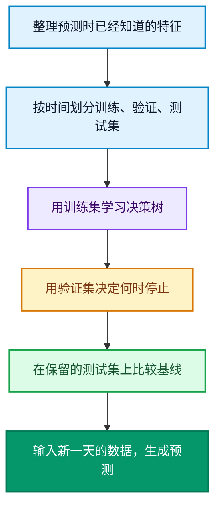

LightGBM 能从已有的表格数据中学习规律，用来预测新样本的结果。比如你开了一家咖啡店，记录了每天的气温预报、促销安排和实际销量，就可以尝试预测：“周六预计 28 度，还有促销，该准备多少杯？”

这篇教程围绕这个问题，讲清模型在学什么、代码怎么写，以及怎样判断预测是否有用。理解原理不需要微积分，动手部分只需要会运行基础 Python 代码。

<!--more-->

## 先把业务问题变成一张表

下面是**用于解释字段的虚构数据，不是后面代码的运行结果**：

| 星期 | 当天的气温预报 | 是否促销 | 实际售出杯数 |
| --- | --- | --- | --- |
| 周一 | 24 度 | 否 | 150 |
| 周六 | 28 度 | 是 | 220 |
| 周日 | 20 度 | 否 | 165 |

一行就是一天的记录。前三列是预测时可以提供的**特征**，代码里通常记作 **X**；最后一列是想预测的**目标值或标签**，记作 **y**。

**训练**时，把 X 和已知的 y 一起交给模型，让它学习规律。**预测**时，只输入新一天的 X，模型返回预计销量。还没发生的实际销量，不能提前混进输入字段。

这种用“带答案的历史样本”学习的方法，叫**监督学习**。LightGBM 可以处理下面三类任务，[官方 Python API](https://lightgbm.readthedocs.io/en/stable/Python-API.html) 提供了各自的接口。

| 业务问题 | 任务类型 | Python 接口 |
| --- | --- | --- |
| 明天能卖多少杯？ | 回归，预测数值 | **LGBMRegressor** |
| 用户会不会再次购买？ | 分类，预测类别或概率 | **LGBMClassifier** |
| 同一次搜索的商品如何排序？ | 排序，学习相对次序 | **LGBMRanker** |

排序还要按查询组织候选样本，不能把销量示例里的类名换一下就直接使用。我们先从最容易理解的销量回归开始。

## 它怎么学习？先用树找规则，再逐步纠正偏差

把**决策树**想象成一连串问题：“今天有促销吗？”“气温高于某个值吗？”每问一次，就把历史样本分成不同组，最后输出一个数值。这些问题、阈值和输出值，都是训练时从数据中学出来的。

LightGBM 的默认训练方式会依次加入多棵树。新加入的树根据当前整个模型的不足，学习该往哪个方向修正。这就是**梯度提升**最直观的含义。

对于平方误差回归，可以先把修正方向理解为“真实值减去当前预测值”，也就是残差。分类或其他任务使用相应损失函数的梯度来确定修正方向。[scikit-learn 的梯度提升文档](https://scikit-learn.org/stable/modules/ensemble.html#gradient-boosted-trees) 给出了更完整的解释。

假设某天实际卖了 130 杯。下面的数字**只是原理示意**：

| 阶段 | 本次修正 | 累计预测 |
| --- | --- | --- |
| 初始预测 | 从 100 杯起步 | 100 杯 |
| 第一棵修正树 | 增加 20 杯 | 120 杯 |
| 第二棵修正树 | 增加 8 杯 | 128 杯 |

这里的修正量已经包含学习率的缩放。真实训练要同时照顾很多条样本，新树可能调高预测，也可能调低预测；验证集误差不一定每轮都变好。

训练完成后，这些树组成一个模型。预测新记录时，模型沿着各棵树的规则计算，再合并它们的贡献，无需为每条新记录重新训练。

## LightGBM 为什么注重训练效率？

先记住两个设计：

- **直方图分箱**：把连续特征归入较少的区间，减少寻找分裂点时的计算量和内存开销。
- **优先分裂收益最大的叶子节点**：每次选择最能降低训练损失的位置继续生长，不要求整层同时展开。这叫 **leaf-wise** 生长。

[LightGBM 官方功能文档](https://lightgbm.readthedocs.io/en/stable/Features.html) 介绍了这两种机制。叶子节点就是一条路径的终点，负责给出数值。如果分得过细，模型可能连少量样本的偶然特点也记下来，出现**过拟合**。

具体速度和效果仍然需要在自己的数据上测量。样本太少、字段没有预测信号，或者未来的情况发生变化，都会影响模型表现。

## 开始写代码前，先留好三份数据

我们的目标是预测未来销量，因此按时间顺序切分 1000 天的数据：前 700 天训练，中间 150 天验证，最后 150 天测试。



**训练集是练习题，验证集是练习过程中的测验，测试集是最后才打开的试卷。** 早停和调参都看验证集。反复根据测试集成绩调整模型，会让最后的评估失去客观性。

本例只做一次时间划分，目的是学会流程。实际项目还可以用多个时间窗口回测；[TimeSeriesSplit 官方文档](https://scikit-learn.org/stable/modules/generated/sklearn.model_selection.TimeSeriesSplit.html) 解释了为什么时间序列需要这种评估方式。

## Python 实战：完整跑通一次销量预测

示例会**直接生成模拟数据**，不用另外下载数据集。我们人为设置气温、周末和促销对销量的影响，再加入随机噪声，用来观察模型能否学到这些关系。

### 1. 安装依赖，创建示例文件

先准备 Python 3.12。如果还没创建虚拟环境，运行 **python -m venv .venv**。macOS／Linux 用 **source .venv/bin/activate** 激活；Windows PowerShell 用 **.venv\Scripts\Activate.ps1** 激活。

在已激活的环境中安装：

```bash
python -m pip install lightgbm==4.7.0 pandas==3.0.6 scikit-learn==1.9.1
```

如果 macOS 导入时报 OpenMP 缺失，按[官方安装说明](https://github.com/lightgbm-org/LightGBM/tree/main/python-package#installation) 安装 **libomp**。

把接下来的三段 Python 按顺序放进同一个 **lightgbm_coffee_demo.py**，或者[下载完整示例代码](lightgbm_coffee_demo.py)。运行 **python lightgbm_coffee_demo.py** 即可。

### 2. 准备特征 X 和目标值 y

```python
import numpy as np
import pandas as pd
import lightgbm as lgb
from sklearn.dummy import DummyRegressor
from sklearn.metrics import mean_absolute_error

rng = np.random.default_rng(42)
n = 1000
dates = pd.date_range("2024-01-01", periods=n, freq="D")
X = pd.DataFrame({
    "day_of_week": dates.dayofweek,
    "forecast_temp": rng.uniform(10, 35, n),
    "promotion": rng.integers(0, 2, n),
})
y = pd.Series(np.maximum(0, np.round(
    80 + 3 * X["forecast_temp"]
    + 20 * (X["day_of_week"] >= 5)
    + 35 * X["promotion"]
    + rng.normal(0, 8, n)
)), name="cups_sold")
```

**day_of_week** 用 0 表示周一，6 表示周日；**promotion** 用 0／1 表示没有／有促销。**forecast_temp** 模拟的是预测时已获取的气温预报。

生成 y 的公式是为教学设计的。**模型只会拿到 X 和 y，并不知道这条生成公式。** 换成实际项目时，这些字段来自历史业务记录。

### 3. 划分数据并训练模型

```python
X_train, y_train = X.iloc[:700], y.iloc[:700]
X_valid, y_valid = X.iloc[700:850], y.iloc[700:850]
X_test, y_test = X.iloc[850:], y.iloc[850:]

model = lgb.LGBMRegressor(
    objective="regression", metric="mae",
    n_estimators=800, learning_rate=0.05,
    num_leaves=15, min_child_samples=20,
    random_state=42, n_jobs=2, verbosity=-1,
)
model.fit(
    X_train, y_train,
    eval_X=X_valid, eval_y=y_valid,
    callbacks=[lgb.early_stopping(30, verbose=False)],
)
```

**fit** 执行训练，**eval_X／eval_y** 指定验证数据。**early_stopping(30)** 的意思是：验证 MAE 连续 30 轮没有改善就停止训练，同时记录最佳轮次。早停需要验证集，[官方回调文档](https://lightgbm.readthedocs.io/en/stable/pythonapi/lightgbm.early_stopping.html) 解释了具体条件。

本文固定使用 **LightGBM 4.7.0**。这个版本引入 **eval_X／eval_y**，并弃用旧的 **eval_set** 参数；老版本可能不认识新参数，所以请先对齐依赖版本。[对应 API 文档](https://lightgbm.readthedocs.io/en/stable/pythonapi/lightgbm.LGBMRegressor.html#lightgbm.LGBMRegressor.fit)

### 4. 比较误差，再预测一个新样本

```python
baseline = DummyRegressor(strategy="mean")
baseline.fit(X_train, y_train)
baseline_mae = mean_absolute_error(y_test, baseline.predict(X_test))
model_mae = mean_absolute_error(y_test, model.predict(X_test))
print(f"Baseline MAE: {baseline_mae:.2f} cups")
print(f"LightGBM MAE: {model_mae:.2f} cups")
print(f"Best iteration: {model.best_iteration_}")

tomorrow = pd.DataFrame({
    "day_of_week": [5],
    "forecast_temp": [28.0],
    "promotion": [1],
})
print(f"New-day prediction: {model.predict(tomorrow)[0]:.1f} cups")
```

这里的 **DummyRegressor** 始终预测训练集的平均销量，提供一个最简单的[基线模型](https://scikit-learn.org/stable/modules/generated/sklearn.dummy.DummyRegressor.html)。**predict** 则把新样本的特征转换成预计销量。

## 如何理解运行结果？

2026 年 10 月 17 日，我们在 Python 3.12.10、LightGBM 4.7.0、pandas 3.0.6、scikit-learn 1.9.1 和 NumPy 2.5.4 环境实际运行了代码，输出如下：

```text
Baseline MAE: 24.40 cups
LightGBM MAE: 7.15 cups
Best iteration: 104
New-day prediction: 220.3 cups
```

**MAE 是平均绝对误差，越小越好。** 7.15 杯表示在这 150 个测试日里，预测与实际销量的绝对差平均为 7.15 杯。它不表示每天最多错 7.15 杯，更不能换算成“准确率 92.85%”。[MAE 官方定义](https://scikit-learn.org/stable/modules/generated/sklearn.metrics.mean_absolute_error.html) 给出了计算规则。

最佳轮次 104 表示验证集选出的模型使用了 104 轮，而不是全部 800 轮。220.3 杯是新一天的预测值；如何据此备货，还要结合缺货和剩余库存的成本。

**这些指标只适用于本文构造的模拟数据。** 真实经营中存在天气预报偏差、临时活动和需求变化，不能照搬这个误差。实际项目还应比较更强的基线，例如“上周同一天的销量”。

## 新手先认识五个设置

| 设置 | 本例取值 | 它控制什么 |
| --- | --- | --- |
| **n_estimators** | 800 | 最大训练轮数，本例每轮增加一棵树 |
| **learning_rate** | 0.05 | 每轮修正的步长 |
| **num_leaves** | 15 | 每棵树最多的叶子节点数 |
| **min_child_samples** | 20 | 控制叶子节点至少需要的样本量 |
| **early_stopping** | 30 | 验证指标连续几轮不改善就停止 |

可以从这组设置起步，先观察训练和验证表现的差距。如果训练很好、验证很差，尝试减小叶子数或提高叶子节点的样本门槛。**min_child_samples** 对应核心参数 **min_data_in_leaf**，**max_depth** 则可限制树的深度。[调参指南](https://lightgbm.readthedocs.io/en/stable/Parameters-Tuning.html) 和[参数定义](https://lightgbm.readthedocs.io/en/stable/Parameters.html#min_data_in_leaf) 提供了详细解释。

注意，**objective="regression"** 让模型按平方误差学习，**metric="mae"** 让我们按 MAE 检查验证表现。训练目标和评估指标承担的是不同职责。

## 换成真实数据前，确认三个问题

假设已有 **sales.csv**，一行一天，包含日期 **date**、气温预报 **forecast_temp**、促销 **promotion** 和销量 **cups_sold**。保留导入依赖的代码，用这段替换步骤 2 生成模拟数据的部分：

```python
df = pd.read_csv("sales.csv", parse_dates=["date"]).sort_values("date")
df["day_of_week"] = df["date"].dt.dayofweek
X = df[["day_of_week", "forecast_temp", "promotion"]]
y = df["cups_sold"]
```

**promotion** 继续用 0／1。原示例的 700／850 切分位置针对 1000 行；记录数不同，需要先按实际数据量重新划分训练、验证和测试区间，再开始训练。

**预测时能拿到这个字段吗？** 明天的气温预报和已经安排好的促销可以作为输入；明天结束后才产生的营业额、实际客流不能用。否则就出现了**数据泄漏**，测试分数会产生误导。[scikit-learn 的数据泄漏说明](https://scikit-learn.org/stable/common_pitfalls.html#data-leakage) 是接入真实数据前值得读的一页。

**字段类型处理正确了吗？** 星期、温度和促销要保持一致格式。LightGBM 支持数值缺失值和类别特征，但普通字符串列仍需处理；例如把门店类型转成 pandas 的 **category** 类型，并保证训练和预测时类别映射一致。支持缺失值不等于可以不检查数据质量。[类别特征与缺失值文档](https://lightgbm.readthedocs.io/en/stable/Advanced-Topics.html)

**评估方式接近实际使用吗？** 先按日期排序，再划分训练集、验证集和测试集。预测时保持相同的特征名称、列顺序和含义，不要把 **cups_sold** 标签列一起交给 **predict**。

第一次动手，先走通“准备 X／y → 划分数据 → fit → 比较基线 → predict”。等你能说清楚每个特征为什么可用、每个误差代表什么，再继续增加特征和调参，才知道自己究竟改善了哪个问题。
