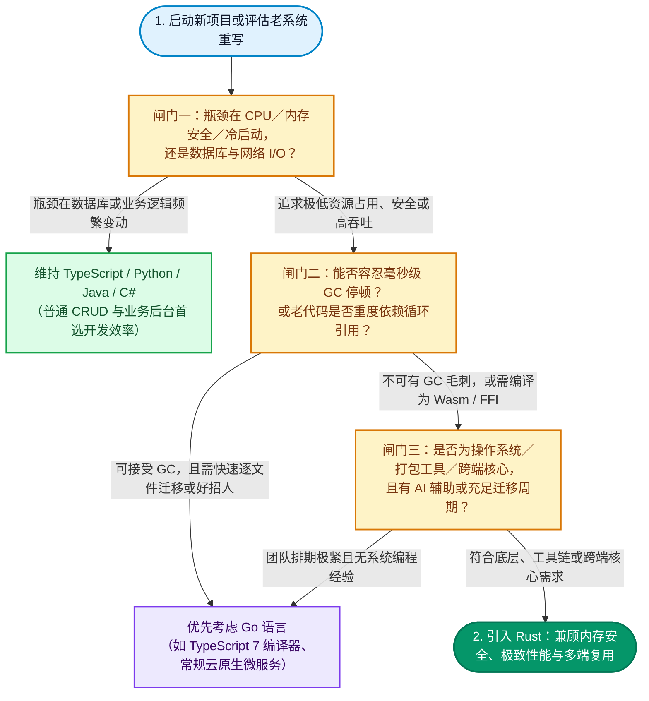

不管你是写前端、写 Python 还是每天开着桌面软件办公，这两年都很难忽略 **Rust** 的存在：前端打包工具换成了 Rust 编写的 **Turbopack** 与 **Rolldown（Vite 8）**，Python 社区一窝蜂换用 **uv** 与 **Ruff**，**Linux 7.0** 正式摘掉 Rust 的实验性标签，连玩家们每天挂着的 **Discord** 也在 2026 年 11 月宣布桌面端将弃用 **Electron**、改用 **Rust** 从头重构。

**Rust 确实越来越火，但它的流行高度集中：主要发生在操作系统内核、高并发云基础设施、开发者工具链，以及受够内存膨胀与启动缓慢的跨平台客户端。** 让各大科技巨头愿意投入重写的根本原因，在于 Rust 不依赖垃圾回收（Garbage Collection, GC），就能同时实现**编译期内存安全**与**接近 C 语言的执行性能**；而在 2026 年，AI 辅助编程搭配 Rust 严格的编译器检查，更让过去动辄耗时数年的大型项目迁移成本大幅下降。不过，Rust 并不是所有软件的标准答案——微软重写 **TypeScript 7** 编译器时就选择了 **Go**，Cloudflare 也曾因为一行 Rust 代码里的 `unwrap()` 引发全球大宕机。

<!--more-->

## Rust 现在到底有多火？从排行榜与开发者调查拆解真实热度

不少开发者心里都会有个疑问：技术社区里几乎每周都有某个知名项目“用 Rust 重写（Rewrite It in Rust）”的新闻，但打开招聘网站，Rust 的岗位数量却远不如 Python、Java 或 TypeScript。要看清 Rust 的真实生态位，可以把主流排行榜与开发者调查放在一起对比：

| 指标来源 | 关键数据与排名变化 |
| --- | --- |
| [TIOBE 2026 年 11 月指数](https://www.tiobe.com/tiobe-index/) | 排名第 **11 名**（占比 **1.63%**），较一年前的第 14 名上升三位；2026 年 7 月至 10 月连续四个月跻身前 10 名，11 月才被 **Go** 微弱反超 |
| [Stack Overflow 2026 开发者调查](https://survey.stackoverflow.co/2026/technology/data/languages) | **18.0%** 的受访开发者表示过去一年重度使用 Rust，在所有编程语言中排第 **12 名** |
| Stack Overflow 2025 开发者调查 | 连续第九年蝉联“最受推崇语言”，高达 **72%** 用过 Rust 的开发者表示明年想继续使用 |

这三组数据反映出一个非常清晰的趋势：**Rust 不是靠庞大的初学者基数或普通业务系统冲高市场份额，而是凭借极高的开发者留存率，在底层系统与基础工具链领域稳步渗透。** 许多前端或 Python 工程师虽然日常不直接写 Rust，但每天运行打包构建、代码检查或安装依赖包时，底层跑的其实已经全是 Rust 编译出来的二进制程序。

## 为什么大厂纷纷转向 Rust？五个解决工程痛点的核心原因

把一个已经在线上稳定运行多年的系统换成另一种语言，对任何工程团队来说都是高风险决策。为什么 Google、微软、Cloudflare、GitHub 与 Discord 依然决定迈出这一步？背后主要有五个实际的工程考量：

### 1. 编译期守住内存安全，从根源拦截底层安全漏洞

在传统的操作系统、浏览器引擎与底层原生库中，C 与 C++ 几乎是唯一能兼顾性能与硬件控制的选择。但手动管理内存的代价极高——微软与 Google 都曾公开统计，过去几十年约有 **70% 的高危安全漏洞**（例如缓冲区溢出 Buffer Overflow、释放后使用 Use-After-Free、双重释放与数据竞争）都源于内存安全缺陷。像此前 [Node.js 十月安全更新](/zh-cn/2026/10/21/nodejs-october-2026-security-analysis/)中修复的 Brotli 原生解码器越界写入漏洞，就是底层原生代码常见的风险。

Rust 通过独特的**所有权（Ownership）**、**借用检查器（Borrow Checker）**与**生命周期（Lifetimes）**机制，在不牺牲运行速度的前提下，把内存检查前置到“编译阶段”。只要代码存在悬垂指针或未受保护的跨线程读写，编译器就会直接报错拦截。

根据 [Google Android 安全团队公布的实战数据](https://blog.google/security/rust-in-android-move-fast-fix-things/)，自从 Android 新增系统代码大规模采用 Rust 后，内存安全漏洞占全部漏洞的比例**历史上首次降到 20% 以内**；Android 内部 Rust 代码的内存漏洞密度大约只有 C／C++ 的**千分之一**，而且由于编译期检查严格，工程师提交代码后的回滚率（Rollback Rate）也降低了 **4 倍**。

### 2. 告别垃圾回收（GC）停顿，彻底消除服务的延迟毛刺

既然追求内存安全，为什么不直接用 Go、Java、C# 或 JavaScript？在绝大多数普通业务后台，这些语言确实够用。但它们都依赖**垃圾回收器（Garbage Collector, GC）**在后台定期扫描并回收不再使用的内存。当服务承载极高并发、或者在内存中维护数百万个缓存对象时，GC 触发扫描就会造成短暂却明显的停顿（即工程上常说的“延迟毛刺”）。

最典型的案例就是 **Discord** 在 2020 年将负责追踪用户已读状态的 **[Read States 服务从 Go 迁移到 Rust](https://discord.com/blog/why-discord-is-switching-from-go-to-rust)**。当时 Go 语言的运行时每 2 分钟就会强制执行一次垃圾回收，导致服务固定每两分钟出现一次明显的延迟尖峰；改用 Rust 后，内存在变量离开作用域的瞬间便确定性地释放，延迟曲线瞬间变得平滑，同时 CPU 与内存占用也大幅下降。

### 3. 接近 C 语言的执行性能与毫秒级冷启动速度

对于命令行工具（CLI）、前端打包器与 AI Agent 运行时来说，“启动要快、占用资源要少”直接决定了开发者的使用体验。解释型语言或带有庞大虚拟机的运行时，光是启动加载与即时编译（JIT）就要消耗不少时间。

**GitHub Copilot** 在 2026 年 8 月将旗下的 Agent 运行时从原本的 TypeScript 与 Node.js [全面重写为 83 万行 Rust](https://github.blog/news-insights/product-news/migrating-the-github-copilot-runtime-to-rust-using-copilot/)。根据 [InfoQ 的技术报道](https://infoq.com/news/2026/10/github-copilot-rust-migration)，重写后的运行时从启动到完成第一轮对话的耗时，由原来的 **5.25 秒**直接压缩到 **292 毫秒**，冷启动延迟几乎难以察觉。

### 4. 一套核心代码，通过 FFI 与 WebAssembly 多端复用

现代软件往往需要同时覆盖 Windows、macOS、Linux、iOS、Android 与 Web 端。如果每个平台各自用原生语言写一套核心逻辑，不仅维护成本高昂，还很容易出现“移动端算出来的结果和桌面端不一致”的同步隐患。

Rust 编译出的原生库没有沉重的运行时依赖，能轻松通过 **FFI（外部函数接口）** 供 Python、Node.js、Swift、Kotlin 或 Go 直接调用，也能编译成 **WebAssembly（Wasm）** 运行在浏览器中。GitHub Copilot 的 Rust 运行时正是利用这一特性，用同一套底层核心同时服务六种不同编程语言的 SDK；Discord 的新一代跨端架构也采取了完全相同的思路。

### 5. 2026 年的关键推力：AI 编程加上严格编译器，让大规模重写算得过账

过去许多团队明知老系统性能不佳，却不敢轻易启动重写，因为**重写软件最贵的永远是工程师的人力与时间**。但到了 2026 年，AI 编码代理（Coding Agents）与 Rust 的结合改变了这笔账。

正如我们在[从 Vibe Coding 狂欢到 PR 审查地狱](/zh-cn/2026/08/26/vibe-coding-pr-review-engineering-shift/)一文中所探讨的，AI 生成动态语言代码时，最怕产生“看似能跑、却在边界条件下崩溃”的隐蔽缺陷；而 **Rust 极其严格的类型系统与借用检查器，恰好成为 AI 写代码最天然的自动化验证闸门**。当 AI 写出类型不匹配或生命周期错误的代码时，Rust 编译器会给出非常详尽的报错信息，让 AI 代理自己读取报错、自行修正，直到通过编译与测试为止。

GitHub 官方就透露，将 Copilot Agent 运行时迁移到 83 万行 Rust 这项庞大工程，放在过去至少需要一个完整团队投入一到两年；但这次主要由**一名工程师借助 Copilot，在约 14.5 周内**便完成了迁移。

## 哪些知名项目已经换成 Rust？四大领域代表案例汇总

为了帮你快速把握行业全貌，先将近年来最具代表性的大厂与开源重写案例整理如下表，随后再看各领域背后的技术演进逻辑：

| 领域 | 项目或企业 | 重写内容与实际成效 | 关键时间点 |
| --- | --- | --- | --- |
| 操作系统 | **Linux 内核** | [Linux 7.0](https://linuxiac.com/linux-kernel-7-0-released/) 正式去掉 Rust 的“实验性”标签，Rust 成为内核长期支持的官方语言之一 | 2026 年 4 月 |
| 操作系统 | **Android** | 新增系统代码大量采用 Rust，内存安全漏洞占比[首次降至总数的 20% 以内](https://blog.google/security/rust-in-android-move-fast-fix-things/) | 2025 年 |
| 操作系统 | **Windows** | 字体解析组件 **DirectWriteCore** 移植为 15.4 万行 Rust；**Win32k** 的 GDI region 代码已随系统发布（[Azure CTO Russinovich](https://www.thestack.technology/rewriting-windows-in-rust/)） | 2025 年 |
| 操作系统 | **Ubuntu 26.04 LTS** | 默认改用 **sudo-rs** 与 Rust 版 coreutils（**cp**、**mv**、**rm** 仍保留 GNU 版本） | 2026 年 4 月 |
| 云基础设施 | **Cloudflare** | 以自研的 [Pingora](https://blog.cloudflare.com/how-we-built-pingora-the-proxy-that-connects-cloudflare-to-the-internet/) 替代 NGINX，日处理请求超 1 万亿次，同等流量下 **CPU 降低 70%、内存降低 67%** | 2022 年起 |
| 云基础设施 | **AWS** | 支撑 AWS Lambda 与 Fargate 底层的微虚拟机 **Firecracker** 完全由 Rust 编写 | 2018 年起 |
| 浏览器 | **Google Chrome** | Web 字体处理改用 Rust 编写的 [Skrifa](https://developer.chrome.com/blog/memory-safety-fonts) 替代老牌 C 语言库 FreeType | 2025 年 |
| 开发工具 | **Vite 8** | 默认打包工具换成 Rust 打造的 [Rolldown](https://vite.dev/blog/announcing-vite8)，官方测试构建提速 **10 到 30 倍** | 2026 年 3 月 |
| 开发工具 | **Next.js 16** | Rust 编写的 [Turbopack](https://nextjs.org/blog/next-16) 正式成为默认打包工具 | 2025 年 10 月 |
| 开发工具 | **uv、Ruff** | Python 高速包管理与代码检查工具；开发商 Astral 于 2026 年 3 月被 [OpenAI 宣布收购](https://thenewstack.io/openai-astral-acquisition/)并并入 Codex 团队 | 2026 年 3 月 |
| 开发工具 | **fish shell** | 4.0 版本完成从 C++ 到 Rust 的整体迁移 | 2025 年 2 月 |
| 开发工具 | **GitHub Copilot** | Agent 运行时从 TypeScript／Node.js [重写为 83 万行 Rust](https://github.blog/news-insights/product-news/migrating-the-github-copilot-runtime-to-rust-using-copilot/)，启动加首轮对话从 5.25 秒降至 292 毫秒 | 2026 年 8 月 |
| 跨端应用 | **Discord** | 从后端服务、语音引擎一路扩展到 2026 年宣布桌面端弃用 Electron 改用 Rust（代号 **Phoenix**） | 2018 年至 2026 年 |

从这张表可以清晰地看出一条规律：**转向 Rust 的全部是“底层内核、长时间高并发运行、对安全或延迟极度敏感”的基础软件，而不是普通的企业内部业务后台。**

- **操作系统与浏览器看重的是“收敛攻击面”**：像字体解析器（Windows 的 **DirectWriteCore**、Chrome 的 **Skrifa**）与权限提升工具（Ubuntu 的 **sudo-rs**），每天都要解析来自外部不可信的复杂二进制数据，过去是黑客挖掘缓冲区溢出漏洞的重灾区，换成 Rust 能直接消除整类内存越界风险。
- **云厂商看重的是“硬件成本与单机密度”**：对于 Cloudflare 这种每天处理超过 1 万亿次请求的网络巨头来说，**Pingora** 省下的 70% CPU 与 67% 内存，折算下来就是少采购数万台服务器与巨额机房电费。
- **前端与 Python 工具链看重的是“开发者等待时间”**：JavaScript 与 Python 写业务逻辑很顺手，但拿来处理成千上万个文件的抽象语法树（AST）解析与打包时，单线程与解释器开销就会成为瓶颈。改用 Rust 结合多线程并行计算（如 **Rolldown**、**Turbopack**、**uv**、**Ruff**），能把原本几十秒的构建与依赖安装缩短到一两秒内。

## 深度案例：为什么 Discord 决定连桌面端都弃用 Electron、改用 Rust？

在所有案例中，**Discord** 是最能代表“应用软件从后端一路 Rust 化到前端桌面”的完整样本。

Discord 从 2018 年起就在后端基础设施与语音服务中使用 Rust，并在 2020 年完成著名的 Read States 服务迁移。然而，广大玩家与社区用户每天打开的 **Discord 桌面客户端**，多年来一直基于 **Electron** 框架（底层打包了完整的 Chromium 浏览器与 Node.js）。虽然 Electron 让团队能用一套 React 代码跨平台交付，但也带来了众所周知的痛点：内存动辄占用 1 GB 以上、冷启动要等好几秒。

即便 Discord 工程团队在 2026 年 9 月将客户端升级到 **Electron 42**，虽然让 CPU 使用率中位数下降了约 **17%**，但内存占用反而微升了约 **4%**——这证明只要底层还背着整套浏览器引擎，内存优化就存在物理上限。

因此在 **2026 年 11 月 4 日**，Discord 首席技术官 Stanislav Vishnevskiy 正式宣布内部代号为 **Phoenix** 的跨世代重构计划：桌面端将[彻底弃用 Electron](https://www.ghacks.net/2026/11/06/discord-is-rebuilding-its-desktop-app-in-rust-with-the-new-client-using-290-mb-of-ram/)，改用 **Rust** 搭配 **Zed 编辑器**团队开发的 GPU 加速界面框架 **GPUI** 重新打造。

| 评估维度 | 旧版 Discord（Electron 架构） | 新版代号 Phoenix（Rust + GPUI 架构） |
| --- | --- | --- |
| **内存占用** | 常态占用数百 MB 至超过 1 GB | Windows 11 上同时登录两个账号仅占 **290.2 MB**（CTO 公布的实测截图） |
| **冷启动时间** | 约 **6 秒** | 约 **1 秒** |
| **移动端架构** | 使用 React Native | 移除 React Native，保留 iOS／Android 原生界面，与桌面端共享同一套 Rust 核心业务逻辑 |
| **Web 端架构** | 纯 JavaScript 与 HTML | 保留 HTML 页面渲染，底层状态与逻辑改为编译成 **WebAssembly** |
| **当前进度** | 线上正式版运行中 | 内部构建版本已完成验证，官方预告将于近期开启外部测试 |

Discord 的架构演进为跨平台应用指出了另一条可行的路径：不一定要为了跨平台而在桌面端塞进整个浏览器，通过 **Rust 编写底层共享逻辑**，再分别对接桌面端 GPU 渲染、移动端原生 UI 与 Web 端 Wasm，就能同时兼顾多端研发效率与原生级别的轻量体验。

## Rust 不是万金油：不选 Rust 的真实反例与翻车代价

看到这里，你可能会想：“既然 Rust 又快又安全，那我们是不是该把公司所有新项目都换成 Rust？”先别急，软件工程世界没有零代价的银弹。以下四个真实反例，清晰地划出了 Rust 目前的能力边界：

### 1. 为什么微软 TypeScript 7 编译器放弃 Rust、选择 Go？

当前端圈的工具链（Vite、Next.js、SWC、Biome）纷纷投向 Rust 时，微软在重写自家 **[TypeScript](/zh-cn/2023/03/05/what-is-typescript/) 7** 原生编译器（将编译速度提升约 10 倍）时，却出人意料地选择了 **Go 语言**，而不是 Rust。

微软团队给出的理由非常务实：原本用 TypeScript 编写的老编译器，架构上重度依赖**垃圾回收（GC）**以及大量**相互引用（Cyclic References）的抽象语法树（AST）数据结构**。如果选用同样具备 GC 的 Go 语言，工程师可以把老编译器的代码“一对一逐文件移植”，完整保留十多年来积累的类型推导逻辑与边界行为；但如果改用 Rust，借用检查器会直接禁止这种复杂的双向与循环引用结构，团队就必须把整套编译器的数据结构与算法推倒重来，不仅工期难以评估，也很难保证新版行为与旧版 100% 兼容。

### 2. 内存安全不等于不会宕机：Cloudflare 的 unwrap() 全球大故障

很多人误以为“用 Rust 写的系统就不会崩溃”，但 **2025 年 11 月 18 日**发生的 [Cloudflare 全球大故障](https://blog.cloudflare.com/18-november-2025-outage/)给所有工程师敲响了警钟。

这起被 Cloudflare 称为自 2019 年以来最严重的事故，起因是一份配置文件大小超出了系统预期的上限，而用 Rust 编写的新一代 **FL2** 代理程序在读取该配置时，直接调用了 `unwrap()` 处理返回结果。当错误发生时，`unwrap()` 直接触发程序 **panic（崩溃退出）**，进而导致全球网络流量中断。这个案例证明了一件事：**Rust 能帮你拦下内存越界与数据竞争，但拦不住草率的错误处理与业务逻辑缺陷。**

### 3. 企业引入放缓：陡峭的学习曲线与招人瓶颈

在基础设施大厂之外，普通企业对 Rust 的态度其实相当审慎。根据 [DeveloperTech 2026 年 4 月的行业报道](https://www.developer-tech.com/news/rust-adoption-stalls-memory-safe-programming-trends/)，许多企业采用 Rust 的步伐出现放缓迹象，核心卡在两个现实问题：**学习曲线太陡**与**资深工程师难招**。

对习惯了 Java、C#、Go 或 Python 的工程师来说，刚接触 Rust 的所有权、生命周期标注与异步类型时，往往要经历一段“跟编译器较劲”的阵痛期。如果只是普通的企业内部系统、电商网站或 CRUD 业务后台，性能瓶颈通常在数据库查询或外部 API 网络延迟，用 Java、C# 或 Go 开发的速度更快、团队更好招人，强行上马 Rust 反而会拖慢业务交付节奏。

### 4. 生态成熟度与“全面消除 C++”的传闻澄清

虽然 Rust 在系统层与命令行工具领域非常成熟，但在图形界面（GUI）与部分垂直领域仍在快速迭代。例如 Discord 这次选用的 **GPUI** 框架就尚未发布 1.0 正式版，Discord 团队必须自己投入人力维护定制补丁。

另外，网络上一度盛传“微软宣布在 2030 年前把 Windows 用 Rust 全部重写”——事实上，那是微软工程师 Galen Hunt 在社交平台上提到目标在 2030 年前“借助 AI 与自动化工具消除 C／C++ 代码”，事后已公开澄清那属于**代码迁移工具的内部研究项目**，并非微软要把整套 Windows 操作系统全部改写成 Rust。

## 技术选型指南：你的项目适合用 Rust、Go 还是维持现状？

如果你正在评估下一个项目或重构计划是否应该引入 Rust，可以顺着下面这张决策流程图，从项目的**性能敏感度**、**架构特性**与**团队成本**三个关键闸门来判断：

总结来说，你可以用这张对照表快速做出决定：

| 非常适合引入 Rust 的场景 | 不一定需要（建议选其他语言）的场景 |
| --- | --- |
| **操作系统内核、驱动程序、嵌入式与浏览器引擎**：需要直接操控底层硬件资源，且绝不能出现内存越界漏洞 | **普通 CRUD 网站、电商与企业管理后台**：需求变化快，用 TypeScript、Python、Java 或 Go 开发效率高得多 |
| **高并发代理服务器、实时通信与数据库**：如 Cloudflare Pingora 或 Discord，不能容忍任何 GC 延迟毛刺 | **重度依赖 GC 与复杂循环引用的存量大型项目**：如 TypeScript 编译器，改用 Go 逐文件移植比用 Rust 重新设计更务实 |
| **编译器、打包工具、Linter 与 CLI 工具**：如 Vite Rolldown、uv、Copilot CLI，极度在意毫秒级启动与多核并行处理 | **上线排期紧迫、且团队完全没有 Rust 经验的项目**：初期与借用检查器磨合的成本，可能会直接耽误产品验证 |
| **跨桌面、移动、Web 共享的底层核心逻辑**：需要通过 FFI 或 WebAssembly 编写一次供多端调用 | **性能瓶颈在 SQL 查询或外部 API 等待时间的服务**：换成 Rust 并不会让慢速的数据库查询变快 |

## 常见问题 FAQ

### Q1：2026 年值得开始学 Rust 吗？哪些工程师最该学？

如果你的日常工作是编写普通业务页面或拼接后端接口，不学 Rust 完全不会影响工作。但如果你属于以下三类开发者，学习 Rust 的投资回报率会非常高：
1. **想深入前端或 Python 工具链底层的开发者**：如今主流的打包工具（Turbopack、Rolldown）与 Python 工具（uv、Ruff、Pydantic 核心）都是用 Rust 写的，懂 Rust 才有能力阅读源码或编写高性能插件。
2. **需要打造轻量级桌面应用或跨端核心的独立开发者**：使用 Tauri 或 GPUI 搭配 Rust，能做出体积仅有几 MB、内存占用极低的桌面软件。
3. **重度使用 AI 写代码的工程师**：借助 Rust 严格的编译器约束 AI 代理，单人就能开发出过去需要小团队才能维护的高性能底层工具。

### Q2：Rust 和 Go 该怎么选？它们是互相取代的关系吗？

两者虽然经常被放在一起比较，但生态定位其实相当互补。**Go 语言**的设计哲学是“简单、编译快、心智负担低、内置垃圾回收（GC）”，非常适合云原生微服务、API 网关、容器编排工具（如 Docker、Kubernetes）以及像 TypeScript 7 这样需要快速移植的项目；而 **Rust** 的设计哲学是“零成本抽象、无 GC、编译期把关所有内存与并发安全”，适合对延迟毛刺零容忍、追求极限硬件利用率或需要嵌入其他语言运行时的底层核心。

### Q3：Rust 未来会完全取代 C 和 C++ 吗？

短期内不会“完全取代”存量庞大的 C／C++ 历史代码库，因为全球仍有数十亿行稳定运行的 C／C++ 系统，没有商业理由全部推倒重写。但从 Linux 7.0 正式扶正 Rust、Android 与 Windows 将高风险解析组件换成 Rust 的趋势来看，**“新编写的系统底层模块与高风险解析器优先采用 Rust，存量 C／C++ 代码维持维护或逐步替换边界模块”**，已经成为整个科技行业的明确共识。
