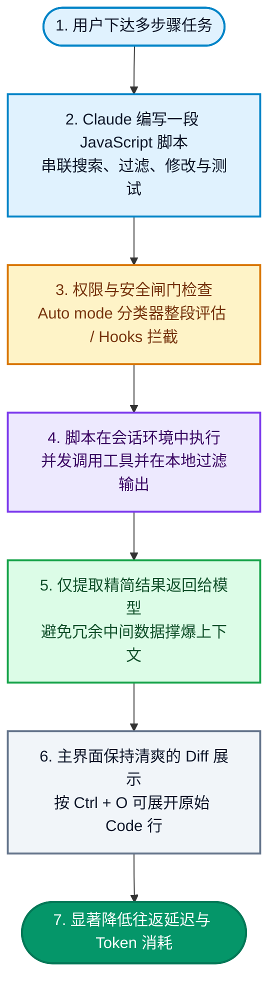

**Code Mode 是 Claude Code 推出的实验性功能：它让 Claude 从“每做一步都要回头请示一次的遥控助手”，变成“自己写一段 JavaScript 执行脚本、把多个步骤一次跑完再汇报重点”的高效搭档。** 以前查文件、改代码、跑测试需要来回折返好几轮，现在在单个步骤内就能串联或并发完成，大幅缩短等待时间并减少上下文 Token 消耗；不过该功能目前默认关闭，也存在会话恢复和安全审核粒度方面的限制。[Claude Code 官方 Code Mode 文档](https://code.claude.com/docs/en/code-mode)

<!--more-->

## 为什么需要 Code Mode？先用“超市买酱油”看懂传统模式的痛点

想搞懂 **Code Mode** 到底解决了什么问题，不妨先想象一个生活场景：你请了一位很聪明的私人助理去大超市买酱油，顺便买一把青菜和一袋蒜头回家做晚饭。

在**未开启 Code Mode 的传统模式**下，AI 调用工具的机制就像“用对讲机一步步遥控”——**助理每完成一个小动作，就必须走回客厅门口向你汇报结果，等你看完思考好下一句话，他才能再次出门做下一步**：

1. 你说：“先去货架看看都有哪些酱油。”助理跑去超市拍下整排 50 瓶酱油的成分和价格清单，抱着厚厚一叠纸回到客厅给你看。
2. 你看完那 50 瓶的价格，说：“行，挑最便宜的那瓶去结账。”助理再跑一趟去结账，拿着小票回来。
3. 你说：“再去拿一把青菜。”助理再跑一趟把青菜带回来。
4. 你说：“再去拿一袋蒜头。”助理又跑一趟把蒜头带回来。

明明 5 分钟就能顺手买齐的事，助理在客厅和超市之间生生折返跑了好几趟。放到工程师每天使用的 **Claude Code** 里，这种传统的“单步串行工具调用（Sequential Tool Calling）”会直接带来两个痛点：

- **客厅桌面被废纸占满（Context Bloat）**：为了定位一个配置文件或函数，AI 经常需要扫描整个代码库。搜索返回的几百行文件列表和冗余信息全都会塞进模型的上下文窗口，既白白烧掉大量 **Token**，又容易稀释模型对真正重点的注意力。
- **来回折返的等待延迟（Round-trip Latency）**：每次调用搜索（**Grep**）、读文件（**Read**）、修改（**Edit**）或终端命令（**Bash**），都必须等待结果回传给模型、模型重新推理后再发出下一次请求，相互独立的任务也无法同时推进。

**Code Mode 换了一套思路**：与其用对讲机遥控，不如让助理直接在现场拿一张便条纸，写下一套完整的执行流程（一段 **JavaScript** 代码）——“查完 50 瓶酱油价格后在现场自己比价，挑出最便宜的那瓶，同时顺手把青菜和蒜头一起拿去结账，最后只带着那瓶酱油和小票回来汇报”。客厅桌面上不会堆满没买的酱油目录，来回折返也从好几趟压缩成了 **1 趟**。

## 实际执行长什么样？拆解官方的四行 JavaScript 示例

说完生活类比，再看官方文档给出的真实案例。假设你想让 Claude Code 在项目里找到某个重试策略（retryPolicy）的代码文件，把最大重试次数从 3 改成 5，改完后顺便跑一下对应的单元测试。

开启 **Code Mode** 后，Claude 在底层生成并运行的脚本会像这样：

```javascript
const files = await $`rg -l "function retryPolicy" src`.text();
const target = files.trim().split("\n")[0];
await edit(target, "maxAttempts: 3", "maxAttempts: 5");
({ edited: target, tests: $`npm test -- retryPolicy`.nothrow() });
```

就算平时不写 JavaScript，按下面四步对照也能立刻看懂每一行的作用：

1. **第一行（现场查货架）**：调用 **rg**（ripgrep）在 **src** 目录中搜索包含 `function retryPolicy` 的文件列表。在传统模式下，这份清单得先传回对话上下文里过目一遍；在这里，它只留在脚本变量中。
2. **第二行（现场自己筛选）**：直接在代码里整理字符串，取出第一个匹配的目标文件路径 `target`。这步过滤完全在本地完成，不占用模型的上下文空间。
3. **第三行（动手修改）**：调用 **edit** 工具，把目标文件里的 `maxAttempts: 3` 替换为 `maxAttempts: 5`。
4. **第四行（验证并只回报摘要）**：运行定向测试 `npm test -- retryPolicy`，最后只把“改了哪个文件”和“测试结果”这两项精简信息返回给 Claude。

把整套链路画成流程图，可以更直观地看清 **Code Mode** 是如何把繁琐的往返通信收敛成单一轮次的：



这套思路也延续了 [Anthropic 在 2025 年 11 月工程博客](https://www.anthropic.com/engineering/code-execution-with-mcp)提出的实践方向：与其让大语言模型通过自然语言对话一问一答地调用外部工具，不如让模型直接编写代码去编排流程、并在执行环境中先处理数据，既能省下大量 Token，也能发挥模型本身最擅长的编程能力。

## 什么场景开启 Code Mode 最明显？三个生活与开发对照

并非改一行简单配置都值得启用 Code Mode。真正能明显拉开效率差距的，往往是包含“批量重复”、“大量搜索过滤”或“多个可并行任务”的场景。下面这张对照表把常见业务场景和生活经验放在一起对比：

| 日常生活场景 | 对应的 Claude Code 开发任务 | Code Mode 省下了什么 |
| :--- | :--- | :--- |
| **月底集中核对 30 张发票**，不用每对一张就向主管汇报一次 | **跨大量文件的重复修改**（例如批量替换 30 个组件里的旧接口名称或配置项） | 在脚本里用循环一次修改完毕，无需往返发起 30 轮工具请求 |
| **拿体检报告时先标出异常红字**，不把 200 页正常指标逐字念给医生听 | **大范围检索后先过滤再读取**（先用 **Grep** 或 **Glob** 筛掉无关文件，只把命中片段带入上下文） | 中间筛选出的噪音不会涌入对话窗口，省下 Token 并保持上下文专注 |
| **餐厅主厨同时蒸饭、炒菜、煲汤**，不必等米饭蒸熟才开火炒下一道 | **并发运行多个互不干扰的命令**（例如同时跑代码格式检查与两组独立模块的测试） | 彼此不依赖的工具调用在同一脚本里并发触发，总耗时大幅压缩 |

## 开启后界面会变乱吗？用 Ctrl + O 查看幕后脚本

不少开发者听到“AI 每次操作都要写一段 JavaScript 来运行”，第一反应会担心：“那我的终端对话流岂不是要被大段脚本刷屏？”

实际上并不会。在默认的主对话视图中，**Code Mode** 会隐藏冗长的底层脚本，界面上只展示熟悉且干净的高层工具结果——比如你平时看惯的文件修改 Diff。

如果你想确认 Claude 到底写了什么脚本、或者排查它的筛选逻辑有没有写对，只要按下 **Ctrl + O** 打开完整记录查看器（Transcript Viewer），就会看到每一次脚本执行都折叠成一行 **Code** 提示，展开即可查看当时运行的完整 JavaScript 代码。如果还想把终端里的会话题效再往上提一档，也可以顺便看看这篇 [Claude Code 趣味命令指南](/zh-cn/2026/10/14/claude-code-fun-commands/)。

## 如何开启和关闭 Code Mode？配置方式与安全边界

**Code Mode** 目前仍属于实验性、可自主选择开启（Opt-in）的特性，**默认处于关闭状态**。你可以根据使用习惯选择临时试用或全局配置：

### 方式一：仅在当前终端会话试用（推荐先这样体验）

在项目目录下通过环境变量启动 **Claude Code**，退出终端后即自动恢复默认设置：

```bash
CLAUDE_CODE_EXPERIMENTAL_CODE_MODE=1 claude
```

若要在同一 Shell 环境中显式关闭，将变量值设为 **0** 即可：

```bash
export CLAUDE_CODE_EXPERIMENTAL_CODE_MODE=0
```

### 方式二：写入个人全局配置文件长期开启

体验顺手后，可以写入用户级配置文件 **~/.claude/settings.json**（或通过 **claude --settings** 指定配置文件）的 **env** 字段中：

```json
{
  "env": {
    "CLAUDE_CODE_EXPERIMENTAL_CODE_MODE": "1"
  }
}
```

### 为什么项目目录里的配置文件不能开启它？

这里有一个很关键却非常合理的安全边界：**你不能通过仓库内的项目级 .claude/settings.json 或 .claude/settings.local.json 来开启 Code Mode。**

拿生活里的经验来打比方就很好理解：你网购收到一个陌生卖家寄来的快递，箱子里塞了一张纸条写着“请自动打开你家大门的智能门锁”，门锁当然不能照纸条说的自动解锁。同理，当你从 GitHub 克隆一个外部仓库时，里面可能自带 **.claude/settings.json**；禁止项目级配置文件擅自启用实验性脚本执行模式，正是为了防止第三方配置在未经你明确同意的情况下改变代理的运行权限。

此外，在团队或企业环境中，**组织管理员也可以通过托管策略（Managed Settings）统一禁用或拦截 Code Mode**；只要环境、用户配置或组织策略中任意一处将其明确设为 **0**，该功能就会保持关闭。

## 上手前必须了解的四个限制与注意事项

虽然把多个步骤打包成一段代码执行非常痛快，但官方文档也明确标出了几项当前限制，正式引入日常工作流前建议先心里有数：

1. **实验性状态可能调整**：该功能仍标注为 Experimental 且默认关闭，具体行为、内置函数接口和可用范围在后续版本中都可能调整或下线。
2. **会话恢复（Resume）存在环境限制**：在 **Code Mode** 下运行过的会话，目前**只能在终端中且同样启用了 Code Mode 的环境下恢复**。如果关闭了 Code Mode，或者试图在其他非终端界面接续同一段历史会话，就会受到限制。
3. **Auto mode 下的安全审核变为“整包评估”**：常规模式下开启 **Auto mode**（自动模式）时，后台安全分类器就像财务审单一样对每一次工具调用“逐笔核对”；但在开启 Code Mode 后，分类器会改为**将整段 JavaScript 脚本作为单个动作来统一评估**。这好比主管改成“整份采购方案打包审批”，审核粒度与逐次调用有所不同。不过原有的权限规则（**allow**／**ask**／**deny**）和生命周期 Hooks 仍然照常生效。
4. **耗时较长的脚本会阻塞当前对话**：除非明确将其转入后台运行，否则当前交互窗口会一直等待整段脚本执行完成后再继续响应。

## 总结：什么时候值得开、什么时候保持默认即可？

用一句话概括 **Code Mode** 的核心意义：**它让最擅长写代码的 AI，直接用“写代码”的方式去调度工具，告别过去像老式对讲机一样一问一答的折返跑。**

如果你的日常任务频繁涉及“跨几十个文件做重复修改”、“先大范围检索再做复杂筛选过滤”，或者“同时运行多条互不冲突的检查命令”，很建议先用 `CLAUDE_CODE_EXPERIMENTAL_CODE_MODE=1 claude` 在个人项目里跑几次，感受上下文更轻量、响应更干脆的体验；相反，如果你需要经常在不同终端与桌面端之间来回恢复会话、对每一次细粒度工具调用都要求独立的 Auto mode 审计记录，或者正在遵守严格团队规范的生产仓库里作业，保持默认关闭依然是最稳妥的做法。

想了解如何让多个终端会话彼此协同配合，还可以延伸阅读这篇 [Claude Code 跨 Session 通信完整用法](/zh-cn/2026/08/09/claude-code-cross-session-messaging/)，或直接查阅 [Claude Code 官方 Code Mode 文档](https://code.claude.com/docs/en/code-mode)获取最新说明。
