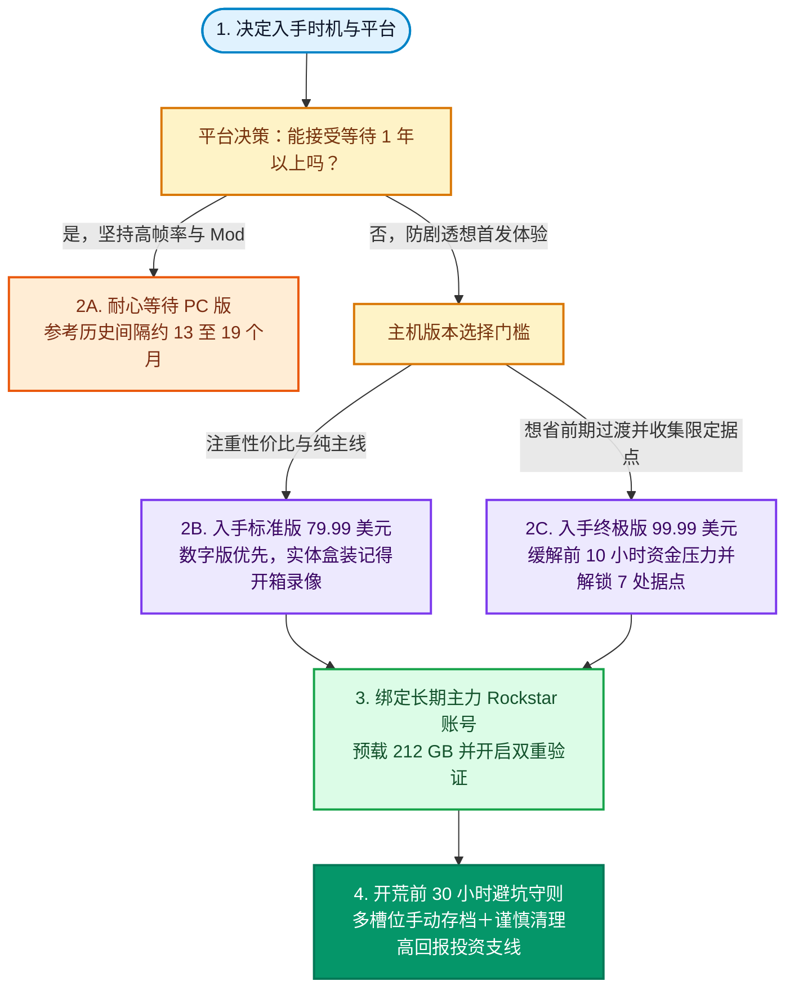

**《Grand Theft Auto VI》（GTA 6）将于 2026 年 11 月 19 日按当地零点陆续解锁，首发仅登陆 PS5 与 Xbox Series X|S，数字预载需要 212 GB 空间。** 标准版定价涨至 **79.99 美元**，实体盒装首次取消光盘改用一次性下载兑换卡，全主机锁定 **30 FPS**，且首发当晚不会同步上线多人模式与 PC 版。踏入 **Leonida（雷欧尼达州）** 之前，先把硬件门槛、实机新系统与 **GTA 5** 历年避坑经验一次对齐。

<!--more-->

## 发售时间、预载与“无光盘实体版”五个硬指标

多数玩家只记住了 **11 月 19 日**，但正式开玩前还有五项直接影响钱包和硬盘空间的官方规格要先核对。[Rockstar Games GTA 6 官方页面](https://www.rockstargames.com/VI)

| 项目 | 官方公布规格 | 玩家实操影响 |
| :--- | :--- | :--- |
| 解锁时间 | **2026 年 11 月 19 日** 各区午夜滚动解锁 | 东八区（UTC+8）账号于 **11 月 19 日 00:00** 解锁 |
| 首发平台 | **PS5**（含 PS5 Pro 增强）、**Xbox Series X\|S** | PC 版与任天堂平台首发缺席、时间未定 |
| 预载容量 | **11 月 10 日** 起分批开放（亚洲区约 **11 月 12 日**） | 本体约 **212 GB**，建议提前腾出 **220 GB** 以上固态硬盘 |
| 版本定价 | 标准版 **79.99 美元**（台币 2,320）／终极版 **99.99 美元**（台币 2,900） | 正式跨过此前 69.99 美元的 3A 定价基准线 |
| 实体盒装 | 标准版采用 **Code-in-Box（盒内仅含兑换码与海报）** | **无实体光盘、无法二手回血**；终极版仅数字发行 |

*实体标准盒装内不含光盘，仅附双面 A3 海报与一次性数字激活码，拆封前务必全程录像留证。*

- **无光盘实体盒的两面性**：由于 **212 GB** 超出常规蓝光光盘容量，[PlayStation 官方博客](https://blog.playstation.com/) 与零售端确认盒内只有一次性激活码与海报。好处是 11 月 12 日提前发货即可预载；缺点是**彻底失去通关转卖回血机制**，且海外已有买家反映开盒缺码争议，**收到务必从未拆封开始录像**。
- **Xbox 与 PS5 新西兰提前玩差异**：新西兰夏令时（UTC+13）比北京时间快 5 小时，即 **北京时间 11 月 18 日 19:00** 解锁。据 [IGN 整理](https://www.ign.com/)，**Xbox** 在 **设置 → 系统 → 语言与位置** 切换新西兰重启即可提前游玩；**PS5** 严格锁定购买时所用 PSN 区服，单改系统时区无效，跨区操作亦存在违反条款风险。

## 标准版 vs 终极版：多花 20 美元到底买了什么？

*左侧为预购礼附赠的经典复古轿车，右侧为终极版随主线章节逐步解锁的海陆载具与定制外观。*

只要在 **11 月 20 日前** 购买标准版或终极版，都会获赠 **Vintage Vice City Pack**，包含 **1955 年 Vapid Stanier 经典轿车与车库**、主角复古服饰发型、热带武器涂装，符合资格的数字版预购还送 **1 个月 GTA+**。

多花 **20 美元** 入手 **终极版（99.99 美元）**，内容会**随主线章节推进逐步解锁**，避免第一章开局直接破坏平衡：

- **专属载具**：**1995 年 Grotti Cheetah** 跑车、**1967 年 Vapid Dominator Buggy** 沙滩车、**Shitzu Squalo** 快艇、Jason 安全屋的 **Dinka Enduro** 越野摩托与 **Crest Kayak** 皮划艇，以及皮卡复古套件。
- **武器与涂装**：源自 Vercetti 庄园背景的 **Hawk & Little Morgan** 雕花双枪、Jason 专用 **Girardi ES9** 与 Lucia 专用 **Klose K17** 定制手枪外观。
- **7 处专属商业据点**：解锁 **Rideout Customs** 与 **One-Eyed Willie's** 改车店、**Sara's Unisex Salon** 造型店、**Stock 305** 服装店、**Electric Fang** 纹身店、**Goodtime Gear** 与 **PTT Youngin$** 黑市据点。

**购买建议**：参照 **GTA 5** 特别版与 **《荒野大镖客：救赎2》** 终极版的经验，特典最香的阶段主要集中在**开荒前 5–10 小时**，中后期商店解锁的顶级跑车与武器很快会追平数值。看重性价比且专注主线剧情，买 **标准版** 赶在 11 月 20 日前拿免费预购礼就够用，后续随时可以补购终极版数字升级包。

## 硬件性能实况：为什么 PS5 Pro 也锁定 30 FPS？

*全主机目标帧率皆为 30 FPS；右侧展示 PS5 Pro 通过 PSSR 超分辨率与专属光追阴影带来的路面反射与锐利度提升。*

包括基础版 **PS5**、**Xbox Series X|S** 与 **PS5 Pro** 在内，本作首发全部锁定 **30 FPS**，**未提供 60 FPS 性能模式**。

据 [Digital Foundry 与 Eurogamer 技术分析](https://www.eurogamer.net/)，瓶颈在于开放世界的 **CPU 模拟上限**：RAGE 引擎把大量算力投入 **实时光线追踪全局光照（RTGI）**、超高密度人群与车流 AI、水体物理和动态飓风天气，因此单纯降低分辨率并不能让帧率直接翻倍。

- **PS5 Pro 实机优势**：同为 30 FPS，但借助 **PSSR** AI 超分辨率显著减轻动态模糊与边缘锯齿，并加入基础主机没有的 **专属光追阴影（Ray-traced shadows）**。
- **DualSense 舒适度设置**：深度支持自适应扳机阻力、路面触觉反馈与 **Tempest 3D 音效**；长时间连续游玩建议在辅助设置适度调低扳机阻尼，减少手指疲劳。

## 上手必看：《An Extended Look》五大机制变化

*雷欧尼达州地图面积约为大表哥2的 3 倍，横跨 Vice City、群岛大桥、Grassrivers 沼泽、工业岸区与北方国家公园。*

2026 年 8 月 27 日播出的 **27 分钟** 官方实机演示 **《Grand Theft Auto VI: An Extended Look》**（先于 Netflix 独播 6 小时后上架官方频道，[Variety 统计](https://variety.com/) 四天播放超 3,110 万次），配合 [GameSpot 对 Rob Nelson 的专访](https://www.gamespot.com/) 确认单主线及核心剧情支线约 **80 小时**，有五项玩法变化直接重塑开荒习惯：

*取消口袋无限军火库改用后备箱配装，结合双主角现场配合与换车换装躲避追捕。*

1. **取消“随身军火库”，回归后备箱配装**：长枪必须背在身上或存进车尾箱。提着沉重战利品袋时会出现单手上膛等动作变化；走近市民区还会主动压低武器以免过早引发恐慌报警。
2. **双主角协同与动态关系**：**Jason Duval** 与 **Lucia Caminos** 不仅能无缝切换，还能打电话叫对方来支援、或在追逐战交出驾驶位让 AI 搭档开车。日常约会、回信息与互动都会影响两人默契。
3. **Focus 专注慢动作**：生命值下方新增紫色眼睛专注条，激活后进入慢动作瞄准，并用 **红点（致命）** 和 **黄点（缴械）** 标记命中部位。
4. **6 星通缉回归与“空心星”逻辑**：6 星回归且星下会显示警方记录的犯罪图标。**空心白星**代表警察只在搜查最后目击圈或只有模糊特征（如“一对男女”），**暗巷换车、换装或双主角分头走**比死踩油门更容易消星。
5. **游戏内社交媒体与沉浸日常**：街头突发事件和警匪追逐会实时刷上内置短视频与直播流；同时回归增肌减脂、路边撸狗或训斥、高尔夫、台球、深潜与气垫船沼泽探索等玩法。

## 从 GTA 5 与大表哥2十年数据看 GTA 6 四大避坑经验

对照 **GTA 5**（截至 2026 年 11 月 [Take-Two 财报](https://www.take2games.com/) 累计销量近 **2.35 亿套**）与 **《荒野大镖客：救赎2》** 的历史规律，首发进城前可以先照这张决策路径图排雷：

*从 GTA 5 延续下来的开荒铁律：留好手动存档防经济踩坑，并清醒面对主机与 PC 之间的发行和存档间隔。*

### 分析一：PC 版到底还要等多久？

Rockstar 大作从不首发 PC：**GTA 5** 主机（2013/09/17）到 PC（2015/04/14）相隔 **19 个月**；**大表哥2** 主机（2018/10/26）到 PC（2019/11/05）相隔约 **13 个月**。先打磨固定主机架构既保首发稳定，也带动核心粉丝二次消费。怕剧透又不愿等一年半以上直接买主机；坚持 **60 FPS** 与 Mod 生态的玩家需做好长期屏蔽剧透准备。

### 分析二：切忌乱绑小号，跨平台存档历来受限

GTA 5 长期禁止 PlayStation 与 Xbox 跨阵营迁移，**2017 年 3 月 6 日** 关闭 PS3 / Xbox 360 迁移后，后续也基本限制在同品牌主机家族内升级，主机与 PC 互通极其严格（2022 年 PS4 转 PS5 初期甚至一度会清空旧端角色）。**11 月 19 日首次登录务必绑定长期主力且开启双重验证的 Rockstar 账号**，不要把“未来主机进度肯定能搬到 PC”当作理所当然。

### 分析三：为什么首发没有 GTA 6 线上模式？

2013 年 GTA 5 首日卖出 **8 亿美元**、三天破 **10 亿美元**，两周后（10 月 1 日）开服的 **GTA Online** 立刻被百万级洪峰挤瘫，导致新手赛车卡死、云存档消失，最后只能公开致歉并发放每人 **GTA$ 500,000** 补偿；大表哥2的线上模式当年也延后约一个月才开 Beta。

这一次 Take-Two 首席执行官 Strauss Zelnick 已确认**旧版《GTA Online》不会在 GTA 6 发售后关停**，而新作多人生态业界多预估落在 **2027 年**。这让首发玩家不用面对炸服排队，安心把 80 小时单机剧情吃透。

### 分析四：GTA 5 “21 亿美元教训”与前 30 小时三条铁律

2013 年新手最普遍的后悔，就是过早做完 **莱斯特（Lester）暗杀任务**，错失大结局分红后配合 **BAWSAQ / LCN 股市** 把三主角资产滚到 **21.4 亿美元上限** 的机会。延续 Rockstar 把超高金融回报绑定在主线大额节点的设计逻辑，前 30 小时建议做到三点：

- **多槽位手动存档**：每次大型劫案、涉及势力或商业竞争变动的支线前，单独留一个手动存档位。
- **前期克制纯外观消费**：前十几小时把现金优先留给武器改装与车辆性能，少在穿搭与涂装上盲目挥霍。
- **遇到明显牵扯企业股价或竞争对手的支线先停一停**：先观察前一个任务的结算倍率，确认没绑定大额本金再连清。

## 上手前最后 48 小时核对清单

- **确保 SSD 腾出 220 GB 以上空间**：覆盖 **212 GB** 本体与首日更新解压缓冲。
- **确认预载或实体开箱全程录像**：无光盘盒装收到即录像拆封并第一时间兑码。
- **检查 Rockstar 账号与 2FA**：确保正确关联主机账号，领齐 **1 个月 GTA+** 福利。
- **卡在 11 月 20 日前入手**：保留免费 **Vintage Vice City Pack** 与 **'55 Vapid Stanier** 轿车。
- **按需调整 DualSense 扳机阻尼**：进辅助设置微调扳机张力，准备开启 **30 FPS** 的雷欧尼达之旅。
