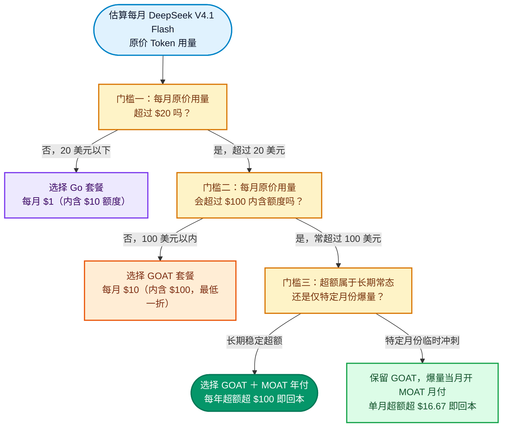

刚接触 **Command Code** 的开发者，看到官网同时列出 **Go**、**GOAT** 和 **MOAT** 三个套餐时，多半会先犯迷糊：这三档到底是谁替代谁？已经买了 **GOAT** 还需要加购 **MOAT** 吗？还是直接单买 **MOAT** 就够了？其实换一个生活中的类比，整套定价逻辑三秒就能看透：**Go 和 GOAT 像是“一折预付代金券”，MOAT 则是“山姆/好市多四折会员卡”——而且两者可以叠加使用。**

本文以 **2026 年 11 月 26 日** 的官方方案数据为基准，聚焦多数人主力使用的 **DeepSeek V4.1 Flash**（下文金额均为美元），通过交互式柱状图、五套餐折线图、区间示意图与决策流程图，把**各套餐实际账单、平均 Token 折扣、MOAT 回本门槛、每月省钱幅度以及不同用量的最优组合**一次讲明白，不绕复杂公式，帮你两分钟挑出最划算的订阅搭配。

<!--more-->

## 先用生活类比看懂三个套餐：一折代金券 vs 会员折扣卡

如果你读过本站之前整理的[AI 订阅怎么买最划算](/zh-cn/2026/09/17/how-to-buy-ai-subscriptions-best-value/)，应该已经体会到，同样是十几二十美元的月费，不同平台给到的实际可用额度可以相差几十倍。Command Code 把付费体系拆成 **Go**、**GOAT** 和 **MOAT**，正是因为它们的职责完全不同：

- **Go（每月 $1）与 GOAT（每月 $10）像“一折预付代金券”**：花 $1 换 $10 原价额度，花 $10 换 $100 原价额度，相当于额度内直接打**一折**；唯一限制是额度用完后，超出部分需要按**原价**充值。
- **MOAT（年付 $60，月均 $5；或月付 $10）像“会员折扣卡”**：本身**不包含任何免费 Token 额度**（内含 $0），但它能让你在购买 **DeepSeek V4.1 Flash** 时享受 **60% 折扣（即原价四折）**。
- **核心亮点在于“可以叠加”**：当你同时订阅 **Go＋MOAT** 或 **GOAT＋MOAT** 时，系统会先消耗套餐内含的一折额度；额度用光后，超额 Token 自动按 MOAT 的四折计费，让你同时吃到“前段一折＋后段四折”两层红利。

```chart
{
  "type": "bar",
  "title": "五大套餐对比柱状图：每月会员费 vs 每月内含原价额度",
  "subtitle": "一眼看出 Go 与 GOAT 的 10 倍额度杠杆，以及 MOAT 零内含额度、专攻超额四折的定位差异",
  "height": 340,
  "yPrefix": "$",
  "yMax": 120,
  "yStep": 20,
  "yLabel": "每月金额（美元）",
  "showBarLabels": true,
  "legendPosition": "top",
  "labels": ["Go", "GOAT", "MOAT（年付）", "Go + MOAT", "GOAT + MOAT"],
  "datasets": [
    {
      "label": "每月会员费（实付）",
      "data": [1, 10, 5, 6, 15],
      "color": "#f97316",
      "labelColor": "#c2410c"
    },
    {
      "label": "每月内含原价额度",
      "data": [10, 100, 0, 10, 100],
      "color": "#059669",
      "labelColor": "#047857"
    }
  ],
  "note": "数据日期：2026/11/26｜MOAT 另提供月付 $10（随时取消）；叠加订阅时先扣内含额度，超额享 DeepSeek V4.1 Flash 四折。"
}
```

把五种常见订阅组合整理成一张速查表，所有费用一目了然：

| 套餐方案 | 每月会员费 | 年度会员费 | 每月内含用量 | 年度内含用量 | 超额 Token 价格 |
| :--- | ---: | ---: | ---: | ---: | ---: |
| **Go** | $1 | $12 | $10 | $120 | 原价 |
| **GOAT** | $10 | $120 | $100 | $1,200 | 原价 |
| **MOAT（年付）** | $5 | $60 | $0 | $0 | 四折 |
| **Go＋MOAT** | $6 | $72 | $10 | $120 | 四折 |
| **GOAT＋MOAT** | $15 | $180 | $100 | $1,200 | 四折 |

顺带说明 **MOAT 的两种计费周期**：选**年付 $60**，折合每月仅 **$5**；如果不确定后续用量，也可以选**月付 $10**、随时取消，灵活度更高。

## 省流版结论：你的用量落在哪一区，直接对号入座

不想先看曲线推导的朋友，可以直接看下面这张**最佳套餐使用区间图**（鼠标悬停或点击各色块可查看详细区间说明）。以 **MOAT 年付（每月 $5）**、在 Command Code 内部使用以及上述五种套餐为前提，估算一下你每月大概会消耗多少“原价”的 DeepSeek V4.1 Flash 额度，就能直接锁定答案：

```chart
{
  "type": "range",
  "title": "最佳套餐使用区间",
  "subtitle": "每月 DeepSeek V4.1 Flash 原价用量（区间示意，非等比例；以 MOAT 年付 $5/月为基准）",
  "defaultHint": "点击或悬停上方任意套餐区块，查看对应每月与年度用量区间。",
  "segments": [
    {
      "label": "Go",
      "weight": 21,
      "color": "#64748b",
      "detail": "Go（$1/月）：每月原价用量 $18.33 以下（年度 $220 以下）最省钱，适合轻度日常开发。"
    },
    {
      "label": "Go + MOAT",
      "weight": 5.5,
      "color": "#ea580c",
      "callout": true,
      "detail": "Go + MOAT（$6/月）：仅在每月 $18.33～$20（年度 $220～$240）极窄区间胜出，最多省不到 $0.67/月。"
    },
    {
      "label": "GOAT",
      "weight": 43,
      "color": "#2563eb",
      "detail": "GOAT（$10/月）：每月 $20～$108.33（年度 $240～$1,300）最划算，用满 $100 时平均成本低至原价一折。"
    },
    {
      "label": "GOAT + MOAT",
      "weight": 30.5,
      "color": "#059669",
      "detail": "GOAT + MOAT（$15/月）：每月超过 $108.33（年度 $1,300 以上）完胜，前 $100 一折＋超额全面四折。"
    }
  ],
  "ticks": [
    { "label": "$0", "align": "start" },
    { "label": "$18.33", "stagger": true },
    { "label": "$20", "align": "start", "dx": 2 },
    { "label": "$108.33" },
    { "label": "∞", "align": "end" }
  ],
  "note": "注：单独订阅 MOAT 在五种套餐中没有最优区间；月用量达到 $100 以上时，叠加 GOAT 永远比单买 MOAT 每月少花 $30。"
}
```

| 每月 Token 原价用量 | 年度 Token 原价用量 | 最划算方案 |
| ---: | ---: | :--- |
| $18.33 以下 | $220 以下 | **Go** |
| $18.33～$20 | $220～$240 | **Go＋MOAT** |
| $20～$108.33 | $240～$1,300 | **GOAT** |
| $108.33 以上 | $1,300 以上 | **GOAT＋MOAT** |

从这张区间图里，可以直接提炼出两个避坑重点：

1. **绝大多数人只需要在 Go、GOAT、GOAT＋MOAT 之间三选一**：**Go＋MOAT** 占优的窗口只有每月 $18.33 到 $20，宽度仅 $1.67，哪怕卡在最中间也省不到一美元。实际选择时，轻度用 **Go**、中度上 **GOAT**、重度叠 **GOAT＋MOAT** 即可。
2. **“单独买 MOAT”在这五种套餐里没有任何成本优势**：算一笔账就懂——单买 MOAT 用掉 $100 原价额度，要付 $5 会员费加 $40 Token 费，合计 $45；但只要多花 $10 叠加 GOAT，前 $100 额度直接包干，实付降到 $15。只要月用量达到 $100 以上，**GOAT＋MOAT 永远比单买 MOAT 每月少花 $30（一年省 $360）**。

## 拆解平均 Token 成本：为什么重度用户一定要叠加？

很多人对比订阅套餐时只盯月费，容易忽略真正决定性价比的核心指标：**平均每消耗 $1 原价 Token，你实际掏了多少钱？** 用下面这条简单公式就能算出每个方案的综合折扣：

**平均成本比例 ＝（会员费 ＋ 额外 Token 费用）÷ Token 原价总用量 × 100%**

比例越低，说明花同样的钱买到的 Token 越多（比如 **10%** 就是一折，**40%** 就是四折）。把五种套餐（**Go**、**Go＋MOAT**、**GOAT**、**GOAT＋MOAT** 与 **单独 MOAT 年付**）全部画在同一张等比例交互折线图上——鼠标悬停即可直接对比任意用量的精准折扣，点击底部图例还能单独开关曲线：

```chart
{
  "type": "line",
  "title": "五种套餐平均 Token 成本折线图（年度原价用量 $120～$3,600）",
  "subtitle": "横轴为真实等比例年度原价用量，线越低代表越省；点击底部图例可开关单个套餐曲线",
  "height": 380,
  "xType": "linear",
  "xMin": 120,
  "xMax": 3600,
  "xTicks": [120, 600, 1200, 1900, 2400, 3000, 3600],
  "xPrefix": "$",
  "xLabel": "年度 Token 原价用量（美元）",
  "yMin": 0,
  "yMax": 160,
  "yStep": 20,
  "ySuffix": "%",
  "yLabel": "平均 Token 成本（原价百分比）",
  "tooltipTitlePrefix": "年度原价用量 ",
  "legendPosition": "bottom",
  "referenceLines": [
    { "axis": "y", "value": 40, "color": "#64748b", "label": "40% 四折渐近线", "labelAlign": "right" },
    { "axis": "x", "value": 1300, "color": "#d97706", "label": "$1,300 黄金交叉 (16.9%)", "labelBg": "#fffbeb", "labelColor": "#92400e", "labelYOffset": 4 },
    { "axis": "x", "value": 1900, "color": "#64748b", "label": "$1,900 GOAT 追平 MOAT", "labelBg": "#f8fafc", "labelColor": "#334155", "labelYOffset": 34 }
  ],
  "datasets": [
    {
      "label": "Go",
      "color": "#2563eb",
      "data": [
        { "x": 120, "y": 10 }, { "x": 180, "y": 40 }, { "x": 220, "y": 50.91 }, { "x": 240, "y": 55 },
        { "x": 400, "y": 73 }, { "x": 600, "y": 82 }, { "x": 900, "y": 88 }, { "x": 1200, "y": 91 },
        { "x": 1300, "y": 91.69 }, { "x": 1900, "y": 94.32 }, { "x": 2400, "y": 95.5 }, { "x": 3600, "y": 97 }
      ]
    },
    {
      "label": "Go + MOAT",
      "color": "#16a34a",
      "data": [
        { "x": 120, "y": 60 }, { "x": 180, "y": 53.33 }, { "x": 220, "y": 50.91 }, { "x": 240, "y": 50 },
        { "x": 400, "y": 46 }, { "x": 600, "y": 44 }, { "x": 900, "y": 42.67 }, { "x": 1200, "y": 42 },
        { "x": 1300, "y": 41.85 }, { "x": 1900, "y": 41.26 }, { "x": 2400, "y": 41 }, { "x": 3600, "y": 40.67 }
      ]
    },
    {
      "label": "GOAT",
      "color": "#ea580c",
      "data": [
        { "x": 120, "y": 100 }, { "x": 180, "y": 66.67 }, { "x": 220, "y": 54.55 }, { "x": 240, "y": 50 },
        { "x": 400, "y": 30 }, { "x": 600, "y": 20 }, { "x": 900, "y": 13.33 }, { "x": 1200, "y": 10 },
        { "x": 1300, "y": 16.92 }, { "x": 1900, "y": 43.16 }, { "x": 2400, "y": 55 }, { "x": 3600, "y": 70 }
      ]
    },
    {
      "label": "GOAT + MOAT",
      "color": "#d97706",
      "borderWidth": 3.4,
      "data": [
        { "x": 120, "y": 150 }, { "x": 180, "y": 100 }, { "x": 220, "y": 81.82 }, { "x": 240, "y": 75 },
        { "x": 400, "y": 45 }, { "x": 600, "y": 30 }, { "x": 900, "y": 20 }, { "x": 1200, "y": 15 },
        { "x": 1300, "y": 16.92 }, { "x": 1900, "y": 24.21 }, { "x": 2400, "y": 27.5 }, { "x": 3600, "y": 31.67 }
      ]
    },
    {
      "label": "MOAT（年付）",
      "color": "#7c3aed",
      "data": [
        { "x": 120, "y": 90 }, { "x": 180, "y": 73.33 }, { "x": 220, "y": 67.27 }, { "x": 240, "y": 65 },
        { "x": 400, "y": 55 }, { "x": 600, "y": 50 }, { "x": 900, "y": 46.67 }, { "x": 1200, "y": 45 },
        { "x": 1300, "y": 44.62 }, { "x": 1900, "y": 43.16 }, { "x": 2400, "y": 42.5 }, { "x": 3600, "y": 41.67 }
      ]
    }
  ],
  "note": "年度用量超过 $3,600 后，GOAT 会持续攀升至趋近 100%（原价），而 GOAT + MOAT 与 MOAT 均稳稳压在 40%（四折）以内。"
}
```

| 年度 Token 原价用量 | GOAT | MOAT（年付） | GOAT＋MOAT（年付） |
| ---: | ---: | ---: | ---: |
| $600 | **20%** | 50% | 30% |
| $1,200 | **10%** | 45% | 15% |
| $1,300 | **16.92%** | 44.62% | **16.92%** |
| $1,500 | 28% | 44% | **20%** |
| $1,900 | 43.16% | 43.16% | **24.21%** |
| $2,400 | 55% | 42.5% | **27.5%** |
| $3,600 | 70% | 41.67% | **31.67%** |
| $6,000 | 82% | 41% | **35%** |
| $12,000 | 91% | 40.5% | **37.5%** |
| 趋近无限用量 | 100% | 40% | **40%** |

抓住曲线上的三个关键节点，就能彻底明白叠加方案的含金量：

- **节点一：年用量 $1,200（每月正好用满 $100）**——这是 **GOAT** 性价比封神的甜蜜点。全年 $120 会员费吃满 $1,200 原价额度，平均成本压到 **10%（一折）**；如果此时额外买了 MOAT 却没有超额消费，相当于多交 $60 会员费，平均成本反而涨到 15%。
- **节点二：年用量 $1,300（每月 $108.33）**——这是 **GOAT 与 GOAT＋MOAT 的黄金交叉点**。一旦超出 $1,200 内含额度，单买 GOAT 每一美元超额都要按原价结算，橙色曲线迅速抬头；两条线在 $1,300 处以 **16.92%** 交汇，此后 **GOAT＋MOAT 全程领先**。
- **节点三：年用量 $1,900（约每月 $158）**——此时单买 GOAT 的平均成本已经爬到 **43.16%（超过四成三）**，被单买 MOAT 追平；而同一用量下 **GOAT＋MOAT 仅需 24.21%（不到原价两成五）**。如果用量继续攀升到 $12,000 乃至更高，单独 GOAT 会无限逼近 **100% 原价**，GOAT＋MOAT 则稳稳压在 **40%（四折）** 以下。

## MOAT 回本门槛怎么算？记住两个数字就行

已经订阅 **GOAT** 的开发者最关心的问题通常是：“我超额用到多少，加购 **MOAT** 才不亏？”

算法非常简单：加购 **MOAT 年付**等于每月多付 **$5 会员成本**，换来超额 Token **每美元立省 60%（$0.60）**。把多付的会员费除以 60%，回本线立刻清晰：

- **年度超额回本门槛**：$60 ÷ 60% ＝ **$100 超额用量**（一年内原价超支超过 $100 即回本）。
- **每月平均超额门槛**：$5 ÷ 60% ＝ **$8.33 超额用量**。
- **每月总用量回本门槛**：内含 $100 ＋ 超额 $8.33 ＝ **$108.33 原价用量**。

为了避免把“原价用量”误看成“实付账单”，这里把回本交叉点当月的真实费用明细直接拆开来看：

| 每月费用项目 | 单独 GOAT | GOAT＋MOAT（年付） |
| :--- | ---: | ---: |
| GOAT 会员费 | $10 | $10 |
| MOAT 会员费 | $0 | $5 |
| 内含 Token 用量 | $100 | $100 |
| 额外 Token 原价用量 | $8.33 | $8.33 |
| 额外 Token 实际费用 | $8.33 | $3.33 |
| **实际总支出** | **$18.33** | **$18.33** |
| Token 原价总用量 | $108.33 | $108.33 |

请注意，**108.33 美元是 Token 的原价价值，并非你实际刷卡支付的金额**。在这个交叉点上，两种方案的实际账单都是 **$18.33**——只要超额消费比 $8.33 再多出哪怕一美元，GOAT＋MOAT 就开始帮你真金白银省钱。

### MOAT 年付 vs 月付：长期稳定超额还是临时冲刺？

如果你平时每月 $100 额度绰绰有余，只在赶版本或集中重构的个别月份会大幅爆量，其实没必要一开始就买年付，可以直接对比 **MOAT 月付（$10/月，随时取消）**。把每月用量 $100 到 $160 放大画成三条交互直线，年付与月付各自的回本交叉点一目了然：

```chart
{
  "type": "line",
  "title": "MOAT 年付 vs 月付回本交叉折线图（月用量 $100～$160 放大图）",
  "subtitle": "已订 GOAT 用户加购 MOAT 的两条回本门槛：年付超额 $8.33 回本、月付超额 $16.67 回本",
  "height": 340,
  "xType": "linear",
  "xMin": 100,
  "xMax": 160,
  "xStep": 10,
  "xPrefix": "$",
  "xLabel": "每月 Token 原价总用量（美元）",
  "yMin": 0,
  "yMax": 75,
  "yStep": 15,
  "yPrefix": "$",
  "yLabel": "每月实际总支出（美元）",
  "tooltipTitlePrefix": "每月原价用量 ",
  "legendPosition": "top",
  "referenceLines": [
    { "axis": "x", "value": 108.33, "color": "#059669", "label": "年付回本 $108.33（实付 $18.33）", "labelBg": "#ecfdf5", "labelColor": "#065f46", "labelYOffset": 4 },
    { "axis": "x", "value": 116.67, "color": "#2563eb", "label": "月付回本 $116.67（实付 $26.67）", "labelBg": "#eff6ff", "labelColor": "#1e40af", "labelYOffset": 34 }
  ],
  "datasets": [
    {
      "label": "单独 GOAT（月费 $10）",
      "color": "#ea580c",
      "data": [
        { "x": 100, "y": 10 }, { "x": 108.33, "y": 18.33 }, { "x": 116.67, "y": 26.67 },
        { "x": 130, "y": 40 }, { "x": 140, "y": 50 }, { "x": 150, "y": 60 }, { "x": 160, "y": 70 }
      ]
    },
    {
      "label": "GOAT + MOAT 月付（月费 $20）",
      "color": "#2563eb",
      "dash": [6, 4],
      "data": [
        { "x": 100, "y": 20 }, { "x": 108.33, "y": 23.33 }, { "x": 116.67, "y": 26.67 },
        { "x": 130, "y": 32 }, { "x": 140, "y": 36 }, { "x": 150, "y": 40 }, { "x": 160, "y": 44 }
      ]
    },
    {
      "label": "GOAT + MOAT 年付（月费 $15）",
      "color": "#059669",
      "borderWidth": 3.4,
      "data": [
        { "x": 100, "y": 15 }, { "x": 108.33, "y": 18.33 }, { "x": 116.67, "y": 21.67 },
        { "x": 130, "y": 27 }, { "x": 140, "y": 31 }, { "x": 150, "y": 35 }, { "x": 160, "y": 39 }
      ]
    }
  ]
}
```

| 对比项目 | MOAT 年付 | MOAT 月付 |
| :--- | ---: | ---: |
| 每月会员成本 | $5 | $10 |
| GOAT＋MOAT 每月会员总成本 | $15 | $20 |
| DeepSeek V4.1 Flash 超额折扣 | 60%（四折） | 60%（四折） |
| **每月超额用量回本门槛** | **$8.33** | **$16.67** |
| 每月总用量回本门槛 | $108.33 | $116.67 |
| 回本时每月实际支出 | $18.33 | $26.67 |

决策逻辑很干脆：**长期每月稳定超额，优先选年付**（每月超额 $8.33 就回本）；**只有特定月份集中爆量，平时保持 GOAT，爆量当月临时开通 MOAT 月付**（当月额外原价充值超过 $16.67 即可回本），用完当月取消最省心。

## 账单真实对比：不同用量下每月、每年能省多少钱？

比起抽象的百分比，直接看**每月信用卡账单实付金额**会更有体感。以下两张交互柱状图均基于 **GOAT＋MOAT 年付**测算，所有数字均已包含会员费和超额 Token 费用：

```chart
{
  "type": "bar",
  "title": "每月实际支出对比柱状图（GOAT vs GOAT + MOAT 年付）",
  "subtitle": "费用已包含会员费与额外 Token 充值，柱体越低代表实付越少",
  "height": 330,
  "yPrefix": "$",
  "yMax": 1050,
  "yStep": 200,
  "xLabel": "每月 Token 原价用量",
  "yLabel": "每月实际总支出（美元）",
  "showBarLabels": true,
  "legendPosition": "top",
  "labels": ["$100", "$108.33", "$120", "$150", "$200", "$300", "$500", "$1,000"],
  "datasets": [
    {
      "label": "单独 GOAT 实付",
      "data": [10, 18.33, 30, 60, 110, 210, 410, 910],
      "color": "#fb923c",
      "labelColor": "#c2410c"
    },
    {
      "label": "GOAT + MOAT（年付）实付",
      "data": [15, 18.33, 23, 35, 55, 95, 175, 375],
      "color": "#059669",
      "labelColor": "#047857"
    }
  ]
}
```

```chart
{
  "type": "bar",
  "title": "加购 MOAT 年付后的年度净省金额柱状图",
  "subtitle": "正值为每年净省下的美元金额，负值为未达回本门槛时多付的年费差额",
  "height": 300,
  "yPrefix": "$",
  "yShowPlus": true,
  "yMin": -800,
  "yMax": 7200,
  "yStep": 2000,
  "xLabel": "每月 Token 原价用量",
  "yLabel": "每年净节省（美元）",
  "showBarLabels": true,
  "zeroLabel": "打平 $0",
  "showLegend": false,
  "labels": ["$100", "$108.33", "$120", "$150", "$200", "$300", "$500", "$1,000"],
  "datasets": [
    {
      "label": "每年净节省",
      "data": [-60, 0, 84, 300, 660, 1380, 2820, 6420],
      "backgroundColor": ["#ef4444", "#d97706", "#10b981", "#10b981", "#10b981", "#10b981", "#059669", "#047857"],
      "labelColors": ["#b91c1c", "#b45309", "#047857", "#047857", "#047857", "#047857", "#047857", "#065f46"]
    }
  ]
}
```

| 每月 Token 原价用量 | GOAT 实际支出 | GOAT＋MOAT 实际支出 | 每月节省 | 每年节省 |
| ---: | ---: | ---: | ---: | ---: |
| $100 | $10 | $15 | -$5 | -$60 |
| $108.33 | $18.33 | $18.33 | 约 $0 | 约 $0 |
| $120 | $30 | $23 | **$7** | **$84** |
| $150 | $60 | $35 | **$25** | **$300** |
| $200 | $110 | $55 | **$55** | **$660** |
| $300 | $210 | $95 | **$115** | **$1,380** |
| $500 | $410 | $175 | **$235** | **$2,820** |
| $1,000 | $910 | $375 | **$535** | **$6,420** |

对照几个典型的重度开发场景，就能直观感受到叠加 MOAT 的省钱威力：

- **每月跑 $200 原价用量**：单独 GOAT 实付 **$110**，叠加 MOAT 年付直接腰斩到 **$55**，一年省下 **$660**。
- **每月跑 $500 原价用量**：单独 GOAT 账单高达 **$410**，叠加 MOAT 只需 **$175**，一年省下 **$2,820**。
- **重度 Agent 工作流每月跑 $1,000 原价用量**：单独 GOAT 要付 **$910**，叠加 MOAT 压到 **$375**，一年直接省出 **$6,420**。

## 30 秒决策流程图：按图索骥选出你的最佳方案

如果还在纠结怎么下单，顺着下面这张决策流程图走一遍，30 秒就能定案：



用四句话总结不同人群的订阅建议：

- **轻度用户**：选 **Go**，每月只需 **$1**，尝鲜与轻度辅助门槛最低。
- **中度用户**：选 **GOAT**，每月 **$10** 拿下 **$100** 原价额度，是性价比最高的甜点区。
- **重度用户**：选 **GOAT＋MOAT（年付）**，吃满 GOAT 前段一折，再用 MOAT 四折打底超额用量。
- **阶段性爆量用户**：日常保持 **GOAT**，只在需要大量 Token 的冲刺月份加购 **MOAT 月付**。

对于已经订阅 GOAT 的用户，不用每次按计算器，直接记住这两句判断口诀即可：

**如果每年额外原价充值的金额超过 $100，就值得加购 MOAT 年付。**

**如果单月额外原价充值的金额超过 $16.67，就值得考虑加购 MOAT 月付。**

说到底，**MOAT 的核心定位并不是替代 GOAT，而是在 GOAT 内含额度耗尽之后，帮你把额外 Token 成本直接砍掉六成。** 如果你还在横向对比其他 AI 编程工具或模型能力，也可以顺便参考[Claude Code vs Codex vs Cursor 对比](/zh-cn/2026/05/06/claude-code-vs-codex-vs-cursor/)和[Artificial Analysis 排行榜完全指南](/zh-cn/2026/08/17/artificial-analysis-definitive-guide-llm-selection/)，先确认工具和模型是否契合自己的开发流，再挑最省钱的付费姿势。

## 下单前必读的 7 个注意事项与限制

在决定订阅前，有几个容易被忽略的官方细则值得提前确认：

1. **适用模型范围**：本文所有测算均以 **DeepSeek V4.1 Flash** 为基准，其他模型的内含优惠额度与折扣比例可能存在差异。
2. **年度额度前提**：文中的年度用量假设当前优惠政策维持一整年，并非官方承诺全年不变的固定年度配额。
3. **时段限额规则**：**Go** 与 **GOAT** 的内含额度按月计算，并受**每 5 小时及每周用量限制**约束；额外付费购买的 Token 不受这些时段限额限制。
4. **Provider API 差异**：**Go** 的内含额度**不支持**用于 Provider API，**GOAT** 则提供支持。
5. **极低用量替代方案**：若使用量极低，也可以不订阅任何套餐，直接按量付费。
6. **未计入项目**：本文未涵盖 **Pro**、**Max** 等其他方案，也不包含跨境支付手续费、税费与汇率波动。
7. **月度波动差异**：年度对比默认各月用量均匀分布；如果你的使用量淡旺季波动明显，请以**实际超额充值金额**为准判断是否回本。

## 参考资料

- [Command Code MOAT 会员说明](https://commandcode.ai/zh/moat)
- [Command Code Go 套餐文档](https://commandcode.ai/docs/plans/go)
- [Command Code GOAT 套餐文档](https://commandcode.ai/docs/plans/goat)
- [Command Code 官方定价页](https://commandcode.ai/pricing)
- [Command Code Provider API 文档](https://commandcode.ai/docs/provider)
- [Command Code 使用量限制说明](https://commandcode.ai/docs/resources/usage-limits)
